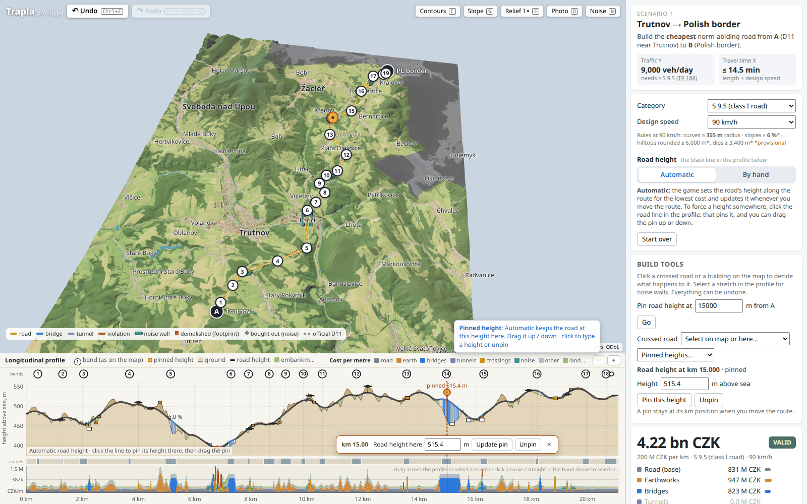
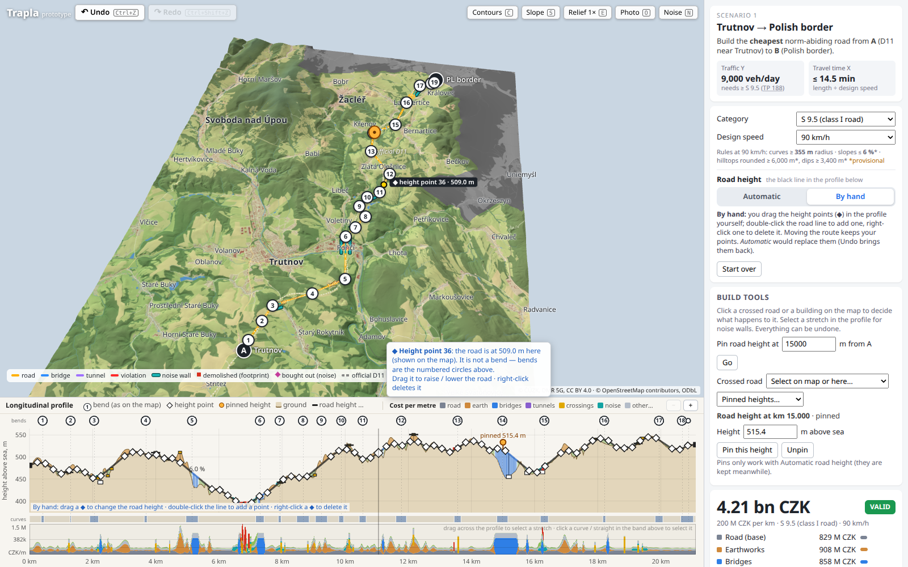
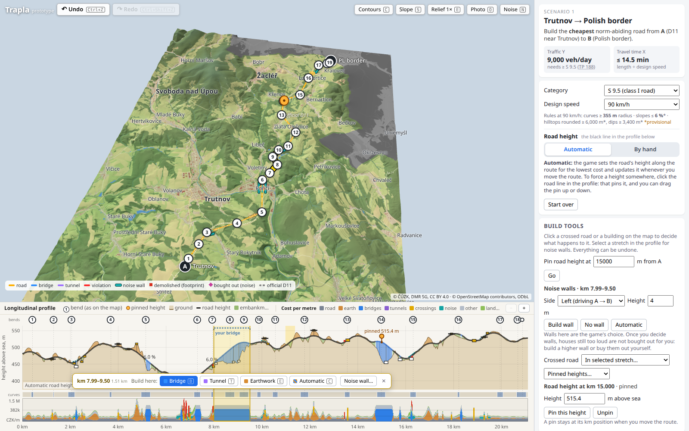
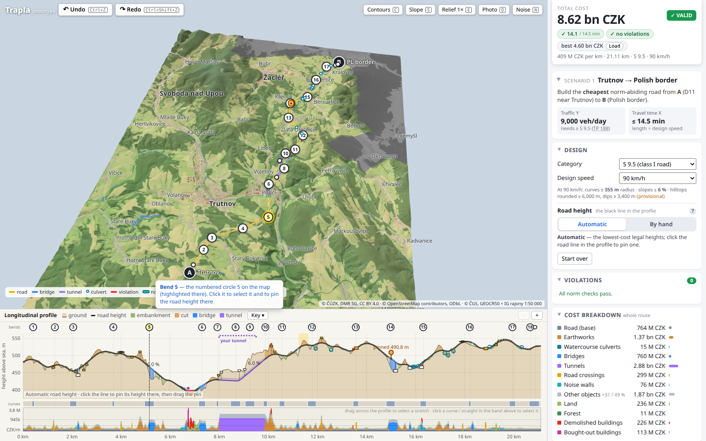
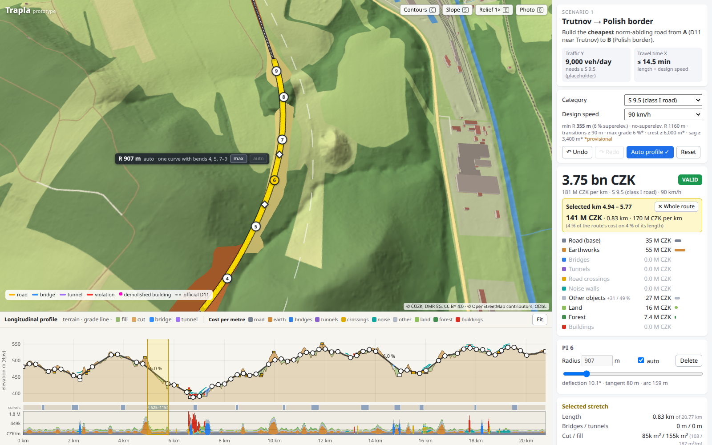

# Trapla — road design on real terrain (prototype)

Build the cheapest norm-abiding road from A to B on real Czech terrain, within a travel-time target
and for a given traffic. Scenario #1: Trutnov → Polish border (the D11 corridor).
Background, data sources and decisions: `PLAN.md`, `research/00-feasibility-map.md`, `research/07`–`11` (prices, geology and noise).


| close-up (vector map layers, extruded buildings) | contours + elevation labels | aerial photo + contours |
|---|---|---|
|  |  |  |

More in `docs/screenshots/` (cost of a selected stretch, town, forest edge, deep cut, slope tint, 2× relief with a noise wall,
contours over cut and fill slopes, the noise view on a town fringe and in the town centre with a buyout explained).

## Quick start

```sh
npm install
npm run data      # builds public/scenarios/d11/ (≈ 17 MB; needs uv; ~10 min on first run, ~5 min once cached)
npm run dev       # → http://localhost:5173/
```

Another scenario: `npm run data -- <id>` builds `pipeline/scenarios/<id>.json`, the app opens it with
`?scenario=<id>`, Node scripts with `SCENARIO=<id>`. How to add one (area, geology, traffic, X, validation, what is
still D11-specific): [docs/new-scenario.md](docs/new-scenario.md).

Other commands:

| command | what |
|---|---|
| `npm test` | vitest unit tests of the pure maths (geometry, earthworks, cost, auto-profile) |
| `npm run typecheck` / `npm run build` | TypeScript check / production build into `dist/` |
| `npm run bench [design.json]` | recompute timing + realism numbers in Node (default: straight line and an official-line-like design) |
| `npm run shots` | drives the app headlessly (Chromium + SwiftShader; `GPU=1 npm run shots` uses the hardware GPU via Vulkan) and writes `docs/screenshots/*.png` |
| `npm run smoke` | interaction smoke test with real mouse events (add/drag/delete a bend, road height By hand, undo, persistence) |
| `node scripts/ux.mjs [--docs]` | UX checks with real mouse/keyboard events: road-height switch, pins, height points, stretch bar, Undo/Redo bar, bends in the profile, map ↔ profile hover, click-to-zoom; `--docs` writes screenshots 36–41 |
| `npx tsx scripts/optimize.ts <speed> <iters> [start.json / official / -] [out.json] [seed]` | crude local search; fresh official-corridor or straight-line seed supported |
| `npx tsx scripts/town-audit.ts design.json [map.svg]` | urban/rural cost-per-km audit; optional map of mask, buildings, removals and route |
| `node scripts/layout.mjs` | layout check: the profile panel keeps its size through resizes, range selection / Esc and view toggles, and follows the route's length while fitted |
| `node scripts/photo-pan.mjs [--gpu]` | aerial photo while panning: requests made, refetches on revisits, mid-pan screenshots |
| `node scripts/build-tools.mjs [--docs]` | real HUD/map checks for pins, crossings, building buy/keep, wall add/remove/Auto, undo and reload; `--docs` writes screenshots 30–35 |
| `node scripts/crossing-shots.mjs` | oblique views of all five crossing outcomes and an overbridge detail; writes screenshots 42–48 (`--before` writes to `/tmp/trapla-crossings-before`) |
| `node --max-old-space-size=2048 --import tsx scripts/crossing-audit.ts` | audits every saved design: terrain tie-ins ≤0.3 m, unsupported segment flotation ≤0.5 m, rendered road edges/side slopes, clearance and measured quantities; `--strict` also fails blocked designs |
| `node scripts/noise-view.mjs [--gpu] [--docs] [outdir]` | noise view on a town-fringe and the town-centre design: hovers a walled / bought-out dwelling and a wall, prints the tooltips; `--docs` writes `docs/screenshots/28…29-*.png` |
| `node scripts/perf.mjs [--gpu] [--photo] [--contours]` | load time and frame times while orbiting / panning / zooming |
| `node scripts/views.mjs design.json '[[x,y,dist,bearing,elev,"name",{"contours":true}],…]' [outdir]` | debug renders of arbitrary camera views (`GPU=1` as above) |

The headless scripts expect Chromium at `/usr/bin/chromium` (override with `CHROME=...`).

## How to play

- **Move the route:** click the map to add a bend, drag a numbered bend to move it, right-click it (or
  <kbd>Del</kbd>) to delete it. Clicking a building or crossed road selects it instead; **Shift+click** adds a
  bend there anyway. Click a bend to change its curve radius (◇ grips, mouse wheel, <kbd>+</kbd> / <kbd>−</kbd>,
  **max**; "smallest allowed" = the smallest radius the rules allow, incl. room for transition curves).
- Map: left-drag pans, right-drag rotates, wheel zooms.
- **Undo / Redo** sit at the top left of the map (tooltips say what they undo); <kbd>Ctrl+Z</kbd> /
  <kbd>Ctrl+Shift+Z</kbd> (or <kbd>Ctrl+Y</kbd>) work for every edit, including the build tools (also right after
  choosing in one of their drop-downs).
- View options (buttons at the top right of the map, remembered between sessions):
  **Contours** <kbd>C</kbd> — contour lines with elevation labels; the interval follows the zoom (5 / 25 m close,
  10 / 50 m mid, 20 / 100 m far, thick lines = major); **Slope** <kbd>S</kbd> — tints the ground by slope (yellow
  from 8 %, orange from 15 %, red from 25 %, purple from 40 %); **Relief** <kbd>E</kbd> — vertical exaggeration
  1× / 1.5× / 2× / 3× of the whole scene; **Photo** <kbd>O</kbd> — aerial photo instead of the map layers
  (needs a network connection, see below); **Noise** <kbd>N</kbd> — the noise view (see Noise below).
- **The longitudinal profile** (bottom) shows the ground, the **road height** (black line, with slope %), and the
  plan's **bends** as numbered circles above it — the same numbers as on the map, with thin guides down to their
  curves in the curve band. Hovering a bend highlights it on the map and vice versa; hovering the road on the map
  marks that spot in the profile. No modifier keys anywhere:
  **click** = zoom in there (the map glides to the same spot), **drag** = select a stretch, **click a curve /
  straight** in the band under the chart = select it, wheel = zoom, sideways scroll or right-drag = scroll along
  the route; **−** / **+** and **Whole route** (shown only while zoomed in) in the profile's title bar.
- **Road height: Automatic | By hand** (HUD). *Automatic*: the game sets the road's height along the route for the
  lowest cost and updates it whenever you move the route (an approximate search; it can miss a legal solution).
  The computed height points are not drawn; to force a height, **click the road line** — that pins it there — then
  drag the orange pin up / down or type the height in the bar that pops up (**Unpin** removes it). A bend's bar /
  HUD card also offers *Pin road height here*. The finished road passes within ±0.5 m of every pin; slope and
  rounding rules still apply, and an unreachable pin is a violation with a suggested height, never silently moved.
  Pins keep their km position when you move the route (they are kept, inactive, By hand and beyond the end of a
  shortened route). *By hand*: the current automatic heights become your starting point, shown as **◆ height
  points**: drag one to raise / lower the road, **double-click** the line to add one, right-click one to delete it.
  Hovering a height point names it on the map. Going back to Automatic replaces them (Undo brings them back).
- **Bridge / tunnel / earthwork on a stretch:** drag across the profile; a bar pops up over the selection with
  **Bridge**, **Tunnel**, **Earthwork** and **Automatic** (keys <kbd>B</kbd> / <kbd>T</kbd> / <kbd>E</kbd> /
  <kbd>C</kbd>) and **Noise wall…**. Your choice affects the automatic road height, shows as "your bridge" etc. on
  profile and map, and stays at its km position when you reroute; choose again on any part of it to change or
  erase that part. Impossible choices (too low a bridge, too little tunnel cover, too short) stay as you made them
  and show as violations. <kbd>Esc</kbd> or ✕ deselects; without a selection E / C keep their map-view meaning.
- High fills/cuts include benches and a separately visible **provisional engineering reserve**, independent
  of free cut material. Excess stream-culvert length is billed beyond ordinary norm drainage. This moves the
  flat S9.5 bridge break-even from ~26.9 to ~16.6 m at the default material value, not a legal height cap;
  see `research/15-bridge-vs-embankment.md` for assumptions, uncertainty and sensitivity.
- The HUD shows total cost, breakdown, quantities, travel time vs target, all violations (click to fly there),
  VALID / NOT VALID, and the best valid design so far; **Start over** returns to the straight line. The design
  persists in localStorage.
- The game starts from the straight line with Automatic road height; the cost of a design that is not valid is
  struck through. Hover the profile for the cost split at that spot; a selected stretch shows its own bill in the
  HUD, <kbd>Esc</kbd> returns to the whole route.
- **Crossing tools:** click a crossing on the map/profile, or choose a crossed road in **Build tools**
  (filtered by the selected stretch). Choose **Junction / Our bridge over it / Its bridge over us / Close it +
  reconnect / Automatic**. The choice follows the existing road's pack ID, including every intersection of that way.
  Our bridge overrides overlapping structure paint locally; Auto seeks its clearance. Ordinary-road
  overbridges use the same priced raised approaches as Auto; fixed-level motorways/expressways require
  our road in a ≥6 m cut. Unsafe choices remain built, priced and invalid rather than silently replaced.
  Crossed roads retain their OSM alignment. Overbridges have a 1.2 m deck, ≥4.8 m clearance over our crown,
  abutments, railings and terrain-ended approaches with earthwork side slopes and contours. Junction roads
  ramp to our grade; roads under our bridges remain on the ground. Reconnection/diversion links run outside
  our footprint with turning heads, use the base-map road-class palette, and meet real road anchors.
  Deck/approach/link quantities are measured from the displayed geometry, not station-gap proxies.
  These remain study-stage roads: road unit rates include provisional earthworks, not a separate surveyed
  land/earthworks take-off. Missing OSM connections and infeasible approaches are reported, never invented.
- Through-road junctions keep **1.5 km spacing**, including A/B tie-ins (also in town: a scenario assumption).
  Other crossings use overbridges or parallel reconnections/diversions priced by measured built lengths × SPK
  road rates. Profile tooltips show the resolution and link/approach metres; HUD counts and sums them.
- Reconnection reach uses **750 m as an economic preference**, not a safety limit. Both explicit choices
  and Auto's geometry fallback allow up to **2 km along the route to the target**; bills use actual built
  link lengths, never a capped station-gap estimate. Dead-end remnants within the connection working
  strip (half link width plus 3 m beyond the earthwork toe) are consumed, not separate surviving branches.
- Cut quantities use ČGS GEOCR50 / engineering-geological rajons on a 25 m ground grid. Hover the profile
  for the ground name and **estimated** loose/weathered depths; the HUD shows class I/II/III shares.
  Mapped lithology is real, vertical weathering profiles are provisional—not borehole measurements or ČSN
  class determinations. Permian/Carboniferous profiles are calibrated to D11 1109 reported excavation
  quantities (official-line surrogate 42.6/18.0/39.4% I/II/III, not an as-built reconstruction).
  Unmapped ground uses the norm's 75/20/5 mix; see `research/10-geology-excavation.md`.
- **Building tools:** click any building on the map → **Buy out + demolish / Keep / Automatic** in Build tools.
  An explicit buyout works even away from the road; off-corridor acquisitions include the existing
  provisional whole-plot allowance. Footprint acquisitions are billed once with corridor land instead.
  **Keep** forbids both demolition and noise buyout: a footprint/working-strip hit or remaining noise
  excess becomes a blocking violation, with the dB shortfall shown. Green KEEP / magenta BUY map labels,
  green profile squares and magenta diamonds show decisions; use the saved-building list to revisit them.
  Clearing the decision restores the automatic policy. Building/road IDs are scoped to the scenario
  object-pack fingerprint: a changed pack clears those positional choices with a HUD notice, keeping
  station-based edits. Unstamped imported designs are assumed to refer to the current pack.
- **Wall tools:** select a profile stretch (or **Noise wall…** in its bar), choose **Left / Right (driving A → B)**
  and **2–6 m** in Build tools, then **Build wall / No wall / Automatic**. Repainting changes only that side and subrange; undo restores it.
  Player walls retain their exact selected extent (no automatic end margins); tunnels suppress built walls.
  Teal walls show the actual height, dotted marks show manual intent, and pink dashed marks show removals
  on map/profile. Nearby retained dwellings are grouped by side/stretch in the violation list.
  **Any manual wall decision at an exposed receiver prevents silent noise buyout** for
  that dwelling: residual noise becomes a blocking dB violation with a computed sufficient wall height
  and extent where possible, otherwise a buyout/route-change fix. Explicitly buy out the building to
  accept acquisition. Clearing all relevant wall decisions restores automatic 3/4/5 m walls and the
  existing fallback-buyout rule; **Keep** still forbids acquisition.
- Noise is a **provisional feasibility model**, not an acoustic assessment: façade distance and top occupied
  floor feed a geometric source–wall–receiver diffraction check for 3–5 m walls. Distant upper floors can be
  shadowed; receivers with a clear sightline over the wall get no benefit. If no wall can protect the dwelling,
  the bill includes its acquisition and
  demolition, separately from buildings in the road footprint. Teal walls show their actual height (from afar,
  where a 3–5 m wall is under a pixel, as a teal line with a dark outline just outside the road; hover it for its
  height, side, extent and how many dwellings it protects); red squares mark footprint demolitions, magenta
  diamonds mark noise buyouts. The HUD and profile tooltip explain both; assumptions and limitations are in
  `PLAN.md`.
- **Noise view** <kbd>N</kbd>: a band along the road shows the controlling-period level (night, for the scenario
  traffic) relative to its limit at ground-floor receivers (1.5 m above the real ground), continuously shaded
  (transparent 6 dB below the limit → yellow at the limit → orange → deep red at +15 dB and above, interpolated
  per pixel), with one thin dark line on the limit itself — computed in the worker by the
  same calculator as the bill, with the chosen walls and the cut-edge screening (per 30 m station and side, a
  12-sample profile across the road; ≈ +1.5 ms per recompute). Dwellings are coloured by outcome: behind a wall,
  screened by a cut, within the limit, bought out for noise, demolished in the footprint (other buildings turn
  grey); walls get height labels. Hover a building for its top-floor level without and with mitigation against
  the limit and why it was walled or bought out. Walls and buyouts are decided at the top floor, so a dwelling
  can be walled although the ground-floor band beside it is already under the limit.

### Profile and editing (UX)

| Automatic road height: click the line to pin, drag the pin | By hand: ◆ height points, hover names one on the map |
|---|---|
|  |  |
| Drag a stretch → Bridge / Tunnel / Earthwork / Automatic | Bends in the profile, hover-linked to the map |
|  |  |

Also: [map hover marks the spot in the profile](docs/screenshots/40-map-hover-in-profile.png),
[a click zooms the profile and the map](docs/screenshots/41-profile-click-zoom.png).
Reproduce with `node scripts/ux.mjs --docs`.

### Manual build tools

| Pinned road height | Crossed-road reconnection |
|---|---|
|  |  |
| Keep a building | Player-built noise wall |
|  |  |

Also: [wall removal produces a violation, not a buyout](docs/screenshots/35-build-no-wall-conflict.png).
Reproduce the build-tool interactions with `node scripts/build-tools.mjs --docs`.

### Physical crossings

| Overbridge: deck, abutments and embankments | Ground-level reconnection |
|---|---|
|  |  |

[Overbridge approaches](docs/screenshots/42-crossing-overbridge.png),
[existing road under our bridge](docs/screenshots/43-crossing-bridge.png),
[track diversion](docs/screenshots/45-crossing-diversion.png),
[at-grade junction](docs/screenshots/46-crossing-junction.png).
[Junction detail, with noise-wall openings](docs/screenshots/48-crossing-junction-detail.png).
Reproduce with `node scripts/crossing-shots.mjs`. Geometry and terrain collars rebuild on evaluation,
not on animation frames; the collars connect the true-height road to the coarser overview terrain mesh.
Junctions join the existing engineered formation without cutting through our carriageway; noise-wall
openings use the same masks for rendering, billing and acoustic checks. The existing worst-station noise
model treats these openings conservatively (including automatic buyouts or Keep violations); finite-opening
leakage and return-wall design are not modelled. Auto tries bounded, real-road
alternatives when a provisional crossing is infeasible. Approach fill/cut beyond 10 m is flagged for
redesign rather than presented as a normal local road. The 1.2 m decks and abutments remain study-stage
representations, not structural designs for long spans.

## Architecture

```
pipeline/build_pack.py  offline: DMR 5G + OSM + ČGS geology + official line → public/scenarios/<id>/,
                        configured by pipeline/scenarios/<id>.json (d11 = Trutnov → border)
pipeline/geology.py     cached ArcGIS queries → 25 m ground grid; estimated profiles in ground_profiles.json
src/core/               pure, tested modules (no DOM)
  data/                 categories, norms, prices, scenario — all numbers live here, with source notes
  terrain.ts, ground.ts  5 m heights (bilinear), land cover, OOB mask, categorical ground/weathering profiles
  horizontal.ts         tangents + circular arcs, transition room, stationing
  vertical.ts           road height (grade line), parabolic vertical curves
  autoprofile.ts        Automatic road height: DP over knots every ~250 m; state = elevation × incoming grade
  sections.ts           cross-sections (crown + cut/fill slopes to daylight) against the terrain
  structures.ts         bridge / tunnel choice per station, gap merging, run-level cost check
  earthworks.ts         average-end-area volumes, mass haul with one balance line
  cost.ts, checks.ts    cost roll-up; norm checks as per-family functions (roads now)
  evaluate.ts           the whole recompute path design → result
src/worker.ts           runs evaluate() off the main thread, latest request only
src/render/             three.js view
  view.ts               scene, camera, route ribbon, markers, heightfield picking
  extras.ts             range highlight, noise walls (+ far-zoom symbols, hover targets)
  noise.ts              noise view: footprint band, dwelling colours, wall labels, legend, hover details
  heightTexture.ts      the 5 m height grid as a filterable GPU texture (RG16F + hand-built mipmaps)
  terrainMaterial.ts    terrain shader: relief shading, hypsometric tint, contours, slope tint, OOB hatch
  landcover.ts          land cover / roads / rails / water / footprints rasterised from vectors into
                        camera-centred clip levels (and the optional orthophoto)
  buildings.ts          extruded buildings, merged per chunk
  contourLabels.ts      elevation labels on major contours
  vectorPack.ts         decoder of vector.bin.gz
src/ui/                 HUD, profile panel (+ floating stretch / pin bar), Undo/Redo bar, view options bar
```

### How the terrain is drawn

Nothing is baked at the 5 m grid any more; close-ups are as sharp as the overview.

- **Relief**: the height grid is a GPU texture. The terrain shader takes the gradient per pixel (step = half a
  cell close up, the pixel footprint when zoomed out), shades it from four light directions and adds the
  hypsometric tint. The mesh itself stays at 20 m (1 M vertices); the shading carries the 5 m detail.
- **Contours and slope tint** come from the same height and gradient: line width is constant in screen pixels
  (distance to the contour = elevation difference ÷ elevation change per pixel), lines fade where they would be
  closer than ~4–9 px, are dark on light ground and light on forest, and are not drawn out of bounds.
  The road's cut and fill slopes carry the same lines (one shared GLSL function, fed with the slope's true
  elevation, so they join the terrain's at the daylight line at any relief exaggeration); the carriageway shows
  them faintly, structures not at all. The slope tint stays on the natural ground: designed slopes (1:1.5–1:2)
  would all be purple and lose the cut / fill colours.
- **Earthworks** (the route ribbon's cut and fill slopes and carriageway) use the terrain's relief lighting —
  same four lights, same strength (also in photo mode), normals of the exaggerated surface — so slopes facing
  away from the light darken and the form reads when the camera tilts. The slopes carry a procedural
  world-space texture (value noise in metres, each octave faded out once a pixel covers it, so it is stable
  at any zoom): cuts are brown soil with erosion rills down the fall line, turning ochre-grey and banded
  (strata) where they reach the ground model's estimated class II / III rock (depth below the original
  ground, per station; unmapped ground shows soil only); fills are topsoiled and seeded embankments,
  mottled green-yellow grass. `node scripts/earthworks.mjs [design.json] [outdir]`
  renders the deepest cut and the highest embankment with contours at 1× and 2× relief
  (`docs/screenshots/24…27-*.png`).
- **Land cover, existing roads, railways, water, building footprints** are vectors (`vector.bin.gz`), rasterised
  on the GPU with 4× MSAA into one base texture of the whole area (≈ 8.5 m/texel, drawn once) and four 2048²
  *clip levels* around the camera focus at 0.125 … 4 m/texel, each twice as coarse as the previous. The levels
  are toroidal: when the focus leaves the middle of a window, the window moves and only the strips it uncovers
  are drawn (at most one level per frame); a zoom by an octave redraws one level. Orbiting costs nothing and
  panning / zooming redraws a little now and then (≈ 1–2 ms on a laptop GPU). Roads keep their real width with a minimum width in texels, so they stay visible from afar.
- **Buildings** (26,660) are flat-roofed boxes extruded from the OSM footprints with heights from
  `height` / `building:levels` or a guess by type and area, merged into ≈ 60 meshes; chunks beyond 7 km are
  hidden (the footprints in the land-cover texture have the roof colour).
- **Photo**: with <kbd>O</kbd> the clip levels hold 512 px JPEG tiles of a fixed grid per level from ČÚZK's
  public Ortofoto ČR view service (ArcGIS `MapServer/export`, EPSG:5514, CORS enabled; up to 6 requests at a
  time, nearest the focus first, 20 s time-out) and the base texture one photo of the whole area. Photo already
  drawn stays while panning; tiles are kept in memory (64 decoded on the GPU, 64 MB of JPEG), so revisited
  ground is not fetched again (the service sends `max-age=0`). A tile that has not arrived is transparent: the
  coarser level shows through, ultimately the base photo or, before that arrives / offline, the map. Nothing is
  stored in the pack. `node scripts/photo-pan.mjs` pans across and back and counts the requests.
- GPU memory: height texture ≈ 85 MB, land-cover textures ≈ 110 MB, MSAA scratch target ≈ 80 MB, meshes ≈ 60 MB,
  photo tiles ≤ 64 MB.
  Needs WebGL2 and no optional extensions; on GPUs limited to 4096 px textures the height texture uses every
  second sample (try it with `?maxtex=4096`). After a lost WebGL context the GPU-only data is rebuilt.

Measured on a Radeon 890M laptop GPU (headless Chromium, 1600 × 1000, `node scripts/perf.mjs --gpu`): 2.5–5 ms
per frame while orbiting, panning and zooming through all levels (worst frame ≈ 25–30 ms), with or without
contours and photo; the same before this renderer was 2.2–3.7 ms. Load to first result ≈ 0.9–1.1 s on
localhost (was ≈ 0.55 s: the height texture, vector geometry and buildings are built at start-up, ≈ 0.3 s).
Dragging a bend (recompute ≈ 13 ms in the worker, then `View.setResult` ≈ 5 ms incl. the footprint mask, profile
and HUD): frames stay at 17 ms median, 23 ms p95. Replaced route materials are disposed one frame late
(`View.retire`) — three.js deletes a shader program with its last material, and recompiling them on every edit
used to cost ≈ 15 ms.

Recompute for a ~21 km route takes ≈ 40 ms in Node (≈ 30 ms of it the auto-profile DP); ≈ 100 ms in the
headless SwiftShader browser where the CPU is shared with software WebGL.

## Scenario pack format (`public/scenarios/d11/`, generated, not committed)

| file | content |
|---|---|
| `meta.json` | grid (3500 × 4500 at 5 m, row 0 = north), origin in EPSG:5514, A/B, official line, attribution, `vector` file, `orthophoto` service (export URL, CRS, attribution) |
| `height.i16.gz` | gzip of row-wise int16 deltas of uint16 heights; h = base + q · 0.1 m (display-filled where no data) |
| `landcover.u8.gz` | gzip uint8 per cell: bits 0–2 class (0 none, 1 forest, 2 water/river, 3 building, 4 road, 5 urban, 6 rail, 7 stream); bit 3 built-up area; bit 5 river/water crossing, bit 6 railway crossing (must-bridge masks); bit 7 out of bounds |
| `ground.u8.gz` | gzip uint8 profile IDs, 700 × 900 at 25 m, row 0 north; `meta.ground` supplies dimensions, profile names, estimated class-I/II bottom depths and attribution; ID 0 = unmapped, norm 75/20/5 mix |
| `watercourses.json.gz` | independent OSM reaches with kind/width, densified local xy, upstream km² and truncation flags from burned 25 m D8; `meta.watercourses` gives file/version/method/SHA256; feeds provisional Q100 sizing, not certified hydrology |
| `overlays.json` | building centroids + radius, `binfo` (area, levels, kind, oriented rectangle per building), place names, main roads, `net` (existing road network for crossings) |
| `vector.bin.gz` | render-only vectors (`pipeline/vectors.py`, format described there): land-cover polygons dissolved per class and triangulated (forest, water, urban, farmland, grass), polylines (roads by class, tracks, railways, rivers, streams; waterways and rails smoothed), building rings + roof triangles + heights; local metres, split into 2.5 km chunks |

Game coordinates are local metres: `x = X_5514 − origin.x` (east), `y = Y_5514 − origin.y` (north).
The play area is the axis-aligned EPSG:5514 rectangle x ∈ [−637 500, −620 000], y ∈ [−1 011 500, −989 000]
(≈ 50.50–50.70 N, 15.82–16.06 E). Terrain is fetched in five 3500 × 900 px requests from the ČÚZK DMR 5G
ImageServer (raw responses cached in `pipeline/cache/`); OSM via Overpass (cached likewise; `osm_cover2` holds
render-only extras: fields, meadows, parks; tracks and service roads come from `osm_roads2`, which the crossings use too). The engine reads only
`height`, `landcover`, `ground`, `watercourses` and `overlays.json`; `vector.bin.gz` and the orthophoto are for display.
ČGS GEOCR50 and IG rajony 1:50k polygons are queried by EPSG:5514 envelope and object-ID pagination,
with cached pages and polite pauses. The 25 m raster does not imply 25 m survey accuracy. Older packs
without `meta.ground` use the explicitly labelled norm mix; run `npm run data` for geology-aware costs.
Pipeline geometry/cache tests: `uv run --with numpy --with shapely python -m unittest discover -s pipeline -p 'test_*.py'`.

## Data attribution

- Terrain: © ČÚZK, DMR 5G, CC BY 4.0.
- Overlays, vector map layers, buildings and the official D11 line: © OpenStreetMap contributors, ODbL.
- Aerial photo (optional view layer, streamed, not redistributed): © ČÚZK, Ortofoto ČR, CC BY 4.0.
- Prices: SFDI SPK CN 2026 and OTSKP 2026 (see `research/00-feasibility-map.md` §3); property, land, crossings, noise
  walls and purchased fill per `research/07-property-land.md`, `08-junctions-crossings.md`,
  `09-noise-earthworks-urban.md` (sources and confidence there; research-informed estimates / provisional
  allowances are marked in `src/core/data/`). Research market/contract examples are not escalated to 2026.
  Building values exclude land; noise buyouts add a provisional plot allowance. Crossings also use
  `research/12-csn-norm-values.md` §2 and `13-crossing-items-tenders.md`: SPK unit prices are sourced,
  link/ramp geometry remains a study-stage heuristic. Noise uses Czech Manuál 2018/2020 vehicle emissions,
  TP219 day/night traffic and an EIA-calibrated hard-ground class, with approximate terrain/barrier geometry
  (`research/11-noise-calculation.md`; EIA comparison limitations are explicit). See `PLAN.md` for model-9
  comparisons, junction spacing, raw-crossing clearance and geometric wall/cut screening.

## Long curves and radius handles (horizontal editing)



- **Bends are corners of the dashed tangent polygon, not waypoints**: the road cuts each corner with a circular arc.
- **One bend, long curve**: select a bend and drag one of the two diamond grips along its leg, turn the mouse wheel over
  the bend (or its grips / label), or press <kbd>+</kbd> / <kbd>−</kbd>. The radius is shown next to the curve;
  **max** sets the largest radius that fits between the neighbours, **auto** returns to the smallest the rules allow.
  The HUD radius field shows the same value; a drag or a burst of wheel steps is one undo step.
- **Several bends, long curve**: bends that turn the same way and are too close for a straight between them are
  joined into one compound curve automatically (the label says "one curve with bends …"). Uneven spacing is fine: the
  solver keeps the minimum radius and a radius ratio ≤ 2 between neighbouring arcs, moving the arc junctions off the
  dashed legs by up to 5 m if it has to. A bend that turns against its neighbour where no S-curve fits, and lies
  within 5 m of the straight line between its neighbours, is left out of the tangent polygon and labelled so.
- Rules (ČSN 73 6101 via the VUT text "Aplikace ČSN 73 6101"; table in `src/core/data/norms.ts`, details in `PLAN.md`):
  no transition needed from R ≥ L²/6 (1,350 / 1,067 / 817 m at 90 / 80 / 70 km/h); opposite curves may touch with
  their transitions, plain arcs need a 2·vn straight between them; every horizontal violation names the bends, the
  room required and available, and a fix.
- In the profile's curve band a compound curve is one stretch (labelled with its range of radii): a click selects
  the whole curve for the cost breakdown. Bends left out have no stretch of their own.
- `npm run curves` replays this with real mouse events (multi-point curve, curve band, grips, wheel, keys, max, auto,
  undo, relief 1–3× with contours / photo) and writes `docs/screenshots/18…23-*.png`; `17-long-curve-before.png` is
  the same design on the previous rules.
