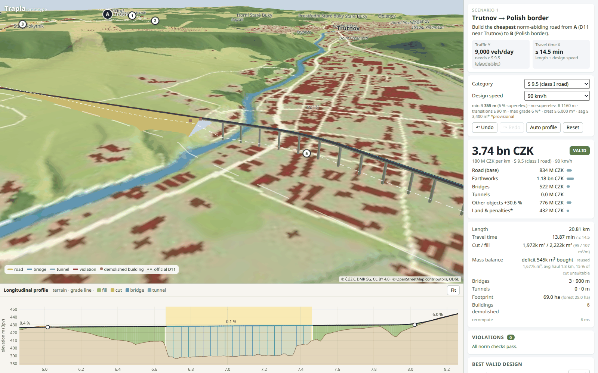

# Trapla — road design on real terrain (prototype)

Build the cheapest norm-abiding road from A to B on real Czech terrain, within a travel-time target
and for a given traffic. Scenario #1: Trutnov → Polish border (the D11 corridor).
Background, data sources and decisions: `PLAN.md`, `research/00-feasibility-map.md`.


| close-up (vector map layers, extruded buildings) | contours + elevation labels | aerial photo + contours |
|---|---|---|
|  |  |  |

More in `docs/screenshots/` (cost of a selected stretch, town, forest edge, deep cut, slope tint, 2× relief with a noise wall).

## Quick start

```sh
npm install
npm run data      # builds public/scenarios/d11/ (≈ 17 MB; needs uv; ~10 min on first run, ~20 s once cached)
npm run dev       # → http://localhost:5173/
```

Other commands:

| command | what |
|---|---|
| `npm test` | vitest unit tests of the pure maths (geometry, earthworks, cost, auto-profile) |
| `npm run typecheck` / `npm run build` | TypeScript check / production build into `dist/` |
| `npm run bench [design.json]` | recompute timing + realism numbers in Node (default: straight line and an official-line-like design) |
| `npm run shots` | drives the app headlessly (Chromium + SwiftShader; `GPU=1 npm run shots` uses the hardware GPU via Vulkan) and writes `docs/screenshots/*.png` |
| `npm run smoke` | interaction smoke test with real mouse events (add/drag/delete PI, profile takeover, undo, persistence) |
| `npx tsx scripts/optimize.ts <speed> <iters> [start.json]` | crude local search over PI positions (calibration aid) |
| `node scripts/perf.mjs [--gpu] [--photo] [--contours]` | load time and frame times while orbiting / panning / zooming |
| `node scripts/views.mjs design.json '[[x,y,dist,bearing,elev,"name",{"contours":true}],…]' [outdir]` | debug renders of arbitrary camera views (`GPU=1` as above) |

The headless scripts expect Chromium at `/usr/bin/chromium` (override with `CHROME=...`).

## How to play

- **Click** the terrain to add a bend (tangent intersection point, PI) to the nearest leg; **drag** a numbered PI
  to move it; **right-click** it or press <kbd>Del</kbd> to delete. Select a PI to edit its radius (auto = the
  smallest radius that satisfies the norm, incl. room for transition curves).
- Map: left-drag pans, right-drag rotates, wheel zooms.
- View options (buttons at the top right of the map, remembered between sessions):
  **Contours** <kbd>C</kbd> — contour lines with elevation labels; the interval follows the zoom (5 / 25 m close,
  10 / 50 m mid, 20 / 100 m far, thick lines = major); **Slope** <kbd>S</kbd> — tints the ground by slope (yellow
  from 8 %, orange from 15 %, red from 25 %, purple from 40 %); **Relief** <kbd>E</kbd> — vertical exaggeration
  1× / 1.5× / 2× / 3× of the whole scene; **Photo** <kbd>O</kbd> — aerial photo instead of the map layers
  (needs a network connection, see below).
- The grade line is computed automatically (dynamic programming, see below) whenever the horizontal
  alignment changes. Dragging a VPI in the profile panel takes manual control; **Auto profile** gives it back.
  Profile: double-click adds a VPI, right-click deletes, wheel zooms, drag pans.
- The HUD shows total cost, breakdown, quantities, travel time vs target, all violations (click to fly there),
  VALID / NOT VALID, and the best valid design so far. Undo/redo (Ctrl+Z / Ctrl+Y), reset; the design persists in
  localStorage.
- The game starts from the straight line with the automatic grade line; the cost of a design that is not valid is
  struck through. Hover the profile for the cost split at a station; drag in the cost strip under it (or click a
  curve / tangent in the band above it) to get the breakdown of that stretch, <kbd>Esc</kbd> for the whole route.

## Architecture

```
pipeline/build_d11.py   offline: DMR 5G terrain + OSM overlays + official line → public/scenarios/d11/
src/core/               pure, tested modules (no DOM)
  data/                 categories, norms, prices, scenario — all numbers live here, with source notes
  terrain.ts            5 m height grid (bilinear), land cover, out-of-bounds mask
  horizontal.ts         tangents + circular arcs, transition room, stationing
  vertical.ts           grade line, parabolic vertical curves
  autoprofile.ts        DP grade line (knots every ~250 m; state = elevation × incoming grade)
  sections.ts           cross-sections (crown + cut/fill slopes to daylight) against the terrain
  structures.ts         bridge / tunnel choice per station, gap merging, run-level cost check
  earthworks.ts         average-end-area volumes, mass haul with one balance line
  cost.ts, checks.ts    cost roll-up; norm checks as per-family functions (roads now)
  evaluate.ts           the whole recompute path design → result
src/worker.ts           runs evaluate() off the main thread, latest request only
src/render/             three.js view
  view.ts               scene, camera, route ribbon, markers, heightfield picking
  heightTexture.ts      the 5 m height grid as a filterable GPU texture (RG16F + hand-built mipmaps)
  terrainMaterial.ts    terrain shader: relief shading, hypsometric tint, contours, slope tint, OOB hatch
  landcover.ts          land cover / roads / rails / water / footprints rasterised from vectors into
                        camera-centred clip levels (and the optional orthophoto)
  buildings.ts          extruded buildings, merged per chunk
  contourLabels.ts      elevation labels on major contours
  vectorPack.ts         decoder of vector.bin.gz
src/ui/                 HUD, profile panel, view options bar
```

### How the terrain is drawn

Nothing is baked at the 5 m grid any more; close-ups are as sharp as the overview.

- **Relief**: the height grid is a GPU texture. The terrain shader takes the gradient per pixel (step = half a
  cell close up, the pixel footprint when zoomed out), shades it from four light directions and adds the
  hypsometric tint. The mesh itself stays at 20 m (1 M vertices); the shading carries the 5 m detail.
- **Contours and slope tint** come from the same height and gradient: line width is constant in screen pixels
  (distance to the contour = elevation difference ÷ elevation change per pixel), lines fade where they would be
  closer than ~4–9 px, are dark on light ground and light on forest, and are not drawn out of bounds.
- **Land cover, existing roads, railways, water, building footprints** are vectors (`vector.bin.gz`), rasterised
  on the GPU with 4× MSAA into one base texture of the whole area (≈ 8.5 m/texel, drawn once) and four 2048²
  *clip levels* around the camera focus at 0.125 … 4 m/texel, each twice as coarse as the previous. A level is
  redrawn — at most one per frame — only when the focus leaves the middle of its window or the zoom changes by
  an octave, so orbiting costs nothing and panning / zooming redraws a level now and then (≈ 1–2 ms on a laptop
  GPU). Roads keep their real width with a minimum width in texels, so they stay visible from afar.
- **Buildings** (26,660) are flat-roofed boxes extruded from the OSM footprints with heights from
  `height` / `building:levels` or a guess by type and area, merged into ≈ 60 meshes; chunks beyond 7 km are
  hidden (the footprints in the land-cover texture have the roof colour).
- **Photo**: with <kbd>O</kbd> each clip-level window is fetched as one JPEG from ČÚZK's public Ortofoto ČR
  view service (ArcGIS `MapServer/export`, EPSG:5514, CORS enabled; one request at a time, stale ones dropped)
  and drawn into the same levels; the map is shown until a photo arrives (or if it does not: 20 s time-out,
  offline). Nothing is stored in the pack.
- GPU memory: height texture ≈ 85 MB, land-cover textures ≈ 110 MB, MSAA scratch target ≈ 80 MB, meshes ≈ 60 MB.
  Needs WebGL2 and no optional extensions; on GPUs limited to 4096 px textures the height texture uses every
  second sample (try it with `?maxtex=4096`). After a lost WebGL context the GPU-only data is rebuilt.

Measured on a Radeon 890M laptop GPU (headless Chromium, 1600 × 1000, `node scripts/perf.mjs --gpu`): 2.5–5 ms
per frame while orbiting, panning and zooming through all levels (worst frame ≈ 25–30 ms), with or without
contours and photo; the same before this renderer was 2.2–3.7 ms. Load to first result ≈ 0.9–1.1 s on
localhost (was ≈ 0.55 s: the height texture, vector geometry and buildings are built at start-up, ≈ 0.3 s).
Dragging a bend (recompute ≈ 13 ms in the worker, then `View.setResult` ≈ 5 ms incl. the footprint mask, profile
and HUD): frames stay at 17 ms median, 23 ms p95. Replaced route materials are disposed one frame late
(`View.retire`) — three.js deletes a shader program with its last material, and recompiling them on every edit
used to cost ≈ 15 ms.

Recompute for a ~21 km route takes ≈ 40 ms in Node (≈ 30 ms of it the auto-profile DP); ≈ 100 ms in the
headless SwiftShader browser where the CPU is shared with software WebGL.

## Scenario pack format (`public/scenarios/d11/`, generated, not committed)

| file | content |
|---|---|
| `meta.json` | grid (3500 × 4500 at 5 m, row 0 = north), origin in EPSG:5514, A/B, official line, attribution, `vector` file, `orthophoto` service (export URL, CRS, attribution) |
| `height.i16.gz` | gzip of row-wise int16 deltas of uint16 heights; h = base + q · 0.1 m (display-filled where no data) |
| `landcover.u8.gz` | gzip uint8 per cell: bits 0–2 class (0 none, 1 forest, 2 water/river, 3 building, 4 road, 5 urban, 6 rail, 7 stream); bit 3 built-up area; bit 5 river/water crossing, bit 6 railway crossing (must-bridge masks); bit 7 out of bounds |
| `overlays.json` | building centroids + radius, `binfo` (area, levels, kind, oriented rectangle per building), place names, main roads, `net` (existing road network for crossings) |
| `vector.bin.gz` | render-only vectors (`pipeline/vectors.py`, format described there): land-cover polygons dissolved per class and triangulated (forest, water, urban, farmland, grass), polylines (roads by class, tracks, railways, rivers, streams; waterways and rails smoothed), building rings + roof triangles + heights; local metres, split into 2.5 km chunks |

Game coordinates are local metres: `x = X_5514 − origin.x` (east), `y = Y_5514 − origin.y` (north).
The play area is the axis-aligned EPSG:5514 rectangle x ∈ [−637 500, −620 000], y ∈ [−1 011 500, −989 000]
(≈ 50.50–50.70 N, 15.82–16.06 E). Terrain is fetched in five 3500 × 900 px requests from the ČÚZK DMR 5G
ImageServer (raw responses cached in `pipeline/cache/`); OSM via Overpass (cached likewise; `osm_cover2` holds
render-only extras: fields, meadows, parks; tracks and service roads come from `osm_roads2`, which the crossings use too). The engine reads only
`height`, `landcover` and `overlays.json`; `vector.bin.gz` and the orthophoto are for display.

## Data attribution

- Terrain: © ČÚZK, DMR 5G, CC BY 4.0.
- Overlays, vector map layers, buildings and the official D11 line: © OpenStreetMap contributors, ODbL.
- Aerial photo (optional view layer, streamed, not redistributed): © ČÚZK, Ortofoto ČR, CC BY 4.0.
- Prices: SFDI SPK CN 2026 and OTSKP 2026 (see `research/00-feasibility-map.md` §3).

## Long curves and radius handles (horizontal editing)


- **Bends are corners of the dashed tangent polygon, not waypoints**: the road cuts each corner with a circular arc.
- **One bend, long curve**: select a bend and drag one of the two diamond grips along its leg, turn the mouse wheel over
  the bend (or its grips / label), or press <kbd>+</kbd> / <kbd>−</kbd>. The radius is shown next to the curve;
  **max** sets the largest radius that fits between the neighbours, **auto** returns to the smallest the rules allow.
  The HUD radius field shows the same value; a drag or a burst of wheel steps is one undo step.
- **Several bends, long curve**: bends that turn the same way and are too close for a straight between them are
  joined into one compound curve automatically (the label says "one curve with bends …"). Uneven spacing is fine: the
  solver keeps the minimum radius and a radius ratio ≤ 2 between neighbouring arcs, moving the arc junctions off the
  dashed legs by up to 5 m if it has to. A bend that turns against its neighbour where no S-curve fits, and lies
  within 5 m of the straight line between its neighbours, is left out of the tangent polygon and labelled so.
- Rules (ČSN 73 6101 via the VUT text "Aplikace ČSN 73 6101"; table in `src/core/data/norms.ts`, details in `PLAN.md`):
  no transition needed from R ≥ L²/6 (1,350 / 1,067 / 817 m at 90 / 80 / 70 km/h); opposite curves may touch with
  their transitions, plain arcs need a 2·vn straight between them; every horizontal violation names the bends, the
  room required and available, and a fix.
- In the profile's curve band a compound curve is one stretch (labelled with its range of radii): a click selects
  the whole curve for the cost breakdown. Bends left out have no stretch of their own.
- `npm run curves` replays this with real mouse events (multi-point curve, curve band, grips, wheel, keys, max, auto,
  undo, relief 1–3× with contours / photo) and writes `docs/screenshots/18…23-*.png`; `17-long-curve-before.png` is
  the same design on the previous rules.
