# Trapla — road design on real terrain (prototype)

Build the cheapest norm-abiding road from A to B on real Czech terrain, within a travel-time target
and for a given traffic. Scenario #1: Trutnov → Polish border (the D11 corridor).

**Play it:** <https://pasky.github.io/trapla/> (desktop browser with WebGL 2). Code: MIT licence (`LICENSE`);
the map data keep their own licences (see *Data attribution* below and the in-game *About Trapla and its data*).

Background, data sources and decisions: `PLAN.md`, `research/00-feasibility-map.md`, `research/07`–`11` (prices, geology and noise).


| close-up (vector map layers, extruded buildings) | contours + elevation labels | aerial photo + contours |
|---|---|---|
|  | 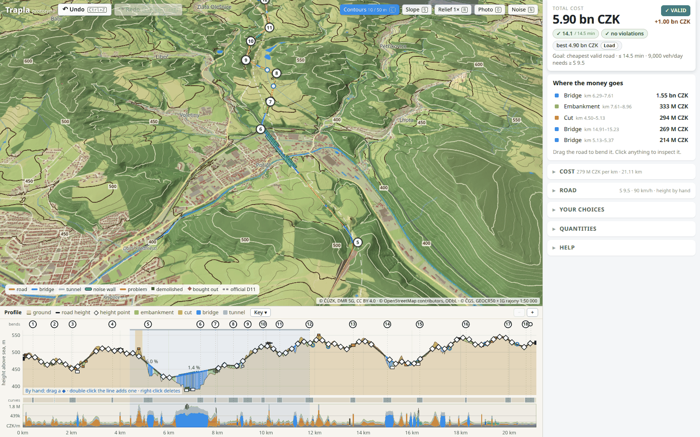 | 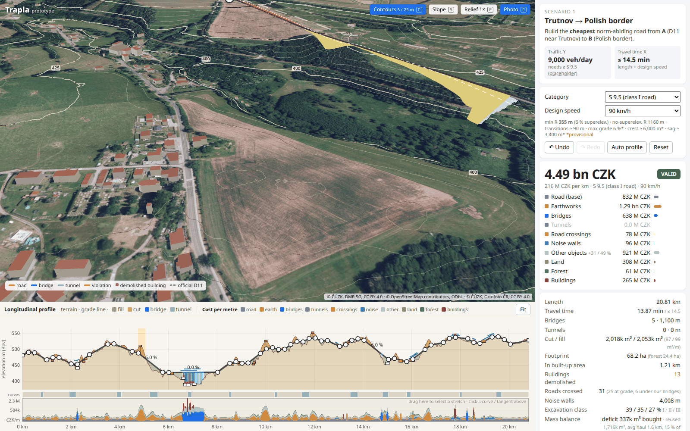 |

More in `docs/screenshots/` (cost of a selected stretch, town, forest edge, deep cut, slope tint, 2× relief with a noise wall,
contours over cut and fill slopes, the noise view on a town fringe and in the town centre with a buyout explained).

## Quick start

```sh
npm install
npm run data      # builds public/scenarios/d11/ (≈ 17 MB; needs uv; ~10 min on first run, ~5 min once cached)
npm run dev       # → http://localhost:5173/
```

Build and publish as a static site (no server of its own, any host, any path): `scripts/release.sh` builds `dist/`
with the packs in it under content-hashed URLs, checks it and plays smoke / playtest / toolbar / the start screen on
it through a plain static server; hosts (Caddy / nginx with rsync, Cloudflare Pages, GitHub Pages), cache headers,
first-load times and what publishing the data implies (ODbL, two permissions still to ask for):
[docs/deploy.md](docs/deploy.md).

Another scenario: `npm run data -- <id>` builds `pipeline/scenarios/<id>.json`, the app opens it with
`?scenario=<id>`, Node scripts with `SCENARIO=<id>`. How to add one (area, geology, traffic, X, validation, what is
still D11-specific): [docs/new-scenario.md](docs/new-scenario.md).

Other commands:

| command | what |
|---|---|
| `npm test` | vitest unit tests of the pure maths (geometry, earthworks, cost, auto-profile) |
| `npm run typecheck` / `npm run build` | TypeScript check / production build into `dist/` (with the packs, docs/deploy.md) |
| `scripts/release.sh [--no-browser \| --serve]` | build, check `dist/` (`scripts/release-check.mjs`) and run the browser checks on it served by `scripts/static-serve.mjs` under `/trapla/`; any browser script runs on a build with `DIST=dist` |
| `node scripts/cold-load.mjs [--picker --read 3000] [--scenario … --preset …]` | a first visit on a slow line (20 Mbit/s, 40 ms, main thread 4× slower): start screen, map, playable |
| `node scripts/release-shots.mjs --check \| --docs [--before DIR]` | the first minute on the built site: start screen, loading card, first run and drag, older saves, no-WebGL and small-screen notices, a failed download, the About page; `--docs` writes 550–564 |
| `npm run bench [design.json]` | recompute timing + realism numbers in Node (default: straight line and an official-line-like design) |
| `npm run shots` | drives the app headlessly (Chromium + SwiftShader; `GPU=1 npm run shots` uses the hardware GPU via Vulkan) and writes `docs/screenshots/*.png` |
| `npm run smoke` | interaction smoke test with real mouse events (empty clicks add nothing, drag the road to add a bend, drag / delete / double-click bends, the inspector's stretch choices and keys, By hand, undo, persistence) |
| `node scripts/playtest.mjs [--docs] [--size=1280x800]` | three players' sessions with real mouse / keyboard: a first-time player (intro, harmless clicks, drag the road, where the money goes, inspect pieces), one fixing violations (fix buttons, the house cross-section, noise view) and a power user (bridge from the map, walls, keep a house, crossing, pin by dragging the line, undo / redo, Start over); a screenshot per step into `/tmp/trapla-playtest`; `--docs` writes the gallery 60–71 |
| `node scripts/select-shots.mjs [--gpu] [--docs]` | select before drag with the real mouse: a road not selected (ours, a mapped one) says *click to select* and a drag on it moves the map; a click selects it, then a drag bends / rebuilds it; `--docs` writes 380–385 |
| `node scripts/any-road-scene.mjs [--gpu] [--docs]` | editing any road with the real mouse (D11 by default, `SCENARIO=d3`): select a mapped road, drag it to rebuild its stretch, one Undo, end handles, its traffic, the road list, reload, Build → Road (free end, joining our road, roundabout), priced rebuilt stretch, photo with mapped roads; `--docs` writes 100–105 |
| `npx tsx scripts/optimize.ts <speed> <iters> [start.json / official / -] [out.json] [seed]` | crude local search; fresh official-corridor or straight-line seed supported |
| `PACK=/path/to/d11 npx tsx scripts/footprint-audit.ts --straight scripts/*-design.json` | automatic footprint remedies, measured wall/road works, remaining violations and bill reconciliation; `DETAIL=1` adds individual diagnostics |
| `PACK=/path/to/d11 npx tsx scripts/eval-regression.ts` | frozen model-16 bills, validity and built geometry on either recognized data pack |
| `PACK=/path/to/d11 npx tsx scripts/repair-designs.ts --budget=400 [--write] design.json` | bounded validity-first local PI refinement; preserves controls/category/speed and writes only valid designs |
| `npx tsx scripts/town-audit.ts design.json [map.svg]` | urban/rural cost-per-km audit; optional map of mask, buildings, removals and route |
| `node scripts/layout.mjs` | layout check: the profile panel keeps its size through resizes, selections / Esc and view toggles, and follows the route's length while fitted |
| `node scripts/photo-pan.mjs [--gpu]` | aerial photo while panning: requests made, refetches on revisits, mid-pan screenshots |
| `node scripts/crossing-shots.mjs` | oblique views of all five crossing outcomes and an overbridge detail; writes screenshots 42–48 (`--before` writes to `/tmp/trapla-crossings-before`) |
| `node scripts/crossing-works-shots.mjs [--before]` | a crossing's own works close up (side roads regraded to meet a junction approach / bridge ramp) and picking a reroute; screenshots 110–116 |
| `node scripts/link-shape-shots.mjs` | shaping a reroute with the mouse; screenshots 117–119 |
| `node scripts/reroute-end-shots.mjs` | leading a reroute to another road by dragging its end (D35 km 2.51); screenshots 500–509 |
| `node scripts/cut-card-shots.mjs` | a cut service road to a hamlet (D11 km 17.67): Auto's box, the player's cut, its parts on the map, one led on; screenshots 530–537 |
| `node scripts/lowered-underpass-shots.mjs` | player pass over lowered underpasses and engineered reroutes (real clicks, card text checked); screenshots 150–156 |
| `node scripts/camera-check.mjs [--shots dir]` | the map camera with real mouse input (low views, Voletiny zoom, pans off the map, *Whole route*, overprinted labels); screenshots 157–159 |
| `npx tsx scripts/crossing-footprint-audit.ts [--straight] [--random N] [designs…]` | rough independent screen: crossing earthworks still lying over other mapped roads |
| `npx tsx scripts/outcome-audit.ts [--straight] [--random N --seed S] [--quiet] [designs…]` | every crossing / footprint outcome with ramp, link and box lengths and costs, every violation; flags ramps > 250 m, links > 1 km and footprint / crossing violations |
| `node scripts/crossing-sanity-shots.mjs [--out dir]` | the owner-reported service-road bridge (km 8.47 fixtures) and four typical crossings with their cards open; writes `docs/screenshots/crossing-sanity/` |
| `node --max-old-space-size=2048 --import tsx scripts/crossing-audit.ts` | audits every saved design: terrain tie-ins ≤0.3 m, unsupported segment flotation ≤0.5 m, rendered road edges/side slopes, clearance and measured quantities; `--strict` also fails blocked designs |
| `node scripts/noise-view.mjs [--gpu] [--docs] [outdir]` | noise view on a town-fringe and the town-centre design: hovers a walled / bought-out dwelling and a wall, prints the tooltips; `--docs` writes `docs/screenshots/28…29-*.png` |
| `node scripts/perf.mjs [--gpu] [--photo] [--contours]` | load time and frame times while orbiting / panning / zooming |
| `node scripts/views.mjs design.json '[[x,y,dist,bearing,elev,"name",{"contours":true}],…]' [outdir]` | debug renders of arbitrary camera views (`GPU=1` as above) |

The headless scripts expect Chromium at `/usr/bin/chromium` (override with `CHROME=...`).

## How to play

One rule for the whole interface: **click anything to inspect (select) it; drag the selected road to bend it.** A
drag that starts on a road not selected moves the map like one on open ground. What you click
opens one card under the score (the *inspector*) that says what it is, what the game decided and why, what it
costs, and offers the alternatives as buttons. The map and the profile always show the same selection.
Design notes, the playtest and the copy rules: [docs/interface-rethink.md](docs/interface-rethink.md).

- **Reshape a reroute:** click the crossed road that was cut and rerouted, then drag its new road — a bend point appears
  under the mouse and follows it, like bending our road. Drag a bend point to move it, click it for *Remove
  bend point*; *Automatic path* in the crossing's card takes the shape back. The game checks it (off our
  earthworks, not too steep, not across a motorway, railway, water or house) and prices it as drawn.
- **Lead a reroute elsewhere:** the end of each new road, where it joins its road, has a square handle: drag it onto
  another road (one that crosses ours on a bridge, under it or in a junction, or one on that side that does not
  cross ours at all; the road it would join lights up) and let go. The game builds and prices the new road there
  like its own; a road it cannot take (across our road, cut by ours too, out of reach) is said on the card, with
  *Lead it where Auto does* to take it back.
- **Bend the road:** click the orange road to select it (its numbered bends show), then drag it — a new bend
  appears under the mouse and follows it (the cursor turns into a hand over the selected road; over one not
  selected it says *click to select*). <kbd>Esc</kbd> or a click on open ground lets go of it. A first-time player
  (the intro is up) finds our road already selected, so the first drag does what the intro says
  ([not selected](docs/screenshots/381-select-road-not-selected.png),
  [selected](docs/screenshots/382-select-road-selected.png), [bent](docs/screenshots/383-select-road-bent.png),
  [a mapped road not selected](docs/screenshots/384-select-mapped-not-selected.png) and
  [selected](docs/screenshots/385-select-mapped-selected.png), [the intro](docs/screenshots/380-select-intro.png)).
  Drag a numbered bend to move it; right-click it, <kbd>Del</kbd>
  or *Delete* in its card removes it. **Double-click** the ground adds a bend to the selected road there (for big detours). A click
  on empty ground only deselects — nothing is ever added by a single click.
- **Inspect anything** — on the map or in the profile: the **road** (selects the piece under the mouse: a
  bridge, tunnel, cut or embankment), a **bend**, a **house**, a **crossed road** (anything its crossing built
  counts: the rebuilt stretch, its ramps, a new road it was rerouted onto, a turning head, a side road raised
  to meet it), a **noise wall**, a pinned height. Drag sideways across the profile for **any stretch**. <kbd>Esc</kbd> or ✕ deselects. With nothing
  selected the card lists **where the money goes** — the five most expensive pieces, each a link.
- **The inspector:** header (what and where), one status line (numbers first, and the reason in a few words:
  *Auto: cheaper here than a bridge*), any **problems with their fix as a button** (*4 m wall right*,
  *Buy out*, *Bridge it*, *Back to Auto*), then the choices, Auto first:
  - piece / stretch: **Auto · Bridge · Tunnel · Earthwork** (keys <kbd>A</kbd> <kbd>B</kbd> <kbd>T</kbd>
    <kbd>E</kbd>) and, where houses are near, **noise walls** per side: Auto · None · 3–6 m. *More ▾*
    (remembered) adds walls elsewhere, a typed road height to pin, and the stretch's bill by component;
  - bend: **Tightest · Widest** curve; *More ▾*: radius field / slider; *Pin height here*, *Delete*. The ◇ grips
    on the map and <kbd>+</kbd> / <kbd>−</kbd> change the radius too;
  - crossed road: **Auto · Junction · Bridge over it · It bridges us · Close + link · Underpass**, ‹ › step
    along the crossed roads; a choice applies wherever we cross that road;
  - house: **Auto · Buy out · Keep**, the wall on its side, a **plan** (our road with travel left → right,
    its walls and side roads, a line from every km where the house is over the limit before walls: red = still
    too loud from there, grey = stopped; one sentence says where the loudest comes from — past the wall's end,
    through a junction's gap, over a too-low wall) and a **cross-section** along that loudest line: our road and
    its noise source, the wall or cut edge, the house floor by floor in its own noise colour with each floor's
    level (and what it was without the wall), the sightline and the wall's shadow. Hovering a wall height redraws
    both ([a house that hears the road through a junction's gap](docs/screenshots/72-house-noise-plan-junction-gap.png)).
  - pinned height (Auto) / height pin (By hand): its height, typed or dragged, *Unpin* / *Delete*.
- **The score** (top right, sticky): total cost (struck through while not valid), ✓ VALID / ✗ NOT VALID, **the
  change the last edit made** (a drag counts once), travel time against the goal, the violations chip (click:
  selects the first one), your best valid design (*Load*; a position half-way through a drag never counts) and
  the goal in one line. Below the inspector: **Violations** (only while there are any; a click selects the thing
  and flies there), then folded: **Cost** (breakdown, of the selection while one is selected), **Road**
  (category, design speed, road height Auto / By hand, *Start over*), **Your choices** (every decision as a link,
  plus all crossed roads), **Quantities**, **Help**. Everything can be undone: Undo / Redo over the map,
  <kbd>Ctrl+Z</kbd> / <kbd>Ctrl+Shift+Z</kbd>; *Start over* and *Load* offer Undo in a toast.
- **The profile** (bottom) is the side view with the same verbs: click = select the piece there (the map flies
  to it if it is off screen), drag sideways = select a stretch, click a curve / straight in the band under the
  chart = select it, **drag the black road line up / down = pin the road height there** (Auto; the finished
  road passes within ±0.5 m of every pin, an unreachable pin is a violation with a suggested height), drag a
  pin to change it. Wheel = zoom, right-drag = scroll, **−** / **+** / *Whole route*. Its tooltip is three short
  lines and stays inside the profile. Numbered bends sit above the chart, hover-linked with the map; hovering
  the road on the map marks the spot here; when the map is zoomed in, a light blue window shows which part of
  the route it is looking at. **Key ▾** explains every mark.
- **Road height: Auto | By hand** (the *Road* section): Auto sets the cheapest legal heights and redoes them after
  every change (an approximate search); pins steer it. By hand starts from exactly the current heights (the same
  bill) as **◆ points**; at each zoom only the points that shape the line have a handle (zoom in for more), and
  the hidden ones between follow a drag in proportion. Drag one, double-click the line to add one, right-click to
  delete. Back to Auto replaces them (Undo brings them back). Height drags (pins, points) move at most 0.5 m per
  pixel, finer when the profile is zoomed in; the tip shows the height and how far it moved.
- **Map:** left-drag pans, right-drag rotates, the wheel or a trackpad pinch zooms about the ground under the
  cursor. The view always turns and zooms about the ground at its centre, never looks out flat along the horizon,
  and stays over the map; a click in the profile or a list brings what it picks into view (looking down on it
  from a low view). **Whole route**
  <kbd>W</kbd> brings the whole road back into view from anywhere. View buttons
  (remembered): **Contours** <kbd>C</kbd> (interval follows the zoom), **Slope** <kbd>S</kbd> (yellow 8 %, orange
  15 %, red 25 %, purple 40 %), **Relief** <kbd>R</kbd> (1–3× vertical exaggeration), **Photo** <kbd>O</kbd> (aerial
  photo, needs a network connection), **Noise** <kbd>N</kbd>. Keys are accelerators only; every action has a button.
- **First run:** three steps at the top left of the map (drag the road, click anything, the cost counts once
  valid); *Got it*, <kbd>Esc</kbd> or the first click dismiss it; *Help → Show the intro* brings it back.
- **Colours** are the same on the map, in the profile and in the cards: road orange, bridge blue, tunnel purple,
  noise wall teal, problems red, kept green. Every house the project takes (under our works, for noise, by your
  choice, in the way of other works) is *bought out*: it stands magenta in every view with a dashed magenta ring on
  the ground; where it is only a few pixels across it is a magenta diamond with a white outline; its card says why. On the map these are symbols for the zoomed-out view (from 2.5 m per pixel, where the road is a few
  pixels wide) and for a road being dragged; closer, the road is drawn as built: asphalt with white Czech
  markings, noise walls as panels between posts, tunnels as a purple dashed trace on the ground, problem
  stretches tinted red. The tangent lines of a bend show only while it is dragged, hovered or selected. The
  official line is a dark dashed pencil line with its label riding along it. Noise uses one ramp everywhere (pale → yellow at the limit → red).
- **Noise view** <kbd>N</kbd>: the band along the road shows the night level (the controlling period for the
  scenario traffic) **at the height that decides walls and buyouts — the top floor of the tallest house beside
  each 30 m station and side** (1.5 m where there is none), continuously shaded with one dark line on the limit,
  computed in the worker by the same calculator as the bill with the built walls and cut edges. Every house is
  coloured by **its own** worst level on the same ramp; bought-out houses magenta. The
  band and the houses now use the same height, so they agree beside the road (the band is per station, a house
  takes its worst station), and raising a wall visibly cools the band where its shadow reaches the top floors. Hover a house for its level, click it for the cross-section.

### Model notes

- High fills/cuts include benches and a separately visible **provisional engineering reserve**, independent
  of free cut material. Excess stream-culvert length is billed beyond ordinary norm drainage. This moves the
  flat S9.5 bridge break-even from ~26.9 to ~16.6 m at the default material value, not a legal height cap;
  see `research/15-bridge-vs-embankment.md`.
- **Your bridge / tunnel / earthwork** choices affect the automatic road height, show as "your bridge" etc. on
  profile and map, and stay at their km position when you reroute; choose again on any part to change or erase
  that part. Impossible choices (too low a bridge, too little tunnel cover, too short) stay as made and show as
  violations.
- **Crossed roads:** the choice follows the existing road's pack ID, including every intersection of that way.
  Our bridge overrides overlapping structure paint locally; Auto seeks its clearance. Ordinary-road
  overbridges use the same priced raised approaches as Auto; fixed-level motorways/expressways require our road
  in a ≥6 m cut. Unsafe choices remain built, priced and invalid rather than silently replaced. Crossed roads
  retain their OSM alignment. Overbridges have a 1.2 m deck, ≥4.8 m clearance over our crown, abutments,
  railings and terrain-ended approaches; ramps climb at the crossed road's class gradient (track 10 %, service
  9 %, streets 8 %, class III 7 %, I/II 6 %, research/20). Junction roads ramp to our grade; roads under our bridges remain on
  the ground. Reconnection/diversion links run outside our footprint with turning heads and meet real road
  anchors. Quantities are measured from the displayed geometry. These remain study-stage roads; missing OSM
  connections and infeasible approaches are reported, never invented.
- Through-road junctions keep **1.5 km spacing**, including A/B tie-ins (also in town: a scenario assumption).
  Reconnection reach uses **750 m as an economic preference** and up to **2 km along the route** as a limit;
  bills use actual built link lengths. Dead-end remnants within the connection working strip are consumed.
- Cut quantities use ČGS GEOCR50 / engineering-geological rajons on a 25 m ground grid; the HUD shows class
  I/II/III shares. Mapped lithology is real, vertical weathering profiles are provisional — not borehole
  measurements. Permian/Carboniferous profiles are calibrated to D11 1109 reported excavation quantities
  (official-line surrogate 42.6/18.0/39.4 % I/II/III). Unmapped ground uses the norm's 75/20/5 mix; see
  `research/10-geology-excavation.md`.
- **Buildings:** an explicit buyout works even away from the road; off-corridor acquisitions include a
  provisional whole-plot allowance, footprint acquisitions are billed once with corridor land. **Keep** forbids
  both demolition and noise buyout: a footprint/working-strip hit or remaining noise becomes a violation. Building
  and road IDs are scoped to the scenario object-pack fingerprint: a changed pack clears those choices with a
  notice, keeping station-based edits.
- **Walls:** player walls keep their exact extent (no automatic end margins); tunnels suppress walls. Teal walls
  show the actual height, dotted marks your choice, pink dashes removals. **Any wall decision of yours at an
  exposed house stops its automatic buyout**: remaining noise becomes a violation with a sufficient wall height
  and extent (a fix button) or a buyout. Clearing the decisions restores the automatic walls (the cheapest of
  2 / 3 / 4 / 5 m, on the crown or deck edge, or on a cut's top edge) and the fallback buyout; **Keep** still
  forbids acquisition.
- Noise is a **provisional feasibility model**, not an acoustic assessment: every 10 m of road is a piece of
  the Czech manual's calculation (its angle of view, distance, the wall, cut edge or road edge in the way),
  added up at every floor of each house. Assumptions and limitations: `research/36`, `PLAN.md`.

### Playtest gallery

Three players' sessions at 1280 × 800 with real mouse events (`node scripts/playtest.mjs --docs`; personas and
checks in [docs/interface-rethink.md](docs/interface-rethink.md)):

| First run: the intro leaves the route visible, the card says where the money goes | Drag the road: a bend, and what it changed |
|---|---|
| 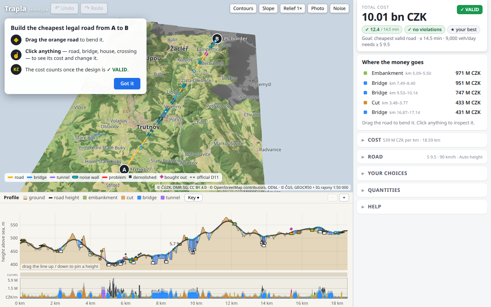 |  |
| A violation: the thing is selected, the fix is a button | The house's cross-section, after the one-click fix |
|  | 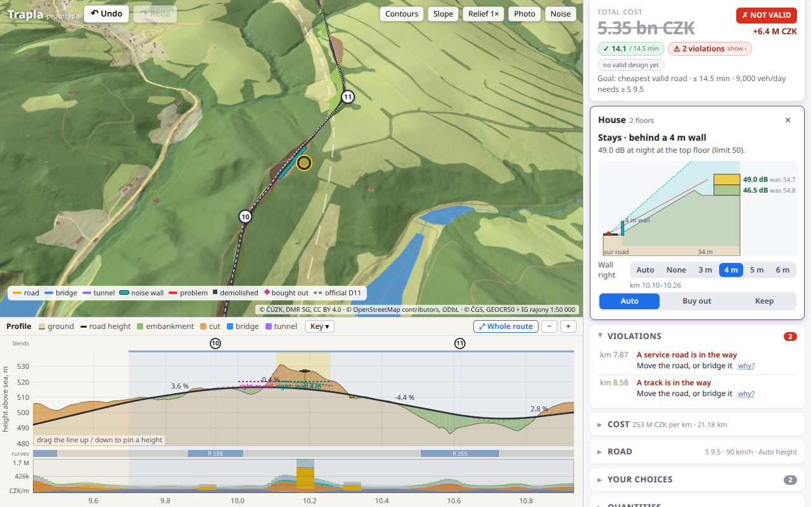 |
| Click the embankment on the map, then Bridge | Walls on a stretch, per side |
| 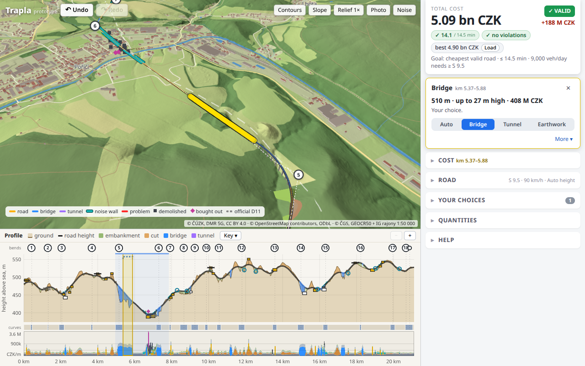 | 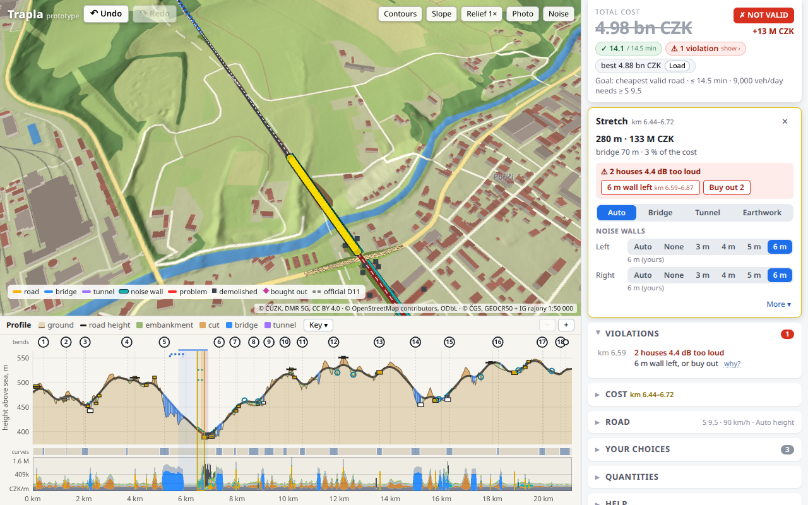 |

Also: [the most expensive piece](docs/screenshots/62-playtest-money.png),
[a piece clicked in the profile](docs/screenshots/63-playtest-piece.png),
[noise view](docs/screenshots/66-playtest-noise-view.png),
[a crossed road](docs/screenshots/69-playtest-crossing.png),
[a pinned height](docs/screenshots/70-playtest-pin.png),
[the reference design](docs/screenshots/71-playtest-overview.png).
Before the rethink: [docs/screenshots/rethink-before](docs/screenshots/rethink-before).

### Twists, news from the site and the reveal

There is no separate game mode: the game stays the builder, and each mission offers **twists**, challenges on top of a
valid design, picked on a short screen after Start ([the twist screen](docs/screenshots/640-twist-screen.png)) and
changed any time from the **Twists** card (the chip by the verdict, "✗ Twists 2/3"). *Earth balance*: what you dig fills
your embankments, at most 10 % brought in or trucked away ([the starter brings in 18 %](docs/screenshots/641-starter-twists.png),
[one height pinned](docs/screenshots/643-pin-lower.png)). *Hands off the castle*: rings around the castles, churches, chapels
and viewpoints near the line ([in Šternberk](docs/screenshots/642-landmark-rings.png)). *Curveballs*: news from the site,
drawn from the real project's story, a place to keep out of or less money ([the villa](docs/screenshots/644-news-villa.png),
[its garden on the map](docs/screenshots/645-villa-broken.png), [the butterflies later](docs/screenshots/647-news-butterflies.png)).
*From scratch* (the straight line, [Šternberk](docs/screenshots/649-from-scratch.png)), *By hand* (your heights,
[Auto's off](docs/screenshots/648-by-hand.png)), and where it asks for something *Real price*. The first time the design is
valid, meets every twist on and is 10 % under the line you started from (the planned one), the **reveal** shows yours next to
the real project, its price and what happened to it ([the reveal](docs/screenshots/646-reveal.png)); *Keep improving*.
*Nobody moves*, *Spare the forest* and *Few bridges* (along our road) where a reference design gets there under the goal.
Every mission with twists has 5–8 curveballs: the real project's own where they can be placed (the Luka tunnel, the Pod
skálou forest, the D11 contract, Český ráj's revoked approval and its conditions: the scarps' green bridges, the biocorridor,
the rivers' banks; Nudvojovice refusing to sell where the real line tunnels under Pelešany), otherwise game events of kinds real projects meet, and the card says so: an
archaeological find kept in place, a nest, a gas main, a village asking for a cutting, less money; some on real registers'
places (old mine workings, undermined
ground and slow landslides from the Czech Geological Survey, streams animals travel along from the nature agency; [a real place](docs/screenshots/650-news-real-place.png),
[on the map](docs/screenshots/651-mastnik-place.png), [a game event](docs/screenshots/652-news-game-event.png); research/95).
A mission without twists says so ([the class I road](docs/screenshots/653-no-twists.png)); the whole routes have theirs
([the whole D3](docs/screenshots/654-whole-route-twists.png)). Each twist is offered only where a reference design meets it
(`npx tsx scripts/twists-check.ts`, PLAN.md "Twists and curveballs").

### Scenarios

The start screen ([now](docs/screenshots/551-start-screen.png), [before](docs/screenshots/550-start-screen-before.png),
[at 1280 × 800](docs/screenshots/552-start-screen-1280x800.png)) offers one mission first, *Start here*: Jílové →
Hostěradice across the Sázava (the smallest map, 3.9 MB, a 4.5 km motorway). Below it one card per corridor or
mission: what it is and how long, one line of what you do, the download size; the D3 and the D35 each have one card
with their sections as choices, the whole route last ([the D3 card](docs/screenshots/553-start-screen-d3-whole-route.png)).
The sections are named by their places ([the D3 card](docs/screenshots/581-start-screen-d3-card.png)), and a card's line says
only what you do. The town bypass comes last: the I/46 around Šternberk, planned and not built (research/88;
[the starter](docs/screenshots/583-sternberk-overview.png), [its end on the road to Opava past the viaduct](docs/screenshots/584-sternberk-end-b.png),
[the aerial photo](docs/screenshots/585-sternberk-photo.png)). It replaced Nová Paka, whose ground and photo were taken
while the real bypass was being built ([the start screen now](docs/screenshots/580-start-screen.png)).
The I/35 from Turnov to Úlibice through Český ráj ([its card](docs/screenshots/600-start-screen-cesky-raj.png); research/89) was
the R35 "D35" and is now a class I road: a four-lane S 21.5 built like a motorway, which may cross the protected landscape
area's outer zone with consent where a motorway may not enter it at all ([the note on that stretch](docs/screenshots/605-i35-chko-zone-iii-note.png)).
Its three stages and the whole route: [the whole route](docs/screenshots/601-i35-whole-route.png),
[Turnov → Valdštejnsko](docs/screenshots/602-i35-turnov-valdstejnsko.png), [Valdštejnsko → Čímyšl](docs/screenshots/603-i35-valdstejnsko-cimysl.png),
[Čímyšl → Úlibice](docs/screenshots/604-i35-cimysl-ulibice.png); [its two carriageways on twin decks](docs/screenshots/606-i35-four-lane-body.png),
[homes bought out for noise at Nudvojovice](docs/screenshots/607-i35-nudvojovice-noise.png), [end A at the Ohrazenice interchange](docs/screenshots/608-i35-end-a.png),
[end B where the D35 goes on](docs/screenshots/609-i35-end-b.png), [the photo round Žernov](docs/screenshots/610-i35-rovensko-photo.png).
Retired missions are never offered; a save of one
is listed under [Your older saves](docs/screenshots/554-start-screen-older-saves.png). A picked mission's map
loads with [a card that counts the megabytes](docs/screenshots/555-loading-card.png); the map is drawn
[before its first price](docs/screenshots/556-map-before-its-first-price.png); then [the first run](docs/screenshots/557-first-run.png)
([before](docs/screenshots/560-first-run-before.png)) and [its first drag](docs/screenshots/558-first-drag.png).
A browser without WebGL 2 [is told so](docs/screenshots/561-no-webgl.png), [a phone or a small window](docs/screenshots/562-small-screen.png)
too (with *Continue anyway*), [a failed download says so with Try again](docs/screenshots/563-loading-failed.png);
[About Trapla and its data](docs/screenshots/564-about-data.png) lists the sources and licences and offers the map
files (linked from the start screen, [the map's credits](docs/screenshots/559-map-credits-about-link.png) and Help).

Earlier start screens: [the four scenarios](docs/screenshots/73-scenario-picker.png),
[Posázaví across the Sázava](docs/screenshots/74-d3-posazavi.png),
[D35 first stage, Opatovec → Staré Město](docs/screenshots/75-d35-opatovec-stare-mesto.png),
[Nová Paka bypass](docs/screenshots/76-nova-paka.png),
[its end joining the retained roundabout](docs/screenshots/77-nova-paka-roundabout-junction.png),
[the aerial photo showing the real bypass under construction](docs/screenshots/78-nova-paka-photo.png).
See `docs/new-scenario.md`.

The Středočeská D3 is offered whole (57 km, Prague ring → Nová Hospoda) and as its five construction
sections 0301–0305/I ([picker](docs/screenshots/140-picker-d3-sections.png), research/39), each a motorway
mission with its real ends: [0301 starts in the D0 interchange](docs/screenshots/141-d3-0301-d0-interchange.png),
[0305/I joins the D3 that is already open](docs/screenshots/142-d3-0305-joins-open-d3.png), a section boundary
[continues as the next section](docs/screenshots/143-d3-0303-continues.png) (the planned line runs on),
[the whole corridor](docs/screenshots/144-d3-whole.png). D35 is offered whole too, Opatovec → Mohelnice,
[ending on the I/35 merge](docs/screenshots/145-d35-mohelnice-merge.png). Long routes stay live while dragging:
previews re-solve only the edited stretch (`docs/evaluate-performance.md`). Reproduce with
`node scripts/scenarios/screenshots.mjs <id> --docs-overview|--docs-A|--docs-B <name>`.
The start view [frames A and B](docs/screenshots/146-whole-d3-start-framed.png) (the whole D3 looked at across);
an end that meets an interchange or a road has a sign and [a card](docs/screenshots/147-interchange-card-i18.png)
("Interchange with road I/18 — shown only: its slip roads are not built or billed here"); the total
[follows a drag live](docs/screenshots/148-whole-d3-live-price-drag.png) (≈); the D35 first section
[joins the open D35 and goes on as the next section](docs/screenshots/149-d35-first-section-ends.png).
Trutnov offers the real D11 as a motorway, first in its card ([start screen](docs/screenshots/570-d11-motorway-picker.png), research/87),
D 27.5 at 110 km/h from where [the D11 from Jaroměř joins](docs/screenshots/572-d11-motorway-end-a.png) to the border,
where it [goes on as the S3 in Poland](docs/screenshots/573-d11-motorway-end-b.png); its starter follows the official
line ([overview](docs/screenshots/571-d11-motorway-overview.png), [the Poříčí viaduct](docs/screenshots/574-d11-motorway-bridge.png)),
14.03 bn against the real 11.71 bn contract. The class I road is the card's second choice. A bridge over what runs
along under it stands on [frame piers](docs/screenshots/575-d11-motorway-frame-piers.png), two columns either side
(`node scripts/d11-motorway-shots.mjs --docs 570`).
A local edit re-solves only its own stretch of the grade line (model 25, research/39 "Local edits",
`scripts/locality.ts`).

### Motorway (cost model 23)

Two motorway places on the start screen ([picker](docs/screenshots/130-motorway-picker.png)): both directions
are designed together as one D 27.5 corridor ([D3 overview](docs/screenshots/131-motorway-overview.png)),
drawn as [two carriageways with a grass median and barrier](docs/screenshots/132-motorway-carriageways.png),
[twin bridge decks on their own piers](docs/screenshots/133-motorway-twin-bridge.png) and
[one portal per tunnel tube](docs/screenshots/134-motorway-twin-tunnel.png). The motorway's own card (click
it, or nothing selected) says what a drag bends: "Both directions", or "Towards …" one of them. Choosing changes
nothing; the first drag of that direction makes it run on its own only over the stretch it changes, from a join
on a straight before the change to one after it ([one direction through its own tunnel](docs/screenshots/135-motorway-one-direction.png));
elsewhere both stay one road body with one bill. Inside, each direction keeps the shared heights while the two
run side by side and gets Auto heights where they are apart. The card lists where the directions run apart,
each with "Join". The Motorway card's one speed control is the design speed (130, 120 or 110 km/h) with the curves and slopes
it demands; the motorway is signed at it. Its noise comes from two directional sources, half the traffic each on the
lane axes 6 m either side of the middle (a direction on its own: all of it on its own lane axis, an upper bound). The direction
towards A reads from its own start: its profile, kilometres and bend numbers count from B. Reproduce with `node scripts/motorway-shots.mjs d3 --docs 130` (its
one-direction shot is 135); `node scripts/stretch-play.mjs --gpu` plays choose, drag, join.

### Railway (cost model 23)

"Railway: Trutnov → Královec" starts and ends on the rail network: at Trutnov hlavní nádraží and at Královec,
the last station before the Polish border, on today's single-track, non-electrified line (passenger trains
run on to Lubawka; 26 min with four stops in the 2022 timetable). No upgrade of it has been announced
(research/38): the card says it is a game proposal. A single-track electric line at up to 120 km/h, slopes
≤ 12.5 ‰ (‰ in the profile), no level crossings, CNOSSOS train noise from each track. The new line joins the old
track in both stations, leaving it at no more than a turnout's angle (4.8°, research/38 §5), and rebuilds it
where it runs along it; elsewhere the old line stays. The starter leaves Trutnov hl.n. north-west along the
station tracks into a tunnel under the hill (VALID, 10.4 bn CZK). The first railway card (between
the motorway's ends) is retired; its saves still load (`?scenario=d11&preset=d11-railway`).
[Overview](docs/screenshots/136-railway-overview.png), [out of Trutnov along the station tracks](docs/screenshots/137-railway-trutnov.png),
[the viaduct over the old line's valley](docs/screenshots/138-railway-bridge.png), [joining the old line at Královec](docs/screenshots/139-railway-kralovec.png)
(`node scripts/railway-shots.mjs --docs 136`; played end to end with `node scripts/mode-play.mjs --gpu`).

Build → Motorway makes both directions of a D 27.5 between two points of open ground (shown, not priced: its
ends meet no road). Build → Railway ends on a mapped railway or open ground. A mapped railway can be
rebuilt by dragging it like a road (no need to select it first): the dragged stretch becomes an editable
single-track railway at the old line's own speed (its mapped limit) and steepness that takes up its old track
(taking it up is not priced yet).

### Editing any road

Any mapped road behaves like our road: click it (its stretch between junctions is highlighted), then drag it
to rebuild that stretch, bent under the pointer, with its profile and price. Where the new line stays on the
old road, the old road is kept as it is (drawn on the ground, not billed, no norm); where it leaves it, a new
road is built and the old one removed. Its traffic is filled in from the ŘSD traffic census 2025 (or the
average of its class, labelled). **Build → Road** places a new road from a click to a click; an end on a road
joins it with a junction (Auto: a T, or a roundabout). See [docs/any-road-editing.md](docs/any-road-editing.md).
A built road's **Start** and **End** are handles while it is selected: drag one along the road it joins (it
stays on it), off it onto open ground, or onto another road.

### A hand-built interchange: slip roads

**Build → Slip road** builds one-way slip roads of an interchange on a motorway of the game (ours, or one built
with Build → Motorway) or a four-lane road (S 21.5) at that road's own widths, speed and price. Traffic runs from its start to its end: start it beside the motorway to leave it (an
exit), end it there to join it (an entry); the side clicked picks the carriageway, the other end joins a road
(a junction or a roundabout, as Build → Road's). It leaves along the traffic through one bend and meets the
road square through another; the motorway gets its exit or entry lane (234 / 295 m on the hard shoulder at 120–130
km/h, shorter on slower roads: 198 / 295 m on the S 21.5 at 110, whose formation is 2.5 m wider along it; drawn and
priced), the slip road keeps the motorway's level by its gore and a low slope's fall from it beside it, where
their slopes overlap that earth is billed once, and a narrow ridge between their cuttings is dug out (billed).
Put a slip road's end on another's and the two share one crossroads, billed once. Where the motorway moves a
track aside, its slip roads are built against the moved track. Four of them make a diamond (D3 0304 at road
II/114: valid, +200 M CZK, `tests/fixtures/interchange/d3-0304-diamond.json`; D3 0303 at road II/105, where the
motorway moves tracks aside: `d3-0303-diamond.json`). Its gore slides along the motorway like any end (its bend
goes with it). Slip roads already in the motorway's price (earth-built ones of one interchange every 7 km, SPK)
are credited. Not yet: a slip road over or under its own motorway (a trumpet's or cloverleaf's loop),
interchange spacing (research/90). Real-mouse check: `node scripts/interchange-scene.mjs [--docs]` (screenshots
620–633; the I/35 diamond 710–719).

| The diamond, valid and priced | Slip roads and motorway in one cutting by their gores |
|---|---|
| 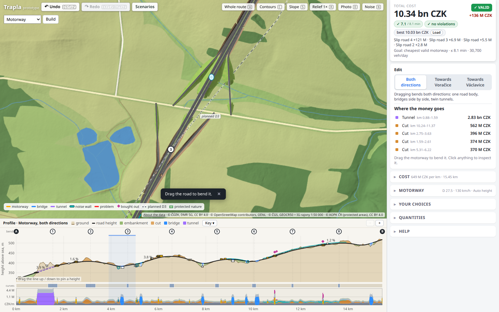 | 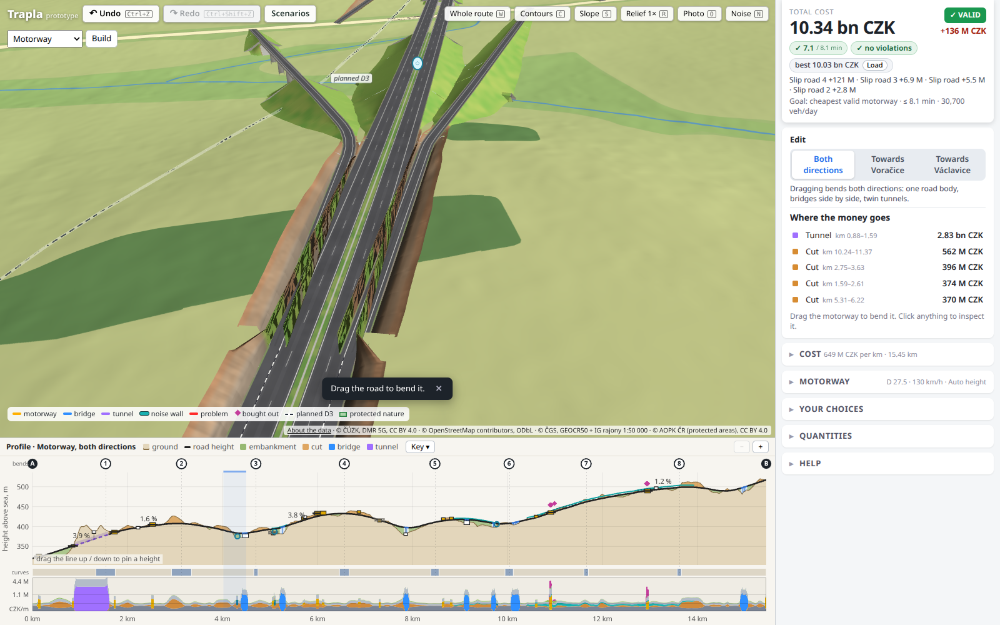 |

Also: [the diamond from the south-west](docs/screenshots/626-diamond-oblique.png), [an exit and an entry at one
crossroads on road II/114](docs/screenshots/628-slip-road-junction-on-road-ii-114.png), [the D3 0303
diamond](docs/screenshots/632-d3-0303-diamond-overview.png), [its slip road past the tracks the motorway
moves aside](docs/screenshots/633-d3-0303-slip-road-over-moved-track.png).

| A diamond on the four-lane I/35 (road II/610) | Its gores: the lanes take the paved shoulder's place |
|---|---|
| 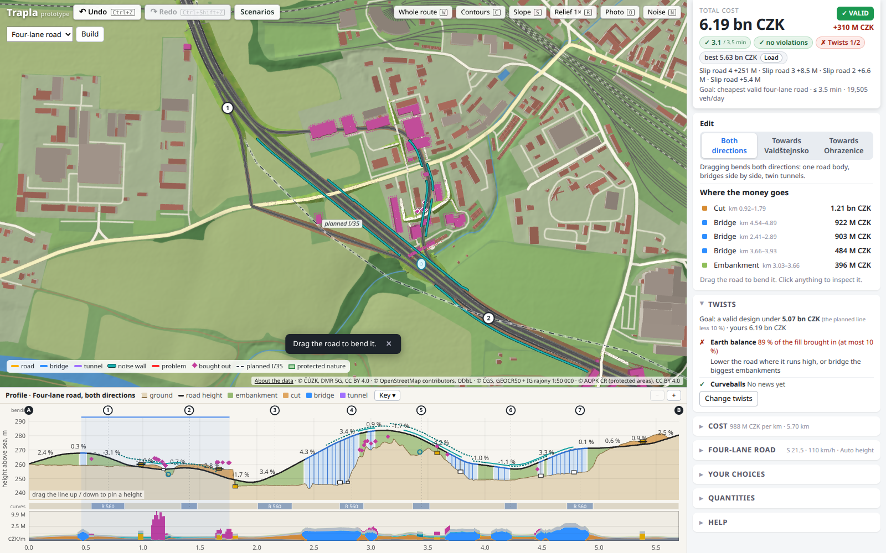 | 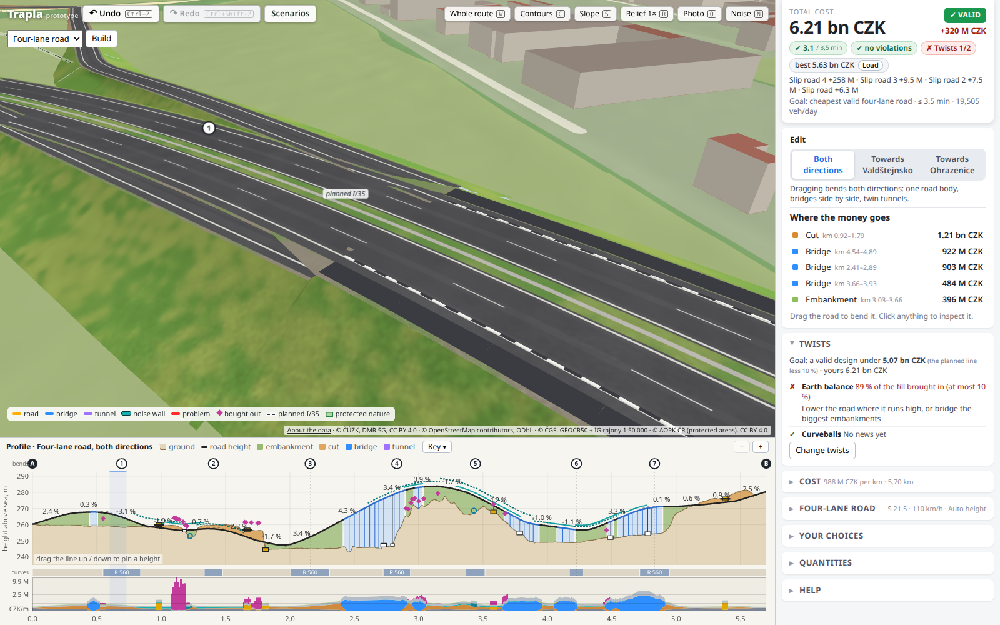 |

Also: [its first slip road's card](docs/screenshots/711-first-slip-road-card-four-lane-road.png), [the lanes over a
bridge, its decks wider](docs/screenshots/715-i35-lanes-over-a-bridge.png), [the gores from
above](docs/screenshots/719-i35-gores-from-above.png), [the north-east slip roads along
Přepeřská](docs/screenshots/718-i35-north-east-slip-roads.png).

| A mapped road selected: drag it to change its line | The stretch rebuilt: its bends follow the old road |
|---|---|
|  |  |
| D3: road III/1057 moved under our motorway bridge; the rest stays on the old road | A side road joining our road at a roundabout |
| 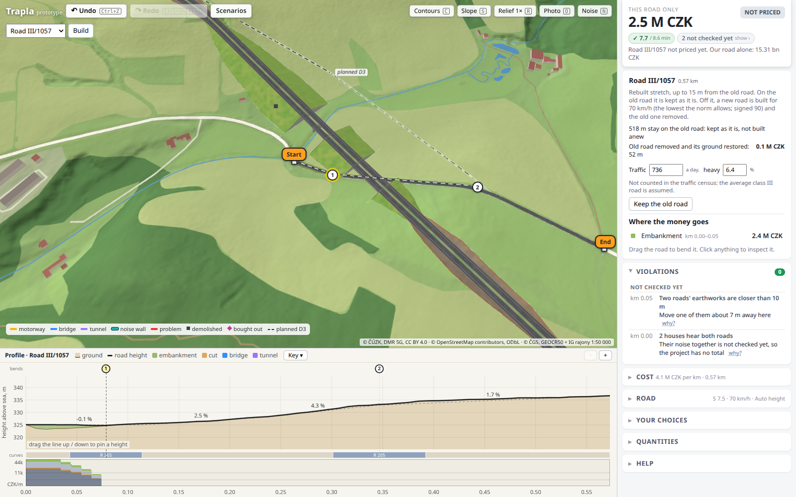 | 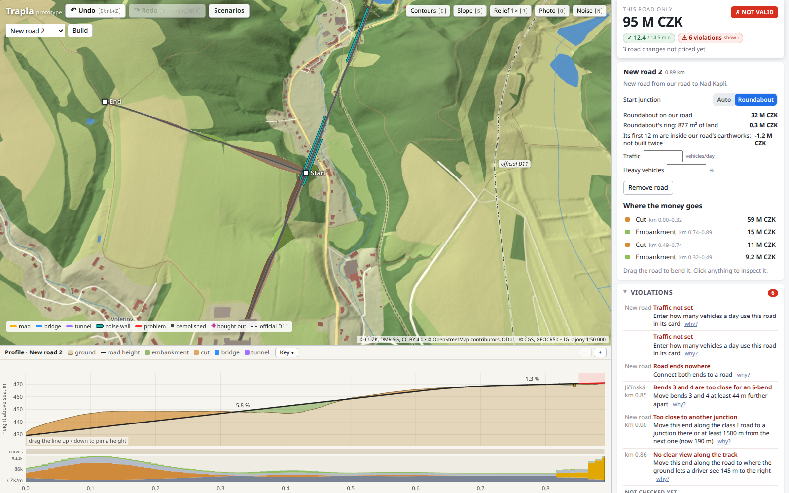 |

Also: [road III/1057 selected](docs/screenshots/106-d3-road-1057-selected.png), [its card with a bend
selected](docs/screenshots/108-d3-road-1057-card.png), [Build → Road: where a click would put the end, and how
long the road would be](docs/screenshots/109-build-road-placing.png) (`node scripts/owner-d3-scene.mjs --docs`),
[D11: Jičínská after a small drag and a longer stretch, still on its old road: drawn on the ground, nothing
built or billed](docs/screenshots/104-rebuilt-road-priced.png), [a new road with a free end](docs/screenshots/102-new-road-built.png), [the photo with the mapped
roads](docs/screenshots/103-photo-mapped-roads.png); the earlier foundation views 79–83 are in `docs/multi-road-ux.md`.

### Physical crossings

| Overbridge: deck, abutments and embankments | Ground-level reconnection |
|---|---|
|  |  |

[Overbridge approaches](docs/screenshots/42-crossing-overbridge.png),
[existing road under our bridge](docs/screenshots/43-crossing-bridge.png),
[track diversion](docs/screenshots/45-crossing-diversion.png),
[at-grade junction](docs/screenshots/46-crossing-junction.png).
[Junction detail, with noise-wall openings](docs/screenshots/48-crossing-junction-detail.png).

Model 19: a crossing's own earthworks leave other roads usable. A street joining a raised junction approach is
raised to meet it instead of being buried under its slope:

| Before (street under the slope) | After (street regraded to meet the junction) |
|---|---|
| 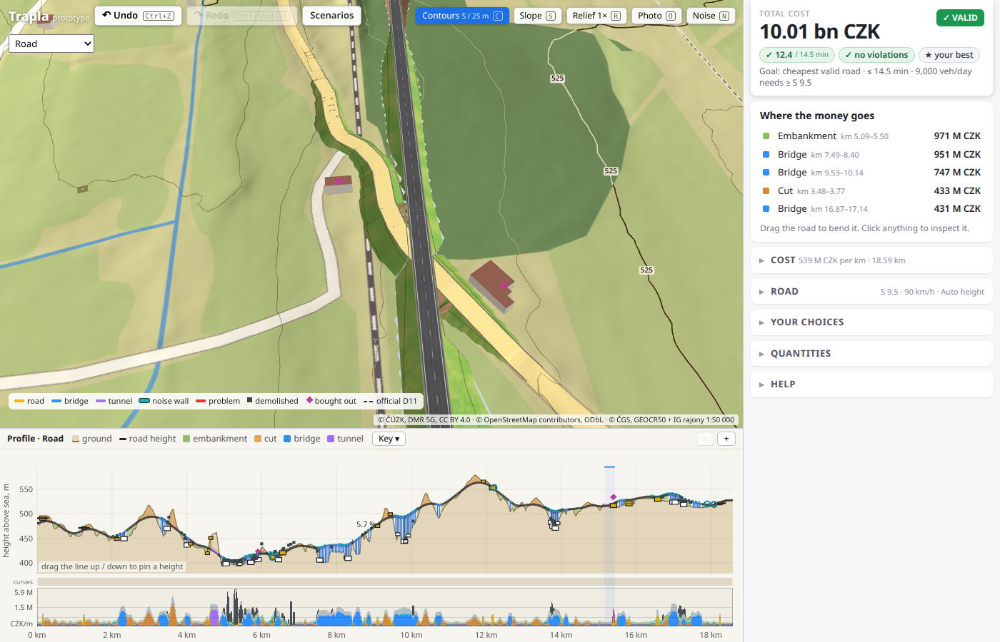 |  |

The *before* pictures are the code before model 19; the *after* ones were retaken on cost model 31 (other
bills, the same places): above, the junction with the class I road at km 15.40 of the straight line, a side
road regraded over 54 m to meet its approach;
[demo junction at km 6.73, before](docs/screenshots/114-crossing-works-before-junction-street-tie-demo.png) /
[after](docs/screenshots/115-crossing-works-after-junction-street-tie-demo.png).
[The ramp to a track bridge over us at km 15.3 of the direct 80 km/h design, before](docs/screenshots/112-crossing-works-before-ramp-wall.png):
on model 31 that ramp reaches no side street any more, so the picture after it is of another bridge of the same
design, [the street carried over us at km 6.55, a side street regraded 85 m to meet its ramp](docs/screenshots/113-crossing-works-after-ramp-wall.png).
[A click on a reroute far from the crossing opens its card](docs/screenshots/116-crossing-pick-link.png).
(`node scripts/crossing-works-shots.mjs`, `--before` on the older code.)

Noise model 21 and what the route takes (`node scripts/noise-shots.mjs`, `ROOT=` an older checkout for the
before): the deep cut at km 10.1, [walls inside the slope before](docs/screenshots/120-noise-cut-km10-before.png),
[on the cut's top edge now](docs/screenshots/121-noise-cut-km10-after.png); [the house beside a junction
opening, walled instead of bought out](docs/screenshots/122-noise-gap-house-card.png); [a card with the wall on
the cut](docs/screenshots/123-noise-wall-on-cut-card.png); demolished buildings under a viaduct, [roof patches
and floating squares before](docs/screenshots/124-demolished-before.png), [cleared plots then](docs/screenshots/125-demolished-after.png) (since 520: bought out, standing magenta);
[a bought-out house with its ring](docs/screenshots/126-bought-out-after.png); [far away: outlined markers on
the ground](docs/screenshots/127-demolished-far-markers.png); the ground beside an abutment, [sky-coloured
slivers before](docs/screenshots/128-seam-abutment-before.png), [closed now](docs/screenshots/129-seam-abutment-after.png).

Shaping a reroute by dragging it (`node scripts/link-shape-shots.mjs`):
[the drag](docs/screenshots/117-link-shape-drag.png) (the first drag starts from the automatic path's own bends),
[the rebuilt road with its bend points and "Automatic path"](docs/screenshots/118-link-shape-built.png),
[a bend point dragged onto our road: the problem, with the way back](docs/screenshots/119-link-shape-rejected.png)
(retaken on cost model 31: the demo's service road at km 6.89).
Leading a reroute to another road by dragging its end (`node scripts/reroute-end-shots.mjs`, D35 full, the track cut at
km 2.51): [Auto leads its north part to the track under our bridge at km 2.70](docs/screenshots/500-reroute-end-auto.png),
[its end dragged over a field (nothing to join)](docs/screenshots/501-reroute-end-drag-field.png),
[over the class III road that crosses at km 2.29 (lit up)](docs/screenshots/502-reroute-end-snap.png),
[let go: built there, "your choice" and *Lead it where Auto does* on the card](docs/screenshots/503-reroute-end-led.png),
[undone](docs/screenshots/504-reroute-end-undo.png), [redone and bent in its middle](docs/screenshots/505-reroute-end-bent.png),
[onto a street across our road: said, Auto's line stands](docs/screenshots/506-reroute-end-across.png),
[*Lead it where Auto does*](docs/screenshots/507-reroute-end-automatic.png), [onto a track that does not cross ours](docs/screenshots/508-reroute-end-snap-track.png),
[built there](docs/screenshots/509-reroute-end-track.png).
A cut way that serves houses (`node scripts/cut-card-shots.mjs`, D11 km 17.67, the service road to a hamlet):
[Auto keeps it across our road in a box](docs/screenshots/530-cut-hamlet-auto.png),
[the player's "Cut it": closed, what each part still reaches and how far round, each part lit to its road](docs/screenshots/531-cut-hamlet-closed.png),
[further out](docs/screenshots/532-cut-hamlet-parts.png), [the ends beside our road](docs/screenshots/533-cut-hamlet-ends.png),
[a part's end dragged onto road I/16](docs/screenshots/534-cut-hamlet-end-drag.png), [led there](docs/screenshots/535-cut-hamlet-end-led.png);
D35 full km 22.08: [a farm's track, its buildings bought out rather than carried over the motorway](docs/screenshots/536-cut-farm-bought-out.png),
[a farm building's card](docs/screenshots/537-cut-farm-building.png).
Buildable reroutes and lowered underpasses (model 21, `node scripts/lowered-underpass-shots.mjs`; retaken on
cost model 31, where the start line lowers other roads than it did):
[the straight start line opens valid](docs/screenshots/150-straight-start-valid.png),
[a service road lowered 1.8 m under its box, clicked on the map](docs/screenshots/151-lowered-local-road-card.png),
[its portal](docs/screenshots/152-lowered-local-road-portal.png),
[a street lowered 5.7 m under a low embankment](docs/screenshots/153-lowered-way-oblique.png),
[the player's reroute that cannot be built (no road nearby to reconnect to), its works outlined](docs/screenshots/154-player-reroute-unbuildable.png),
[town-centre's service road lowered 3.0 m](docs/screenshots/155-town-centre-lowered-service-road.png),
[an engineered service-road reroute at its class's steepest grade (12 %)](docs/screenshots/156-engineered-reroute-best.png).
Map camera and labels (`node scripts/camera-check.mjs`): [*Whole route* after panning off the map](docs/screenshots/157-camera-whole-route.png),
[a low view: no names piled up on the horizon or printed over each other](docs/screenshots/158-camera-low-view-labels.png),
[noise walls on both sides labelled once](docs/screenshots/159-camera-wall-labels.png).
Core play polish (model 24): [By hand from Auto's heights: the same bill, handles only where the line bends](docs/screenshots/160-byhand-same-bill.png),
[dragging a height point: the height and the change in the tip](docs/screenshots/161-byhand-drag-readout.png),
[a pin dragged up 15 m by 30 px](docs/screenshots/162-pin-drag-readout.png),
[1024 × 700: Build under the view buttons, the map key as symbols](docs/screenshots/163-1024-start.png),
[… with the noise key bottom right, clear of A](docs/screenshots/164-1024-noise.png),
[1280 × 720: A clear of the key](docs/screenshots/165-1280x720-start.png),
[Auto bridges the Poříčí halls on its own heights](docs/screenshots/166-porici-auto-bridge.png),
[the player's bridge over km 5.09–5.50: its piers clear the roads (a crossed track's reroute is still reported)](docs/screenshots/167-player-bridge-piers-clear.png),
[a bought-out house drawn behind the 5 m wall Auto tried: one story](docs/screenshots/168-bought-out-one-story.png),
[Nová Paka km 1.97: the tower inside the demolished hall goes with it](docs/screenshots/169-nova-paka-tower-with-hall.png).
Crossing remedies as designers choose them (model 28, `node scripts/crossing-economy-shots.mjs`; retaken on
cost model 31, where the D3 motorway starter and town-centre keep their skewed ways on their own lines, so the
straightened way is one of best):
[D3 motorway: a class III road running along it moved beside it (+699 m of new road)](docs/screenshots/170-d3-motorway-road-moved-beside.png),
[a track led to its neighbour's bridge at km 3.71](docs/screenshots/171-d3-motorway-neighbouring-tracks.png),
[best: a track that met our road at 44° straightened, its bridge 24 m](docs/screenshots/172-best-way-straightened.png),
[the player keeps its line: a 35 m bridge](docs/screenshots/173-best-way-kept-line.png),
[best: a service road moved aside](docs/screenshots/174-best-service-road-moved-aside.png),
[Nová Paka: a service road led along our road to the crossing at km 3.05](docs/screenshots/175-nova-paka-roads-joined-to-one-crossing.png).
Final-sweep P1s (`tests/edited-network`, `new-line-crossings`, `merged-crossings`): [D11 km 4.1: a track the
QA dragged beside our reroute, priced](docs/screenshots/180-d11-track-beside-reroute-priced.png),
[a new road across the Královec valley passes high over our railway bridge on its own](docs/screenshots/181-rail-new-road-over-our-bridge.png),
[whole D3 dragged at km 30: both tracks crossing within 30 m rerouted, none buried](docs/screenshots/182-d3-full-km296-both-tracks-rerouted.png),
[the QA's 50 px drag at km 6 of the Královec railway: valid, the track too steep for a bridge over our cutting
passes under our viaduct](docs/screenshots/190-rail-drag-track-under-viaduct.png) (`tests/rail-drag-locality`, research/57).
Final-sweep P2s (`node scripts/p2-scene.mjs`, research/58): [III/1057 rebuilt past our bridge: the score says
which roads' bills moved, the bend label stays clear of the map's key](docs/screenshots/195-d3-1057-rebuilt-change-explained.png),
[a drag's ≈ price says what it leaves out; the direction card names the place](docs/screenshots/196-d3-0302-drag-estimate.png),
[Nová Paka: the photo's construction note while the photo is on](docs/screenshots/197-nova-paka-photo-note.png).
Design realism (cost model 31, docs/design-realism-plan.md; `node scripts/realism-shots.mjs`): [best km 4.93: a
21 m cut, its rock face at 4:1 and netted](docs/screenshots/210-rock-cut-netted.png),
[km 11.38: a 26 m embankment on VL 1 slopes over a stream in a buried bridge](docs/screenshots/211-vl1-fill-buried-bridge.png)
([close](docs/screenshots/212-buried-bridge-close.png)),
[a bend's card: design speed here 90 / 80 / 70, at 70 km/h a 205 m curve](docs/screenshots/213-bend-card-design-speed.png),
[a hairpin's card](docs/screenshots/214-hairpin-card.png) and [the hairpins widened on steep ground](docs/screenshots/215-hairpin-widened.png),
[a box under our embankment stuck out of the slope](docs/screenshots/216-box-portal-before.png) → [it ends at the
slope behind a headwall, the way runs on between wing walls](docs/screenshots/217-box-portal-after.png)
([before](docs/screenshots/218-box-portal-before-2.png) / [after](docs/screenshots/219-box-portal-after-2.png) from the other side),
[D3-0302 km 3.51: the local road straightened over our motorway on a 48 m bridge](docs/screenshots/220-d3-0302-road-over-motorway-card.png),
[that bridge and its ramps close up](docs/screenshots/221-d3-0302-overbridge-and-reconnection.png) (the secondary road 150 m on is led to it).
Bug-fix sweep (cost model 32, research/60; `node scripts/bugfix-sweep-shots.mjs`): [D3 km 2.67: the player
straightens the track, a shorter box](docs/screenshots/240-d3-motorway-track-straightened-by-player.png),
[km 7.94: it cannot be straightened (the bank is too steep even on 10 m of earthworks): said, kept on its line, our
road as it was](docs/screenshots/241-d3-motorway-track-cannot-be-straightened.png),
[km 3.63: a field-track reroute buys out three sheds](docs/screenshots/242-d3-motorway-track-reroute-sheds.png)
([their cleared plots](docs/screenshots/243-d3-motorway-track-reroute-sheds-cleared.png)),
[D11 direct-80 km 6.83: a street reroute takes three homes, nothing else is buildable
there](docs/screenshots/244-d11-direct-80-street-reroute-homes.png),
[town-centre km 10.05: Auto straightens the track, its new line on its own earthworks](docs/screenshots/245-town-centre-track-straightened-on-earthworks.png),
[the top bars at 1,366 px: no key hints, nothing overlaps](docs/screenshots/246-top-bars-1366.png).
Tunnels as they are built (cost model 34, PLAN.md "Tunnels as they are built"): [the D35 starter's east portal at the
bottom of a 60 m open cut](docs/screenshots/222-d35-portal-before.png) → [the tunnel goes on as cut and cover to where
the cut is about its own height deep](docs/screenshots/223-d35-portal-after.png),
[the tunnel card: how it is built, its method (Mined · Cut and cover)](docs/screenshots/224-d35-tunnel-card.png),
[D3-0304: twin tubes in a 9 m approach cut](docs/screenshots/225-d3-0304-twin-portals.png).
Bridge styles (cost model 35, PLAN.md "Bridge styles"): [D11 direct-80 km 8.6: Auto puts the 50 m high viaduct on
52 m spans, the card's style choice with each style's price](docs/screenshots/226-d11-direct-80-viaduct-long-spans.png)
([from the side: few tall piers](docs/screenshots/227-d11-direct-80-viaduct-long-spans-low.png)),
[direct-90 km 7.84–8.18 as the player’s arch: a 180 m arch with columns on it, +41 M against long
spans](docs/screenshots/228-d11-direct-90-arch.png) ([from the side](docs/screenshots/229-d11-direct-90-arch-low.png)),
[town-centre km 16.78: one 120 m span over the railway with long spans beside it; short spans and an arch do not fit
here](docs/screenshots/230-town-centre-long-span-over-railway.png),
[D3 motorway km 8.59: "Our bridge over it" in our cutting is built, and its card says what raising our motorway
for it cost](docs/screenshots/231-d3-motorway-our-bridge-over-track-raised.png).
Playtest sweep 3 fixes (cost model 41, PLAN.md "Playtest sweep 3"; `node scripts/qa3-fixes-shots.mjs`): [D11, one
bend slowed to 70 km/h: its stretch is the whole road, Auto keeps the 90 km/h curve and heights (the 70 km/h line
was 284 M dearer)](docs/screenshots/290-d11-one-bend-70-keeps-90-geometry.png),
[a bend turning back on itself on steep ground offers a hairpin](docs/screenshots/291-d11-near-u-turn-offers-hairpin.png)
([made one](docs/screenshots/292-d11-u-turn-made-a-hairpin.png)),
[the railway mission's bend: no speed above the line's 120 km/h](docs/screenshots/293-rail-bend-speeds-up-to-the-line.png),
[D11 direct-80 km 8.41–8.88: the 50 m deep valley may be bridged by an arch](docs/screenshots/294-d11-direct-80-valley-arch-fits.png)
([as the player's arch](docs/screenshots/295-d11-direct-80-valley-as-an-arch.png)),
[the D35 viaduct says why no arch fits](docs/screenshots/296-d35-viaduct-no-arch-why.png),
[the D35 tunnel after the player's cut and cover](docs/screenshots/297-d35-tunnel-cut-and-cover-chosen.png),
[D3-0302: the Sázava bridge's end on the cone of fill in front of its abutment (clicked: the bridge's card)](docs/screenshots/298-d3-0302-sazava-bridge-end-on-its-cone.png),
[D3-0302: no 62 m cut and no 41 / 47 m fills, one 1,678 m bridge](docs/screenshots/299-d3-0302-no-deep-cut-one-long-bridge.png),
[a D11 line whose cut would be 67 m deep: Auto's tunnel, the open cut's price on its Earthwork button](docs/screenshots/300-d11-deep-cut-tunnel-open-cut-price.png),
[a bridge end whose fill would cover the road below it: a wall down to the ground](docs/screenshots/301-d11-bridge-end-wall-beside-the-road-below.png).
Bridge ends under one rule (cost model 42, `node scripts/abutment-ends-shots.mjs`): [the Královec railway at km 10.27, once
a 28 m wall, under one bridge with the one before it](docs/screenshots/390-rail-kralovec-km-10-27-under-one-bridge.png), [its fill
at km 5.61–5.70, once boxed in by walls of 25 and 16 m, part of one bridge](docs/screenshots/391-rail-kralovec-km-5-6-one-bridge-no-boxed-fill.png),
[D11 km 2.42, once an 11.4 m wall beside road III/3012, on a cone](docs/screenshots/392-d11-km-2-42-end-on-a-cone-beside-the-road.png),
[a closed end on an 8.5 m fill, its wall's height and price on the bridge card](docs/screenshots/393-d11-km-3-49-wall-within-10-m-billed.png).
Cost model 49 (before | after, `node scripts/render-cones-shots.mjs`): [D3 0304: no lines poke out of the hill above the
tunnel portal](docs/screenshots/450-d3-0304-portal-lines-before-after.png), [D11 km 4.07: a house under a bridge end's cone is
bought out](docs/screenshots/451-d11-house-under-cone-before-after.png), [a road moved aside through a farm building: bought
out](docs/screenshots/452-d11-demo-road-moved-aside-through-building-before-after.png), [road III/3012 rebuilt 23 m east: the
field track that joined it joins the new line](docs/screenshots/453-d11-iii3012-track-joins-rebuilt-road-before-after.png).
Cost model 50 (before | after, `node scripts/render-kept-corner-shots.mjs`): [III/3012's corner dragged 22 m but kept on
the old road: our bridge over it as without it, the curve's grips on the road](docs/screenshots/490-d11-iii3012-corner-kept-our-bridge-as-without-it-before-after.png),
[the track's access to the rebuilt III/3012 ends at its carriageway, no stub between walls](docs/screenshots/491-d11-iii3012-track-access-no-stub-before-after.png).
Cost model 51 (height pins, bends left straight): [an unreachable pin's height to set, a button](docs/screenshots/480-pin-fix-button.png),
[clicked: met, VALID](docs/screenshots/481-pin-set-by-button-valid.png), [the Královec pin at 439.5 m, which would leave the
stream at km 2.09 in an open cut: out of reach, the tunnel kept](docs/screenshots/482-pin-stream-out-of-reach.png) ([why](docs/screenshots/483-pin-stream-why.png)),
[D35 km 4.2 dragged back past bend 2: the bend left on the line, "turns 0°"](docs/screenshots/484-d35-zero-turn-bend-before.png),
[now gone on release](docs/screenshots/485-d35-zero-turn-bend-dropped.png); [a 2° neighbour the curve fit leaves out, gone on
release too](docs/screenshots/492-d35-left-out-bend-dropped-on-release.png), [one left out that stays: its card](docs/screenshots/493-d35-left-out-bend-card.png).
A pin the player set is honoured (cost model 59, `node scripts/pin-honour-shots.mjs`): [the owner's I/35 pin 256.0 m at km
0.29: our road meets the Liberec railway at its level, one problem there, its fix the pin: raise it for our bridge](docs/screenshots/690-i35-pin-honoured-railway-too-low.png)
([the problem's card](docs/screenshots/691-i35-pin-railway-problem-card.png), [the pin's: at a cost](docs/screenshots/692-i35-pin-card-at-a-cost.png)),
[its button: 260.7 m, VALID](docs/screenshots/693-i35-pin-set-by-button-valid.png); [the Královec pin 441.9 m at km 2.03, out of
reach of the climb: steeper next to it, said there](docs/screenshots/694-kralovec-pin-honoured-steep.png) ([its card](docs/screenshots/695-kralovec-pin-steep-card.png)),
[100 m higher, out of any reach: left out, said at the pin](docs/screenshots/696-kralovec-pin-out-of-any-reach.png).
Cost model 53 (before | after, `node scripts/render-works-strip-shots.mjs`): [Královec km 12.98: the houses beside road
II/2253's ramps, 0.2–0.3 m from their toes, bought out with the working strip](docs/screenshots/510-rail-kralovec-km-12-98-ramps-keep-the-strip-before-after.png)
([one's card](docs/screenshots/511-rail-kralovec-km-12-98-house-card-before-after.png)), [III/3012's corner kept on its old
road, lifted onto its bridge over us: rebuilt on the old road our road crossed, not 5.7 m off it](docs/screenshots/512-d11-iii3012-kept-lifted-from-above-before-after.png)
([under our viaduct](docs/screenshots/513-d11-iii3012-kept-lifted-under-our-viaduct-before-after.png)).
One word and one look for every house taken (`node scripts/buyout-look-shots.mjs`): [D11 km 4.07, the house under the
bridge end's cone: bought out](docs/screenshots/520-d11-km-4-07-house-under-a-cone-bought-out.png), [noise
view](docs/screenshots/521-d11-km-4-07-noise-view.png), [photo](docs/screenshots/522-d11-km-4-07-photo.png),
[kept there, in the photo: its ring gone](docs/screenshots/523-d11-km-4-07-photo-kept.png), [plan](docs/screenshots/524-d11-km-4-07-plan.png);
[a noise buyout at km 5.1](docs/screenshots/525-d11-noise-buyout.png); [the Královec railway's houses under its
works](docs/screenshots/526-kralovec-railway-houses-bought-out.png), [far away](docs/screenshots/527-kralovec-railway-far.png).
[The Nová Paka starter along the mapped bypass: its nine curves at their mapped radii, 1.22 bn
VALID](docs/screenshots/232-nova-paka-starter-along-the-bypass.png).
Cost model 37: [Nová Paka with bend 3 dragged 14 m: our road stays 6 m in the cutting the class III road crosses
over, VALID](docs/screenshots/233-nova-paka-drag-class-iii-over-our-cutting.png) (it used to rise 5 m for a lift a
kilometre away and bury a road beside the ramps), [a random D11 line: the track at the tunnel portal carried over a
12 m cutting instead of a 540 m tunnel](docs/screenshots/234-random-15-track-over-the-cutting.png).
Model-18 crossing sanity pass (plain-words card, class-gradient ramps): [service road carried over our road,
km 8.46](docs/screenshots/crossing-sanity/km846-service-loop.png), [track bridge, best km 3.69 (ramps 382 → 124 m)](docs/screenshots/crossing-sanity/best-km369-track-overbridge.png),
[street bridge, direct-80 km 15.97 (421 → 170 m)](docs/screenshots/crossing-sanity/direct80-km1597-street-overbridge.png),
[service reconnection, best km 7.96 (1.6 km → 461 m)](docs/screenshots/crossing-sanity/best-km796-service-reconnection.png).

### Stream culverts

Every billed stream culvert is drawn as what is billed: a precast pipe, a precast frame, or under a high fill the
buried bridge's concrete vault, through our embankment along the stream from toe to toe; at each toe a headwall cut
along our road, splayed wing walls, an apron and the water running out onto the stream, the slope down to the
headwall's top. A click on an end, on its mark over the road or on its ring in the profile opens its card (size,
length, price, why; "Bridge instead"). (`node scripts/culvert-shots.mjs [--scenario … | --query …] [--design
demo|starter] [--only km,…]`.)

| Box culvert 4.0 × 2.5 m, demo km 8.82 | Buried bridge under 17 m of fill, demo km 11.93 |
|---|---|
| 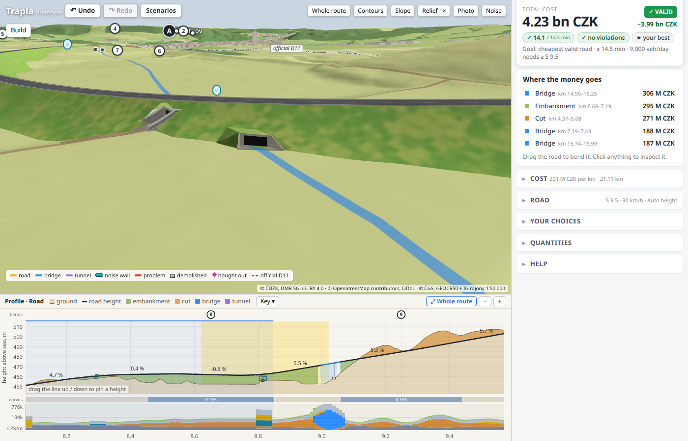 | 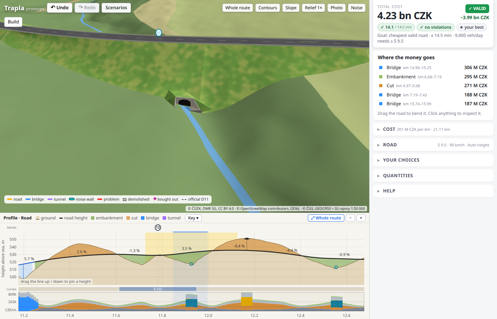 |

[The box beside the track underpass](docs/screenshots/331-culvert-d11-demo-box-beside-track-underpass.png),
[a 1000 mm pipe from the closest view](docs/screenshots/332-culvert-d11-demo-pipe-end.png),
[a buried bridge's end at a retaining wall](docs/screenshots/334-culvert-d11-demo-buried-bridge-at-retaining-wall.png),
[the card after a click on the pipe's end](docs/screenshots/335-culvert-card-from-3d-click.png),
[a profile ring selects its culvert, map and profile in sync](docs/screenshots/336-culvert-profile-ring-selects-box.png),
[D3 5 × 3 m buried bridge](docs/screenshots/337-culvert-d3-buried-bridge-5x3.png),
[D35 box](docs/screenshots/338-culvert-d35-box-end.png),
[Královec railway buried bridge](docs/screenshots/339-culvert-kralovec-railway-buried-bridge.png).
Reproduce with `node scripts/crossing-shots.mjs`.

Grade line problems in the player's words (`node scripts/vc-text-shots.mjs`): on Auto the height points are
the game's and never drawn, so no message names one, and Auto never squeezes two of its changes of slope into
each other ([the owner's Královec drag, now valid](docs/screenshots/400-rail-owner-drag-auto-no-overlap.png);
`scripts/vc-overlap-audit.ts`); By hand the ◆ points are your height pins:
[two 30 m apart, named, both drawn, Move / Delete](docs/screenshots/401-rail-by-hand-two-pins-too-close.png),
[moved as offered](docs/screenshots/402-rail-by-hand-pin-moved.png),
[an Auto pin drawn in the profile](docs/screenshots/403-rail-auto-pin-drawn.png). Geometry and terrain collars rebuild on evaluation,
not on animation frames; the collars connect the true-height road to the coarser overview terrain mesh.
Junctions join the existing engineered formation without cutting through our carriageway; noise-wall
openings use the same masks for rendering, billing and acoustic checks. The existing worst-station noise
model treats these openings conservatively (including automatic buyouts or Keep violations); finite-opening
leakage and return-wall design are not modelled. Auto tries bounded, real-road
alternatives when a provisional crossing is infeasible. Approach fill/cut beyond 10 m is flagged for
redesign rather than presented as a normal local road. The 1.2 m decks and abutments remain study-stage
representations, not structural designs for long spans.

**Protected nature** (cost model 45, research/75): nature reserves, monuments, Natura 2000 sites and national park
zones are drawn as green borders; Auto keeps its works out of reserves, monuments, national parks and CHKO zones I–II
(over on a bridge with no supports inside, under in a mined tunnel). Works in a Natura 2000 site get a note (they need
a Natura assessment; cost model 47), and no tunnel over 500 m is steeper than 5 %.

| D35: Auto's 3.2 km tunnel under Pod skálou, out of its forest | The player's earthworks in the monument: a problem under the Act |
|---|---|
| 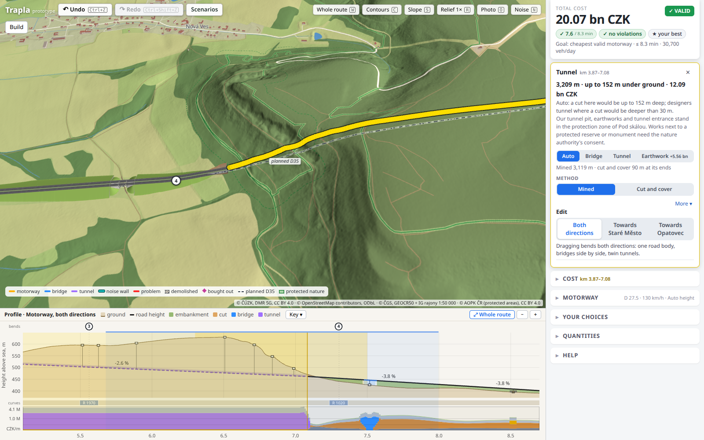 | 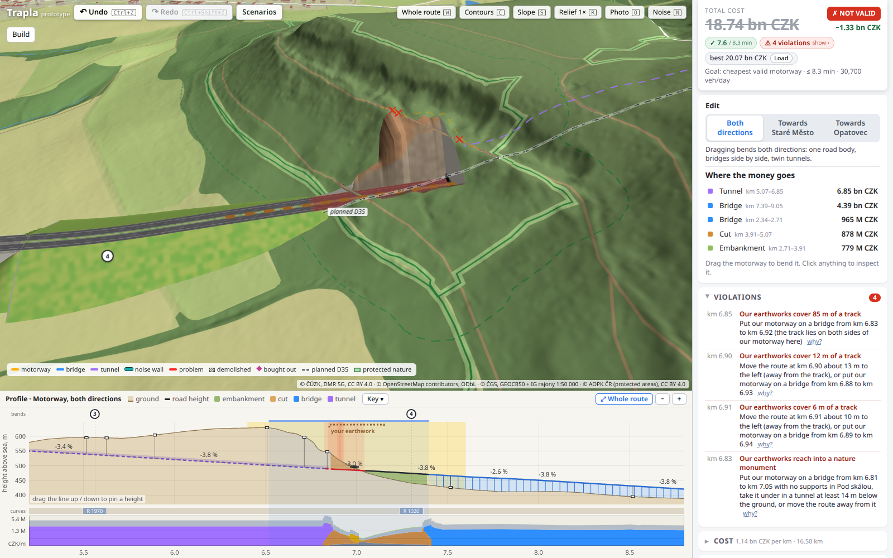 |

[The tunnel's east end beyond the protected forest](docs/screenshots/341-protected-d35-tunnel-portal-beyond-forest.png),
[a tunnel the player made 3.9 % steep: the card's note](docs/screenshots/343-protected-d35-steep-tunnel-note.png),
[the D35 road's tunnel end in the monument's protection zone: a note](docs/screenshots/344-protected-d35-road-tunnel-zone-note.png),
[D3: the Sázava viaduct's piers out of the Natura 2000 river](docs/screenshots/345-protected-d3-sazava-bridge-piers-clear.png)
(model 45). Cost model 47:
[the D3 Sázava viaduct's piers in the Natura 2000 river with the note](docs/screenshots/410-natura-d3-sazava-viaduct-piers-in-river-note.png),
[D35 stage 1: a 2.9 km tunnel at 3.8 %, the note on its card](docs/screenshots/411-tunnel-d35-stage1-2-9-km-3-8-pct-note.png),
[its east end beyond the protected forest](docs/screenshots/412-tunnel-d35-stage1-east-portal-beyond-forest.png),
[the D35 road's 2 km tunnel at 4.7 %, within the law's 5 %](docs/screenshots/413-tunnel-d35-road-2-0-km-4-7-pct-within-law.png),
[d3-full: no tunnel at km 9.7, the Sázava bridge line](docs/screenshots/414-d3-full-km-10-no-tunnel-sazava-bridge-line.png).
Reproduce with `node scripts/realism-shots.mjs` (SCENARIO, PRESET).

## Contributing notes

- **Player-facing text is plain words.** Every violation (title, one concrete fix, why, basis tag), crossing
  card label and tooltip, profile tooltip and bill line uses the vocabulary in `src/core/terms.ts`.
  `tests/player-text.test.ts` generates every violation kind and outcome and fails on internal terms (price-list
  codes, "tie-in", "realignment", "engineering", "faces", "allowance", "overbridge", …) or a missing
  title / fix / basis / rule. A new feature adds its outcome words to `terms.ts`; sources (ČSN, SPK, OTSKP,
  research notes) go only in the `rule` line or pricing tooltips.
- Price or rule changes bump `COST_MODEL_VERSION` and recapture fixtures with
  `npx tsx scripts/eval-regression.ts --capture=current --reviewed-model-change` after review.
- `npx tsx scripts/outcome-audit.ts --straight scripts/*-design.json --random 24` lists every crossing and
  footprint outcome with ramp / link / box lengths and costs and flags absurd ones.

## Architecture

```
pipeline/build_pack.py  offline: DMR 5G + OSM + ČGS geology + official line → public/scenarios/<id>/,
                        configured by pipeline/scenarios/<id>.json (d11 = Trutnov → border)
pipeline/geology.py     cached ArcGIS queries → 25 m ground grid; estimated profiles in ground_profiles.json
src/core/               pure, tested modules (no DOM)
  data/                 categories, norms, prices, scenario — all numbers live here, with source notes
  terrain.ts, ground.ts  5 m heights (bilinear), land cover, OOB mask, categorical ground/weathering profiles
  horizontal.ts         tangents + circular arcs, transition room, stationing
  vertical.ts           road height (grade line), parabolic vertical curves
  autoprofile.ts        Automatic road height: DP over knots every ~250 m; state = elevation × incoming grade
  sections.ts           cross-sections (crown + cut/fill slopes to daylight) against the terrain
  structures.ts         bridge / tunnel choice per station, gap merging, run-level cost check
  earthworks.ts         average-end-area volumes, mass haul with one balance line
  cost.ts, checks.ts    cost roll-up; norm checks as per-family functions (roads now)
  evaluate.ts           the whole recompute path design → result
src/worker.ts           runs evaluate() off the main thread, latest request only
src/render/             three.js view
  view.ts               scene, camera, route ribbon, markers, heightfield picking
  extras.ts             range highlight, noise walls (+ far-zoom symbols, hover targets)
  noise.ts              noise view: footprint band, dwelling colours, wall labels, legend, hover details
  heightTexture.ts      the 5 m height grid as a filterable GPU texture (RG16F + hand-built mipmaps)
  terrainMaterial.ts    terrain shader: relief shading, hypsometric tint, contours, slope tint, OOB hatch
  landcover.ts          land cover / roads / rails / water / footprints rasterised from vectors into
                        camera-centred clip levels (and the optional orthophoto)
  buildings.ts          extruded buildings, merged per chunk
  contourLabels.ts      elevation labels on major contours
  vectorPack.ts         decoder of vector.bin.gz
src/ui/                 HUD, profile panel (+ floating stretch / pin bar), Undo/Redo bar, view options bar
```

### How the terrain is drawn

Nothing is baked at the 5 m grid any more; close-ups are as sharp as the overview.

- **Relief**: the height grid is a GPU texture. The terrain shader takes the gradient per pixel (step = half a
  cell close up, the pixel footprint when zoomed out), shades it from four light directions and adds the
  hypsometric tint. The mesh itself stays at 20 m (1 M vertices); the shading carries the 5 m detail.
- **Contours and slope tint** come from the same height and gradient: line width is constant in screen pixels
  (distance to the contour = elevation difference ÷ elevation change per pixel), lines fade where they would be
  closer than ~4–9 px, are dark on light ground and light on forest, and are not drawn out of bounds.
  The road's cut and fill slopes carry the same lines (one shared GLSL function, fed with the slope's true
  elevation, so they join the terrain's at the daylight line at any relief exaggeration); the carriageway shows
  them faintly, structures not at all. The slope tint stays on the natural ground: designed slopes (1:1.5–1:2)
  would all be purple and lose the cut / fill colours.
- **Earthworks** (the route ribbon's cut and fill slopes and carriageway) use the terrain's relief lighting —
  same four lights, same strength (also in photo mode), normals of the exaggerated surface — so slopes facing
  away from the light darken and the form reads when the camera tilts. The slopes carry a procedural
  world-space texture (value noise in metres, each octave faded out once a pixel covers it, so it is stable
  at any zoom): cuts are brown soil with erosion rills down the fall line, turning ochre-grey and banded
  (strata) where they reach the ground model's estimated class II / III rock (depth below the original
  ground, per station; unmapped ground shows soil only); fills are topsoiled and seeded embankments,
  mottled green-yellow grass. `node scripts/earthworks.mjs [design.json] [outdir]`
  renders the deepest cut and the highest embankment with contours at 1× and 2× relief
  (`docs/screenshots/24…27-*.png`).
- **Carriageway** (same material, `ewKind` road): the category's cross-section from MD VL 1 (2022) sheets
  12-04…06 — lanes, hard shoulders, 0.5 m gravel verge (concrete edge beam on bridges) — and TP 133 markings:
  V 4 edge lines on the inner edge of the guide strip (0.25 m, 0.125 m where the hard shoulder is ≤ 0.5 m) and
  the V 2a centre line, 3 m dash / 6 m gap, 0.125 m (solid lines need sight distances, not modelled). Drawn
  in the shader from per-vertex offset and station, box-filtered over the pixel, so no geometry per mark.
  **Noise walls** stand where they are billed (line, foot on the slope, top): wood-cement absorber panels on
  a concrete plinth between steel posts on a 4 m module (instanced), as in the M-S system; on a bridge on the
  deck's edge beam. **Bridge ends set into a bank** (natural ground still above the deck at the first
  stations) are drawn as the abutment (`groundStations`): the terrain is cut away there too, the sides are
  concrete wing walls out to the engine's daylight points and the front wall under the crown is concrete,
  so the bank no longer covers the deck. Before / after: `docs/screenshots/84…91-road-look-*.png`, the bend
  guide `92`, the official line `93`, a bridge end in a bank `94`/`95` and in a cut `96`
  (`node scripts/road-look-shots.mjs design.json outdir [prefix]`).
- **Land cover, existing roads, railways, water, building footprints** are vectors (`vector.bin.gz`), rasterised
  on the GPU with 4× MSAA into one base texture of the whole area (≈ 8.5 m/texel, drawn once) and four 2048²
  *clip levels* around the camera focus at 0.125 … 4 m/texel, each twice as coarse as the previous. The levels
  are toroidal: when the focus leaves the middle of a window, the window moves and only the strips it uncovers
  are drawn (at most one level per frame); a zoom by an octave redraws one level. Orbiting costs nothing and
  panning / zooming redraws a little now and then (≈ 1–2 ms on a laptop GPU). Roads keep their real width with a minimum width in texels, so they stay visible from afar.
- **Buildings** (26,660) are flat-roofed boxes extruded from the OSM footprints with heights from
  `height` / `building:levels` or a guess by type and area, merged into ≈ 60 meshes; chunks beyond 7 km are
  hidden (the footprints in the land-cover texture have the roof colour).
- **Photo**: with <kbd>O</kbd> the clip levels hold 512 px JPEG tiles of a fixed grid per level from ČÚZK's
  public Ortofoto ČR view service (ArcGIS `MapServer/export`, EPSG:5514, CORS enabled; up to 6 requests at a
  time, nearest the focus first, 20 s time-out) and the base texture one photo of the whole area. Photo already
  drawn stays while panning; tiles are kept in memory (64 decoded on the GPU, 64 MB of JPEG), so revisited
  ground is not fetched again (the service sends `max-age=0`). A tile that has not arrived is transparent: the
  coarser level shows through, ultimately the base photo or, before that arrives / offline, the map. Nothing is
  stored in the pack. `node scripts/photo-pan.mjs` pans across and back and counts the requests.
- GPU memory: height texture ≈ 85 MB, land-cover textures ≈ 110 MB, MSAA scratch target ≈ 80 MB, meshes ≈ 60 MB,
  photo tiles ≤ 64 MB.
  Needs WebGL2 and no optional extensions; on GPUs limited to 4096 px textures the height texture uses every
  second sample (try it with `?maxtex=4096`). After a lost WebGL context the GPU-only data is rebuilt.

Measured on a Radeon 890M laptop GPU (headless Chromium, 1600 × 1000, `node scripts/perf.mjs --gpu`): 2.5–5 ms
per frame while orbiting, panning and zooming through all levels (worst frame ≈ 25–30 ms), with or without
contours and photo; the same before this renderer was 2.2–3.7 ms. Load to first result ≈ 0.9–1.1 s on
localhost (was ≈ 0.55 s: the height texture, vector geometry and buildings are built at start-up, ≈ 0.3 s).
Dragging a bend (recompute ≈ 13 ms in the worker, then `View.setResult` ≈ 5 ms incl. the footprint mask, profile
and HUD): frames stay at 17 ms median, 23 ms p95. Replaced route materials are disposed one frame late
(`View.retire`) — three.js deletes a shader program with its last material, and recompiling them on every edit
used to cost ≈ 15 ms.

Recompute for a ~21 km route takes ≈ 40 ms in Node (≈ 30 ms of it the auto-profile DP); ≈ 100 ms in the
headless SwiftShader browser where the CPU is shared with software WebGL.

## Scenario pack format (`public/scenarios/d11/`, generated, not committed)

| file | content |
|---|---|
| `meta.json` | grid (3500 × 4500 at 5 m, row 0 = north), origin in EPSG:5514, A/B, official line, attribution, `vector` file, `orthophoto` service (export URL, CRS, attribution) |
| `height.i16.gz` | gzip of row-wise int16 deltas of uint16 heights; h = base + q · 0.1 m (display-filled where no data) |
| `landcover.u8.gz` | gzip uint8 per cell: bits 0–2 class (0 none, 1 forest, 2 water/river, 3 building, 4 road, 5 urban, 6 rail, 7 stream); bit 3 built-up area; bit 5 river/water crossing, bit 6 railway crossing (must-bridge masks); bit 7 out of bounds |
| `ground.u8.gz` | gzip uint8 profile IDs, 700 × 900 at 25 m, row 0 north; `meta.ground` supplies dimensions, profile names, estimated class-I/II bottom depths and attribution; ID 0 = unmapped, norm 75/20/5 mix |
| `watercourses.json.gz` | independent OSM reaches with kind/width, densified local xy, upstream km² and truncation flags from burned 25 m D8; `meta.watercourses` gives file/version/method/SHA256; feeds provisional Q100 sizing, not certified hydrology |
| `overlays.json` | building centroids + radius, `binfo` (area, levels, kind, oriented rectangle per building), place names, main roads, `net` (existing road network for crossings) |
| `structures.json` | mapped road bridges, tunnels and covered ways, which `net` leaves out, in its format, from the pack's transport graph (`pipeline/build_structures.py`, run on a built pack: `uv run python pipeline/build_structures.py [id …]`); the game adds them as ways after `net`'s, at their own level (PLAN.md "Mapped bridges and tunnels are crossings") |
| `vector.bin.gz` | render-only vectors (`pipeline/vectors.py`, format described there): land-cover polygons dissolved per class and triangulated (forest, water, urban, farmland, grass), polylines (roads by class, tracks, railways, rivers, streams; waterways and rails smoothed), building rings + roof triangles + heights; local metres, split into 2.5 km chunks |

Game coordinates are local metres: `x = X_5514 − origin.x` (east), `y = Y_5514 − origin.y` (north).
The play area is the axis-aligned EPSG:5514 rectangle x ∈ [−637 500, −620 000], y ∈ [−1 011 500, −989 000]
(≈ 50.50–50.70 N, 15.82–16.06 E). Terrain is fetched in five 3500 × 900 px requests from the ČÚZK DMR 5G
ImageServer (raw responses cached in `pipeline/cache/`); OSM via Overpass (cached likewise; `osm_cover2` holds
render-only extras: fields, meadows, parks; tracks and service roads come from `osm_roads2`, which the crossings use too). The engine reads only
`height`, `landcover`, `ground`, `watercourses`, `overlays.json` and `structures.json`; `vector.bin.gz` and the orthophoto are for display.
ČGS GEOCR50 and IG rajony 1:50k polygons are queried by EPSG:5514 envelope and object-ID pagination,
with cached pages and polite pauses. The 25 m raster does not imply 25 m survey accuracy. Older packs
without `meta.ground` use the explicitly labelled norm mix; run `npm run data` for geology-aware costs.
Pipeline geometry/cache tests: `uv run --with numpy --with shapely python -m unittest discover -s pipeline -p 'test_*.py'`.

## Data attribution

Shown in the game on *About Trapla and its data* (`about.html`); licences and what publishing implies: docs/deploy.md.

- Terrain: © ČÚZK, DMR 5G, CC BY 4.0.
- Overlays, vector map layers, buildings and the official D11 line: © OpenStreetMap contributors, ODbL.
- Aerial photo (optional view layer, streamed, not redistributed): © ČÚZK, Ortofoto ČR, CC BY 4.0.
- Prices: SFDI SPK CN 2026 and OTSKP 2026 (see `research/00-feasibility-map.md` §3); property, land, crossings, noise
  walls and purchased fill per `research/07-property-land.md`, `08-junctions-crossings.md`,
  `09-noise-earthworks-urban.md` (sources and confidence there; research-informed estimates / provisional
  allowances are marked in `src/core/data/`). Research market/contract examples are not escalated to 2026.
  Building values exclude land; noise buyouts add a provisional plot allowance. Crossings also use
  `research/12-csn-norm-values.md` §2 and `13-crossing-items-tenders.md`: SPK unit prices are sourced,
  link/ramp geometry remains a study-stage heuristic. Noise uses Czech Manuál 2018/2020 vehicle emissions,
  TP219 day/night traffic and an EIA-calibrated hard-ground class, with approximate terrain/barrier geometry
  (`research/11-noise-calculation.md`; EIA comparison limitations are explicit). See `PLAN.md` for model-9
  comparisons, junction spacing, raw-crossing clearance and geometric wall/cut screening.

## Long curves and radius handles (horizontal editing)


- **Bends are corners of the tangent polygon, not waypoints**: the road cuts each corner with a circular arc. The
  two tangent lines through a bend are drawn (dashed) while it is dragged, hovered or selected.
- **One bend, long curve**: select a bend and drag one of the two diamond grips along its leg, or press
  <kbd>+</kbd> / <kbd>−</kbd> (or type it in the bend card). The radius is shown next to the curve;
  **max** sets the largest radius that fits between the neighbours, **auto** returns to the smallest the rules allow.
  The HUD radius field shows the same value; a drag or a burst of <kbd>+</kbd> / <kbd>−</kbd> steps is one undo step.
- **Several bends, long curve**: bends that turn the same way and are too close for a straight between them are
  joined into one compound curve automatically (the label says "one curve with bends …"). Uneven spacing is fine: the
  solver keeps the minimum radius and a radius ratio ≤ 2 between neighbouring arcs, moving the arc junctions off the
  dashed legs by up to 5 m if it has to. A bend that turns against its neighbour where no S-curve fits, and lies
  within 5 m of the straight line between its neighbours, is left out of the tangent polygon and labelled so.
- Rules (ČSN 73 6101 via the VUT text "Aplikace ČSN 73 6101"; table in `src/core/data/norms.ts`, details in `PLAN.md`):
  no transition needed from R ≥ L²/6 (1,350 / 1,067 / 817 m at 90 / 80 / 70 km/h); opposite curves may touch with
  their transitions, plain arcs need a 2·vn straight between them; every horizontal violation names the bends, the
  room required and available, and a fix.
- In the profile's curve band a compound curve is one stretch (labelled with its range of radii): a click selects
  the whole curve for the cost breakdown. Bends left out have no stretch of their own.
- `npm run curves` replays this with real mouse events (multi-point curve, curve band, grips, keys, max, auto,
  undo, relief 1–3× with contours / photo). The bends it uses are derived from `scripts/demo-design.json` (the
  25–50° bend with the longest legs becomes six points on its tangent circle; the radius handles go on the ≥ 30°
  turn with the longest legs). Screenshots go to `/tmp/trapla-curves`; `--docs` writes `docs/screenshots/18…23-*.png`
  (the committed ones predate the current demo design; `17-long-curve-before.png` is that design on older rules).
