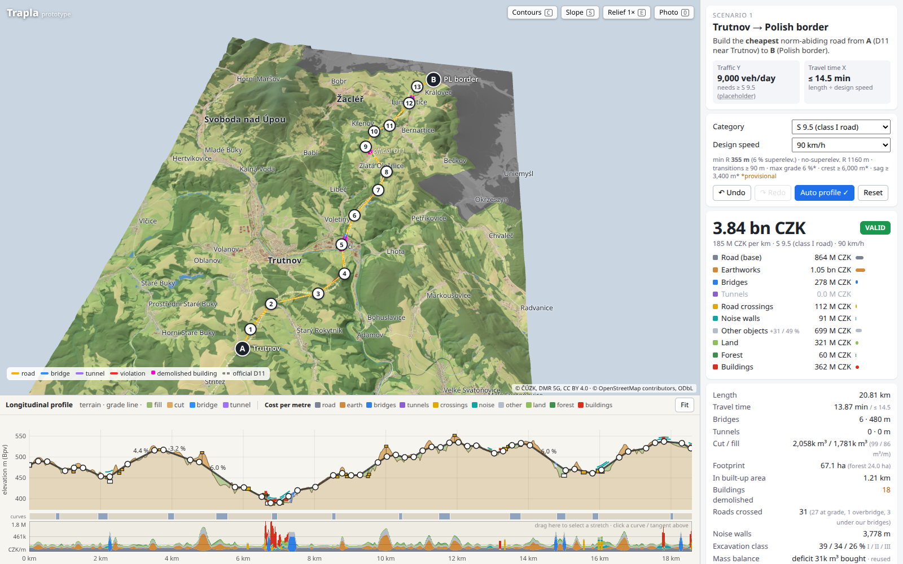
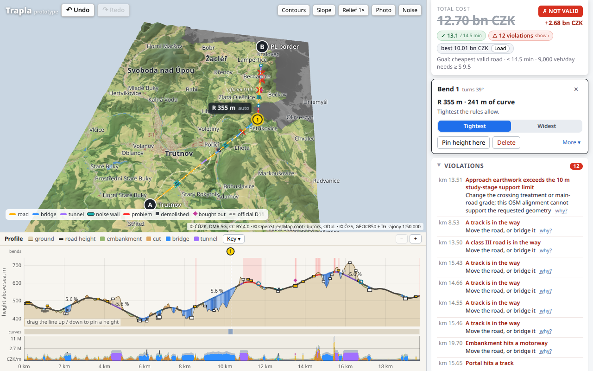
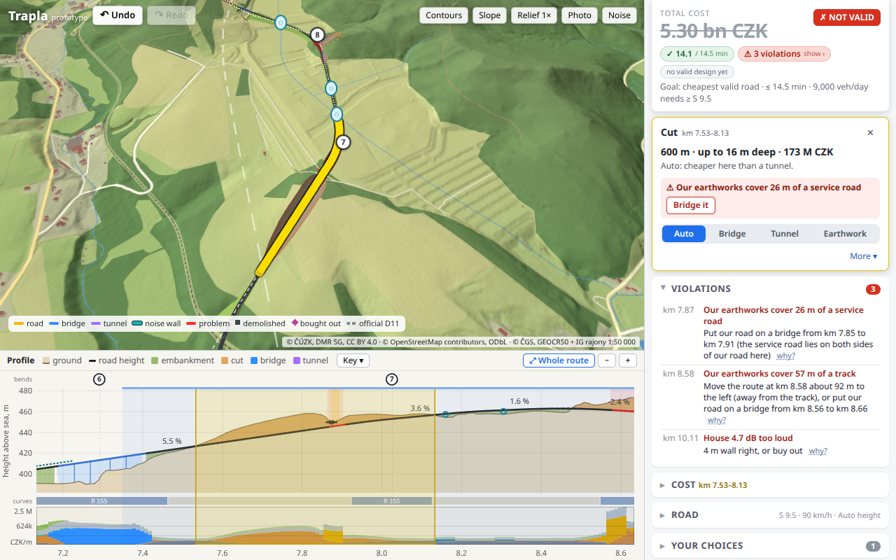
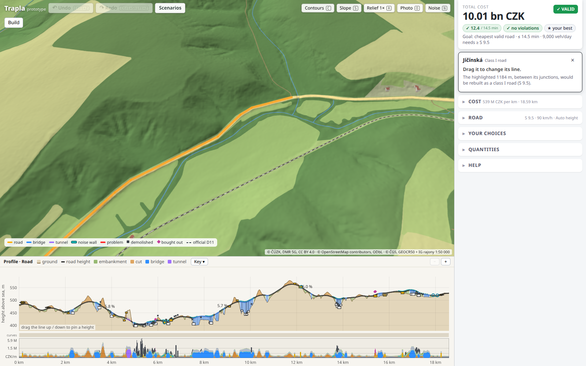
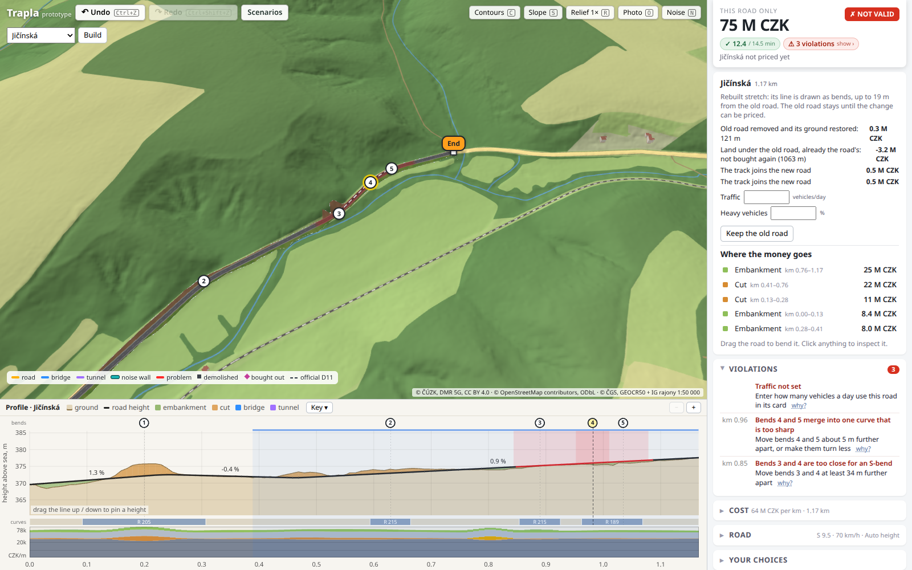
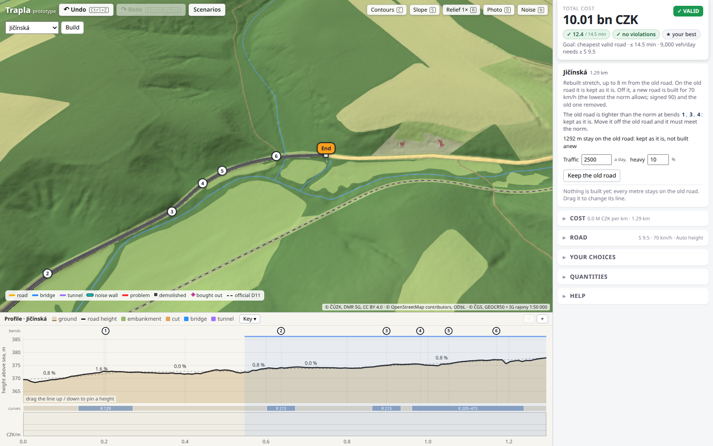
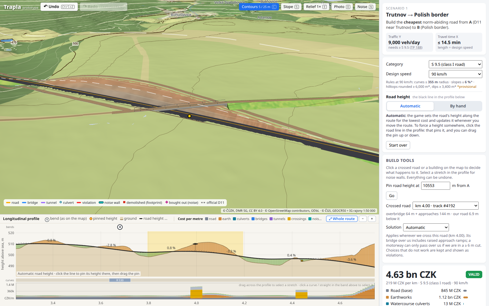
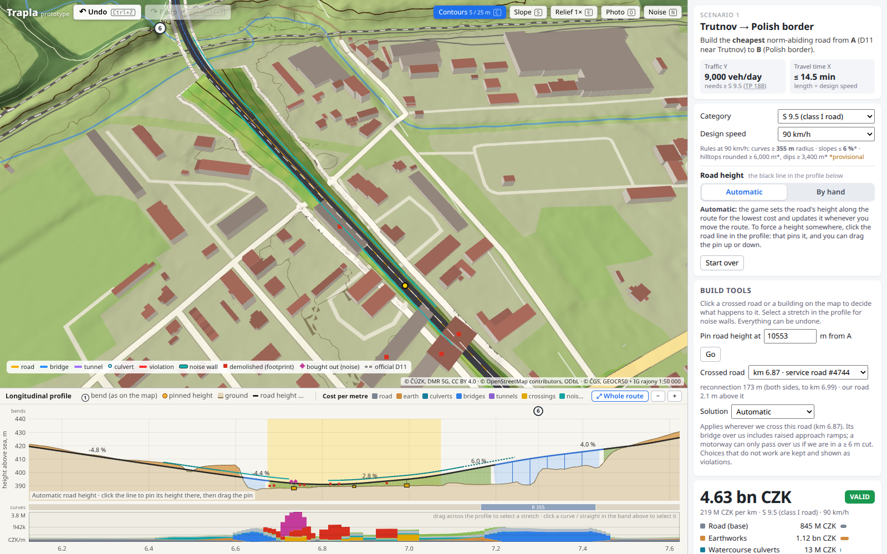

# Trapla — road design on real terrain (prototype)

Build the cheapest norm-abiding road from A to B on real Czech terrain, within a travel-time target
and for a given traffic. Scenario #1: Trutnov → Polish border (the D11 corridor).
Background, data sources and decisions: `PLAN.md`, `research/00-feasibility-map.md`, `research/07`–`11` (prices, geology and noise).



| close-up (vector map layers, extruded buildings) | contours + elevation labels | aerial photo + contours |
|---|---|---|
|  |  |  |

More in `docs/screenshots/` (cost of a selected stretch, town, forest edge, deep cut, slope tint, 2× relief with a noise wall,
contours over cut and fill slopes, the noise view on a town fringe and in the town centre with a buyout explained).

## Quick start

```sh
npm install
npm run data      # builds public/scenarios/d11/ (≈ 17 MB; needs uv; ~10 min on first run, ~5 min once cached)
npm run dev       # → http://localhost:5173/
```

Another scenario: `npm run data -- <id>` builds `pipeline/scenarios/<id>.json`, the app opens it with
`?scenario=<id>`, Node scripts with `SCENARIO=<id>`. How to add one (area, geology, traffic, X, validation, what is
still D11-specific): [docs/new-scenario.md](docs/new-scenario.md).

Other commands:

| command | what |
|---|---|
| `npm test` | vitest unit tests of the pure maths (geometry, earthworks, cost, auto-profile) |
| `npm run typecheck` / `npm run build` | TypeScript check / production build into `dist/` |
| `npm run bench [design.json]` | recompute timing + realism numbers in Node (default: straight line and an official-line-like design) |
| `npm run shots` | drives the app headlessly (Chromium + SwiftShader; `GPU=1 npm run shots` uses the hardware GPU via Vulkan) and writes `docs/screenshots/*.png` |
| `npm run smoke` | interaction smoke test with real mouse events (empty clicks add nothing, drag the road to add a bend, drag / delete / double-click bends, the inspector's stretch choices and keys, By hand, undo, persistence) |
| `node scripts/playtest.mjs [--docs] [--size=1280x800]` | three players' sessions with real mouse / keyboard: a first-time player (intro, harmless clicks, drag the road, where the money goes, inspect pieces), one fixing violations (fix buttons, the house cross-section, noise view) and a power user (bridge from the map, walls, keep a house, crossing, pin by dragging the line, undo / redo, Start over); a screenshot per step into `/tmp/trapla-playtest`; `--docs` writes the gallery 60–71 |
| `node scripts/any-road-scene.mjs [--gpu] [--docs]` | editing any road with the real mouse (D11 by default, `SCENARIO=d3`): select a mapped road, drag it to rebuild its stretch, one Undo, end handles, its traffic, the road list, reload, Build → Road (free end, joining our road, roundabout), priced rebuilt stretch, photo with mapped roads; `--docs` writes 100–105 |
| `npx tsx scripts/optimize.ts <speed> <iters> [start.json / official / -] [out.json] [seed]` | crude local search; fresh official-corridor or straight-line seed supported |
| `PACK=/path/to/d11 npx tsx scripts/footprint-audit.ts --straight scripts/*-design.json` | automatic footprint remedies, measured wall/road works, remaining violations and bill reconciliation; `DETAIL=1` adds individual diagnostics |
| `PACK=/path/to/d11 npx tsx scripts/eval-regression.ts` | frozen model-16 bills, validity and built geometry on either recognized data pack |
| `PACK=/path/to/d11 npx tsx scripts/repair-designs.ts --budget=400 [--write] design.json` | bounded validity-first local PI refinement; preserves controls/category/speed and writes only valid designs |
| `npx tsx scripts/town-audit.ts design.json [map.svg]` | urban/rural cost-per-km audit; optional map of mask, buildings, removals and route |
| `node scripts/layout.mjs` | layout check: the profile panel keeps its size through resizes, selections / Esc and view toggles, and follows the route's length while fitted |
| `node scripts/photo-pan.mjs [--gpu]` | aerial photo while panning: requests made, refetches on revisits, mid-pan screenshots |
| `node scripts/crossing-shots.mjs` | oblique views of all five crossing outcomes and an overbridge detail; writes screenshots 42–48 (`--before` writes to `/tmp/trapla-crossings-before`) |
| `node scripts/crossing-works-shots.mjs [--before]` | a crossing's own works close up (side roads regraded to meet a junction approach / bridge ramp, a retaining wall) and picking a reroute; screenshots 110–116 |
| `node scripts/link-shape-shots.mjs` | shaping a reroute with the mouse; screenshots 117–119 |
| `npx tsx scripts/crossing-footprint-audit.ts [--straight] [--random N] [designs…]` | rough independent screen: crossing earthworks still lying over other mapped roads |
| `npx tsx scripts/outcome-audit.ts [--straight] [--random N --seed S] [--quiet] [designs…]` | every crossing / footprint outcome with ramp, link and box lengths and costs, every violation; flags ramps > 250 m, links > 1 km and footprint / crossing violations |
| `node scripts/crossing-sanity-shots.mjs [--out dir]` | the owner-reported service-road bridge (km 8.47 fixtures) and four typical crossings with their cards open; writes `docs/screenshots/crossing-sanity/` |
| `node --max-old-space-size=2048 --import tsx scripts/crossing-audit.ts` | audits every saved design: terrain tie-ins ≤0.3 m, unsupported segment flotation ≤0.5 m, rendered road edges/side slopes, clearance and measured quantities; `--strict` also fails blocked designs |
| `node scripts/noise-view.mjs [--gpu] [--docs] [outdir]` | noise view on a town-fringe and the town-centre design: hovers a walled / bought-out dwelling and a wall, prints the tooltips; `--docs` writes `docs/screenshots/28…29-*.png` |
| `node scripts/perf.mjs [--gpu] [--photo] [--contours]` | load time and frame times while orbiting / panning / zooming |
| `node scripts/views.mjs design.json '[[x,y,dist,bearing,elev,"name",{"contours":true}],…]' [outdir]` | debug renders of arbitrary camera views (`GPU=1` as above) |

The headless scripts expect Chromium at `/usr/bin/chromium` (override with `CHROME=...`).

## How to play

One rule for the whole interface: **drag the road to bend it, click anything to inspect it.** What you click
opens one card under the score (the *inspector*) that says what it is, what the game decided and why, what it
costs, and offers the alternatives as buttons. The map and the profile always show the same selection.
Design notes, the playtest and the copy rules: [docs/interface-rethink.md](docs/interface-rethink.md).

- **Reshape a reroute:** drag the new road of a crossed road that was cut and rerouted — a bend point appears
  under the mouse and follows it, like bending our road. Drag a bend point to move it, click it for *Remove
  bend point*; *Automatic path* in the crossing's card takes the shape back. The game checks it (off our
  earthworks, not too steep, not across a motorway, railway, water or house) and prices it as drawn.
- **Bend the road:** drag the orange road on the map — a new bend appears under the mouse and follows it
  (the cursor turns into a hand over the road). Drag a numbered bend to move it; right-click it, <kbd>Del</kbd>
  or *Delete* in its card removes it. **Double-click** the ground adds a bend there (for big detours). A click
  on empty ground only deselects — nothing is ever added by a single click.
- **Inspect anything** — on the map or in the profile: the **road** (selects the piece under the mouse: a
  bridge, tunnel, cut or embankment), a **bend**, a **house**, a **crossed road** (anything its crossing built
  counts: the rebuilt stretch, its ramps, a new road it was rerouted onto, a turning head, a side road raised
  to meet it), a **noise wall**, a pinned height. Drag sideways across the profile for **any stretch**. <kbd>Esc</kbd> or ✕ deselects. With nothing
  selected the card lists **where the money goes** — the five most expensive pieces, each a link.
- **The inspector:** header (what and where), one status line (numbers first, and the reason in a few words:
  *Auto: cheaper here than a bridge*), any **problems with their fix as a button** (*4 m wall right*,
  *Buy out*, *Bridge it*, *Back to Auto*), then the choices, Auto first:
  - piece / stretch: **Auto · Bridge · Tunnel · Earthwork** (keys <kbd>A</kbd> <kbd>B</kbd> <kbd>T</kbd>
    <kbd>E</kbd>) and, where houses are near, **noise walls** per side: Auto · None · 3–6 m. *More ▾*
    (remembered) adds walls elsewhere, a typed road height to pin, and the stretch's bill by component;
  - bend: **Tightest · Widest** curve; *More ▾*: radius field / slider; *Pin height here*, *Delete*. The ◇ grips
    on the map and <kbd>+</kbd> / <kbd>−</kbd> change the radius too;
  - crossed road: **Auto · Junction · Bridge over it · It bridges us · Close + link · Underpass**, ‹ › step
    along the crossed roads; a choice applies wherever we cross that road;
  - house: **Auto · Buy out · Keep**, the wall on its side, a **plan** (our road with travel left → right,
    its walls and side roads, a line from every km where the house is over the limit before walls: red = still
    too loud from there, grey = stopped; one sentence says where the loudest comes from — past the wall's end,
    through a junction's gap, over a too-low wall) and a **cross-section** along that loudest line: our road and
    its noise source, the wall or cut edge, the house floor by floor in its own noise colour with each floor's
    level (and what it was without the wall), the sightline and the wall's shadow. Hovering a wall height redraws
    both ([a house that hears the road through a junction's gap](docs/screenshots/72-house-noise-plan-junction-gap.png)).
  - pinned height (Auto) / height point (By hand): its height, typed or dragged, *Unpin* / *Delete*.
- **The score** (top right, sticky): total cost (struck through while not valid), ✓ VALID / ✗ NOT VALID, **the
  change the last edit made** (a drag counts once), travel time against the goal, the violations chip (click:
  selects the first one), your best valid design (*Load*; a position half-way through a drag never counts) and
  the goal in one line. Below the inspector: **Violations** (only while there are any; a click selects the thing
  and flies there), then folded: **Cost** (breakdown, of the selection while one is selected), **Road**
  (category, design speed, road height Auto / By hand, *Start over*), **Your choices** (every decision as a link,
  plus all crossed roads), **Quantities**, **Help**. Everything can be undone: Undo / Redo over the map,
  <kbd>Ctrl+Z</kbd> / <kbd>Ctrl+Shift+Z</kbd>; *Start over* and *Load* offer Undo in a toast.
- **The profile** (bottom) is the side view with the same verbs: click = select the piece there (the map flies
  to it if it is off screen), drag sideways = select a stretch, click a curve / straight in the band under the
  chart = select it, **drag the black road line up / down = pin the road height there** (Auto; the finished
  road passes within ±0.5 m of every pin, an unreachable pin is a violation with a suggested height), drag a
  pin to change it. Wheel = zoom, right-drag = scroll, **−** / **+** / *Whole route*. Its tooltip is three short
  lines and stays inside the profile. Numbered bends sit above the chart, hover-linked with the map; hovering
  the road on the map marks the spot here; when the map is zoomed in, a light blue window shows which part of
  the route it is looking at. **Key ▾** explains every mark.
- **Road height: Auto | By hand** (the *Road* section): Auto sets the cheapest legal heights and redoes them after
  every change (an approximate search); pins steer it. By hand starts from the current heights as **◆ points**:
  drag one, double-click the line to add one, right-click to delete. Back to Auto replaces them (Undo brings them
  back).
- **Map:** left-drag pans, right-drag rotates, the wheel or a trackpad pinch zooms about the cursor. View buttons
  (remembered): **Contours** <kbd>C</kbd> (interval follows the zoom), **Slope** <kbd>S</kbd> (yellow 8 %, orange
  15 %, red 25 %, purple 40 %), **Relief** <kbd>R</kbd> (1–3× vertical exaggeration), **Photo** <kbd>O</kbd> (aerial
  photo, needs a network connection), **Noise** <kbd>N</kbd>. Keys are accelerators only; every action has a button.
- **First run:** three steps at the top left of the map (drag the road, click anything, the cost counts once
  valid); *Got it*, <kbd>Esc</kbd> or the first click dismiss it; *Help → Show the intro* brings it back.
- **Colours** are the same on the map, in the profile and in the cards: road orange, bridge blue, tunnel purple,
  noise wall teal, problems red, demolished buildings dark grey squares, bought-out magenta diamonds, kept
  green. On the map these are symbols for the zoomed-out view (from 2.5 m per pixel, where the road is a few
  pixels wide) and for a road being dragged; closer, the road is drawn as built: asphalt with white Czech
  markings, noise walls as panels between posts, tunnels as a purple dashed trace on the ground, problem
  stretches tinted red. The tangent lines of a bend show only while it is dragged, hovered or selected. The
  official line is a dark dashed pencil line with its label riding along it. Noise uses one ramp everywhere (pale → yellow at the limit → red).
- **Noise view** <kbd>N</kbd>: the band along the road shows the night level (the controlling period for the
  scenario traffic) **at the height that decides walls and buyouts — the top floor of the tallest house beside
  each 30 m station and side** (1.5 m where there is none), continuously shaded with one dark line on the limit,
  computed in the worker by the same calculator as the bill with the built walls and cut edges. Every house is
  coloured by **its own** worst level on the same ramp; bought-out houses magenta, demolished ones are gone. The
  band and the houses now use the same height, so they agree beside the road (the band is per station, a house
  takes its worst station), and raising a wall visibly cools the band where its shadow reaches the top floors. Hover a house for its level, click it for the cross-section.

### Model notes

- High fills/cuts include benches and a separately visible **provisional engineering reserve**, independent
  of free cut material. Excess stream-culvert length is billed beyond ordinary norm drainage. This moves the
  flat S9.5 bridge break-even from ~26.9 to ~16.6 m at the default material value, not a legal height cap;
  see `research/15-bridge-vs-embankment.md`.
- **Your bridge / tunnel / earthwork** choices affect the automatic road height, show as "your bridge" etc. on
  profile and map, and stay at their km position when you reroute; choose again on any part to change or erase
  that part. Impossible choices (too low a bridge, too little tunnel cover, too short) stay as made and show as
  violations.
- **Crossed roads:** the choice follows the existing road's pack ID, including every intersection of that way.
  Our bridge overrides overlapping structure paint locally; Auto seeks its clearance. Ordinary-road
  overbridges use the same priced raised approaches as Auto; fixed-level motorways/expressways require our road
  in a ≥6 m cut. Unsafe choices remain built, priced and invalid rather than silently replaced. Crossed roads
  retain their OSM alignment. Overbridges have a 1.2 m deck, ≥4.8 m clearance over our crown, abutments,
  railings and terrain-ended approaches; ramps climb at the crossed road's class gradient (track 10 %, service
  9 %, streets 8 %, class III 7 %, I/II 6 %, research/20). Junction roads ramp to our grade; roads under our bridges remain on
  the ground. Reconnection/diversion links run outside our footprint with turning heads and meet real road
  anchors. Quantities are measured from the displayed geometry. These remain study-stage roads; missing OSM
  connections and infeasible approaches are reported, never invented.
- Through-road junctions keep **1.5 km spacing**, including A/B tie-ins (also in town: a scenario assumption).
  Reconnection reach uses **750 m as an economic preference** and up to **2 km along the route** as a limit;
  bills use actual built link lengths. Dead-end remnants within the connection working strip are consumed.
- Cut quantities use ČGS GEOCR50 / engineering-geological rajons on a 25 m ground grid; the HUD shows class
  I/II/III shares. Mapped lithology is real, vertical weathering profiles are provisional — not borehole
  measurements. Permian/Carboniferous profiles are calibrated to D11 1109 reported excavation quantities
  (official-line surrogate 42.6/18.0/39.4 % I/II/III). Unmapped ground uses the norm's 75/20/5 mix; see
  `research/10-geology-excavation.md`.
- **Buildings:** an explicit buyout works even away from the road; off-corridor acquisitions include a
  provisional whole-plot allowance, footprint acquisitions are billed once with corridor land. **Keep** forbids
  both demolition and noise buyout: a footprint/working-strip hit or remaining noise becomes a violation. Building
  and road IDs are scoped to the scenario object-pack fingerprint: a changed pack clears those choices with a
  notice, keeping station-based edits.
- **Walls:** player walls keep their exact extent (no automatic end margins); tunnels suppress walls. Teal walls
  show the actual height, dotted marks your choice, pink dashes removals. **Any wall decision of yours at an
  exposed house stops its automatic buyout**: remaining noise becomes a violation with a sufficient wall height
  and extent (a fix button) or a buyout. Clearing the decisions restores automatic 3/4/5 m walls and the
  fallback buyout; **Keep** still forbids acquisition.
- Noise is a **provisional feasibility model**, not an acoustic assessment: façade distance and top occupied
  floor feed a geometric source–wall–receiver diffraction check. Distant upper floors can be shadowed; floors
  with a clear sightline over the wall get no benefit. Assumptions and limitations are in `PLAN.md`.

### Playtest gallery

Three players' sessions at 1280 × 800 with real mouse events (`node scripts/playtest.mjs --docs`; personas and
checks in [docs/interface-rethink.md](docs/interface-rethink.md)):

| First run: the intro leaves the route visible, the card says where the money goes | Drag the road: a bend, and what it changed |
|---|---|
|  |  |
| A violation: the thing is selected, the fix is a button | The house's cross-section, after the one-click fix |
|  |  |
| Click the embankment on the map, then Bridge | Walls on a stretch, per side |
|  |  |

Also: [the most expensive piece](docs/screenshots/62-playtest-money.png),
[a piece clicked in the profile](docs/screenshots/63-playtest-piece.png),
[noise view](docs/screenshots/66-playtest-noise-view.png),
[a crossed road](docs/screenshots/69-playtest-crossing.png),
[a pinned height](docs/screenshots/70-playtest-pin.png),
[the reference design](docs/screenshots/71-playtest-overview.png).
Before the rethink: [docs/screenshots/rethink-before](docs/screenshots/rethink-before).

### Scenarios

Pick a place on the start screen: [the four scenarios](docs/screenshots/73-scenario-picker.png),
[Posázaví across the Sázava](docs/screenshots/74-d3-posazavi.png),
[D35 first stage, Opatovec → Staré Město](docs/screenshots/75-d35-opatovec-stare-mesto.png),
[Nová Paka bypass](docs/screenshots/76-nova-paka.png),
[its end joining the retained roundabout](docs/screenshots/77-nova-paka-roundabout-junction.png),
[the aerial photo showing the real bypass under construction](docs/screenshots/78-nova-paka-photo.png).
See `docs/new-scenario.md`.

### Motorway (cost model 20)

Two motorway places on the start screen ([picker](docs/screenshots/130-motorway-picker.png)): both directions
are designed together as one D 27.5 corridor ([D3 overview](docs/screenshots/131-motorway-overview.png)),
drawn as [two carriageways with a grass median and barrier](docs/screenshots/132-motorway-carriageways.png),
[twin bridge decks on their own piers](docs/screenshots/133-motorway-twin-bridge.png) and
[one portal per tunnel tube](docs/screenshots/134-motorway-twin-tunnel.png). "Edit: Towards …" (in the
Motorway card) splits the directions; [one direction bent on its own](docs/screenshots/135-motorway-split.png)
keeps its height points on their ground and runs as one body with the other wherever they still meet.
"Both directions" joins them again. Reproduce with `node scripts/motorway-shots.mjs d3 --docs 130`.

### Railway (cost model 21)

"Railway: Trutnov → Královec" starts and ends on the rail network: at Trutnov hlavní nádraží and at Královec,
the last station before the Polish border, on today's single-track, non-electrified line (passenger trains
run on to Lubawka; 26 min with four stops in the 2022 timetable). No upgrade of it has been announced
(research/36): the card says it is a game proposal. A single-track electric line at up to 120 km/h, slopes
≤ 12.5 ‰ (‰ in the profile), no level crossings, CNOSSOS train noise. The new line joins the old track in both
stations and rebuilds it where it runs along it; elsewhere the old line stays. The first railway card (between
the motorway's ends) is retired; its saves still load (`?scenario=d11&preset=d11-railway`).
[Overview](docs/screenshots/136-railway-overview.png), [out of Trutnov in a cut to the first tunnel](docs/screenshots/137-railway-trutnov.png),
[the viaduct over Poříčí](docs/screenshots/138-railway-bridge.png), [joining the old line at Královec](docs/screenshots/139-railway-kralovec.png)
(`node scripts/railway-shots.mjs --docs 136`; played end to end with `node scripts/mode-play.mjs --gpu`).

Build → Motorway makes both directions of a D 27.5 between two points of open ground (shown, not priced: the
game has no interchanges). Build → Railway ends on a mapped railway or open ground. A mapped railway can be
rebuilt by dragging it like a road: the dragged stretch becomes an editable single-track railway that takes
up its old track (taking it up is not priced yet).

### Editing any road

Any mapped road behaves like our road: click it (its stretch between junctions is highlighted), then drag it
to rebuild that stretch, bent under the pointer, with its profile and price. **Build → Road** places a new
road from a click to a click; an end on a road joins it with a junction (Auto: a T, or a roundabout).
See [docs/any-road-editing.md](docs/any-road-editing.md).

| A mapped road selected: drag it to change its line | The stretch rebuilt: its bends follow the old road |
|---|---|
|  |  |
| Priced: old road removed, its land not bought again, side roads reconnected | A side road joining our road at a roundabout |
|  |  |

Also: [a new road with a free end](docs/screenshots/102-new-road-built.png), [the photo with the mapped
roads](docs/screenshots/103-photo-mapped-roads.png); the earlier foundation views 79–83 are in `docs/multi-road-ux.md`.

### Physical crossings

| Overbridge: deck, abutments and embankments | Ground-level reconnection |
|---|---|
|  |  |

[Overbridge approaches](docs/screenshots/42-crossing-overbridge.png),
[existing road under our bridge](docs/screenshots/43-crossing-bridge.png),
[track diversion](docs/screenshots/45-crossing-diversion.png),
[at-grade junction](docs/screenshots/46-crossing-junction.png).
[Junction detail, with noise-wall openings](docs/screenshots/48-crossing-junction-detail.png).

Model 19: a crossing's own earthworks leave other roads usable. A street joining a raised junction approach is
raised to meet it instead of being buried under its slope:

| Before (street under the slope) | After (street regraded to meet the junction) |
|---|---|
|  |  |

[Ramp to a track bridge over us, before](docs/screenshots/112-crossing-works-before-ramp-wall.png) /
[after: the side street regraded, a retaining wall at the corner](docs/screenshots/113-crossing-works-after-ramp-wall.png);
[demo junction, before](docs/screenshots/114-crossing-works-before-junction-street-tie-demo.png) /
[after](docs/screenshots/115-crossing-works-after-junction-street-tie-demo.png);
[a click on a reroute far from the crossing opens its card](docs/screenshots/116-crossing-pick-link.png).
(`node scripts/crossing-works-shots.mjs`, `--before` on the older code.)

Shaping a reroute by dragging it (`node scripts/link-shape-shots.mjs`):
[the drag](docs/screenshots/117-link-shape-drag.png) (the first drag starts from the automatic path's own bends),
[the rebuilt road with its bend points and "Automatic path"](docs/screenshots/118-link-shape-built.png),
[a bend point dragged onto our earthworks: the problem, with the way back](docs/screenshots/119-link-shape-rejected.png).
Model-18 crossing sanity pass (plain-words card, class-gradient ramps): [service road carried over our road,
km 8.46](docs/screenshots/crossing-sanity/km846-service-loop.png), [track bridge, best km 3.69 (ramps 382 → 124 m)](docs/screenshots/crossing-sanity/best-km369-track-overbridge.png),
[street bridge, direct-80 km 15.97 (421 → 170 m)](docs/screenshots/crossing-sanity/direct80-km1597-street-overbridge.png),
[service reconnection, best km 7.96 (1.6 km → 461 m)](docs/screenshots/crossing-sanity/best-km796-service-reconnection.png).
Reproduce with `node scripts/crossing-shots.mjs`. Geometry and terrain collars rebuild on evaluation,
not on animation frames; the collars connect the true-height road to the coarser overview terrain mesh.
Junctions join the existing engineered formation without cutting through our carriageway; noise-wall
openings use the same masks for rendering, billing and acoustic checks. The existing worst-station noise
model treats these openings conservatively (including automatic buyouts or Keep violations); finite-opening
leakage and return-wall design are not modelled. Auto tries bounded, real-road
alternatives when a provisional crossing is infeasible. Approach fill/cut beyond 10 m is flagged for
redesign rather than presented as a normal local road. The 1.2 m decks and abutments remain study-stage
representations, not structural designs for long spans.

## Contributing notes

- **Player-facing text is plain words.** Every violation (title, one concrete fix, why, basis tag), crossing
  card label and tooltip, profile tooltip and bill line uses the vocabulary in `src/core/terms.ts`.
  `tests/player-text.test.ts` generates every violation kind and outcome and fails on internal terms (price-list
  codes, "tie-in", "realignment", "engineering", "faces", "allowance", "overbridge", …) or a missing
  title / fix / basis / rule. A new feature adds its outcome words to `terms.ts`; sources (ČSN, SPK, OTSKP,
  research notes) go only in the `rule` line or pricing tooltips.
- Price or rule changes bump `COST_MODEL_VERSION` and recapture fixtures with
  `npx tsx scripts/eval-regression.ts --capture=current --reviewed-model-change` after review.
- `npx tsx scripts/outcome-audit.ts --straight scripts/*-design.json --random 24` lists every crossing and
  footprint outcome with ramp / link / box lengths and costs and flags absurd ones.

## Architecture

```
pipeline/build_pack.py  offline: DMR 5G + OSM + ČGS geology + official line → public/scenarios/<id>/,
                        configured by pipeline/scenarios/<id>.json (d11 = Trutnov → border)
pipeline/geology.py     cached ArcGIS queries → 25 m ground grid; estimated profiles in ground_profiles.json
src/core/               pure, tested modules (no DOM)
  data/                 categories, norms, prices, scenario — all numbers live here, with source notes
  terrain.ts, ground.ts  5 m heights (bilinear), land cover, OOB mask, categorical ground/weathering profiles
  horizontal.ts         tangents + circular arcs, transition room, stationing
  vertical.ts           road height (grade line), parabolic vertical curves
  autoprofile.ts        Automatic road height: DP over knots every ~250 m; state = elevation × incoming grade
  sections.ts           cross-sections (crown + cut/fill slopes to daylight) against the terrain
  structures.ts         bridge / tunnel choice per station, gap merging, run-level cost check
  earthworks.ts         average-end-area volumes, mass haul with one balance line
  cost.ts, checks.ts    cost roll-up; norm checks as per-family functions (roads now)
  evaluate.ts           the whole recompute path design → result
src/worker.ts           runs evaluate() off the main thread, latest request only
src/render/             three.js view
  view.ts               scene, camera, route ribbon, markers, heightfield picking
  extras.ts             range highlight, noise walls (+ far-zoom symbols, hover targets)
  noise.ts              noise view: footprint band, dwelling colours, wall labels, legend, hover details
  heightTexture.ts      the 5 m height grid as a filterable GPU texture (RG16F + hand-built mipmaps)
  terrainMaterial.ts    terrain shader: relief shading, hypsometric tint, contours, slope tint, OOB hatch
  landcover.ts          land cover / roads / rails / water / footprints rasterised from vectors into
                        camera-centred clip levels (and the optional orthophoto)
  buildings.ts          extruded buildings, merged per chunk
  contourLabels.ts      elevation labels on major contours
  vectorPack.ts         decoder of vector.bin.gz
src/ui/                 HUD, profile panel (+ floating stretch / pin bar), Undo/Redo bar, view options bar
```

### How the terrain is drawn

Nothing is baked at the 5 m grid any more; close-ups are as sharp as the overview.

- **Relief**: the height grid is a GPU texture. The terrain shader takes the gradient per pixel (step = half a
  cell close up, the pixel footprint when zoomed out), shades it from four light directions and adds the
  hypsometric tint. The mesh itself stays at 20 m (1 M vertices); the shading carries the 5 m detail.
- **Contours and slope tint** come from the same height and gradient: line width is constant in screen pixels
  (distance to the contour = elevation difference ÷ elevation change per pixel), lines fade where they would be
  closer than ~4–9 px, are dark on light ground and light on forest, and are not drawn out of bounds.
  The road's cut and fill slopes carry the same lines (one shared GLSL function, fed with the slope's true
  elevation, so they join the terrain's at the daylight line at any relief exaggeration); the carriageway shows
  them faintly, structures not at all. The slope tint stays on the natural ground: designed slopes (1:1.5–1:2)
  would all be purple and lose the cut / fill colours.
- **Earthworks** (the route ribbon's cut and fill slopes and carriageway) use the terrain's relief lighting —
  same four lights, same strength (also in photo mode), normals of the exaggerated surface — so slopes facing
  away from the light darken and the form reads when the camera tilts. The slopes carry a procedural
  world-space texture (value noise in metres, each octave faded out once a pixel covers it, so it is stable
  at any zoom): cuts are brown soil with erosion rills down the fall line, turning ochre-grey and banded
  (strata) where they reach the ground model's estimated class II / III rock (depth below the original
  ground, per station; unmapped ground shows soil only); fills are topsoiled and seeded embankments,
  mottled green-yellow grass. `node scripts/earthworks.mjs [design.json] [outdir]`
  renders the deepest cut and the highest embankment with contours at 1× and 2× relief
  (`docs/screenshots/24…27-*.png`).
- **Carriageway** (same material, `ewKind` road): the category's cross-section from MD VL 1 (2022) sheets
  12-04…06 — lanes, hard shoulders, 0.5 m gravel verge (concrete edge beam on bridges) — and TP 133 markings:
  V 4 edge lines on the inner edge of the guide strip (0.25 m, 0.125 m where the hard shoulder is ≤ 0.5 m) and
  the V 2a centre line, 3 m dash / 6 m gap, 0.125 m (solid lines need sight distances, not modelled). Drawn
  in the shader from per-vertex offset and station, box-filtered over the pixel, so no geometry per mark.
  **Noise walls** stand where they are billed (line, foot on the slope, top): wood-cement absorber panels on
  a concrete plinth between steel posts on a 4 m module (instanced), as in the M-S system; on a bridge on the
  deck's edge beam. **Bridge ends set into a bank** (natural ground still above the deck at the first
  stations) are drawn as the abutment (`groundStations`): the terrain is cut away there too, the sides are
  concrete wing walls out to the engine's daylight points and the front wall under the crown is concrete,
  so the bank no longer covers the deck. Before / after: `docs/screenshots/84…91-road-look-*.png`, the bend
  guide `92`, the official line `93`, a bridge end in a bank `94`/`95` and in a cut `96`
  (`node scripts/road-look-shots.mjs design.json outdir [prefix]`).
- **Land cover, existing roads, railways, water, building footprints** are vectors (`vector.bin.gz`), rasterised
  on the GPU with 4× MSAA into one base texture of the whole area (≈ 8.5 m/texel, drawn once) and four 2048²
  *clip levels* around the camera focus at 0.125 … 4 m/texel, each twice as coarse as the previous. The levels
  are toroidal: when the focus leaves the middle of a window, the window moves and only the strips it uncovers
  are drawn (at most one level per frame); a zoom by an octave redraws one level. Orbiting costs nothing and
  panning / zooming redraws a little now and then (≈ 1–2 ms on a laptop GPU). Roads keep their real width with a minimum width in texels, so they stay visible from afar.
- **Buildings** (26,660) are flat-roofed boxes extruded from the OSM footprints with heights from
  `height` / `building:levels` or a guess by type and area, merged into ≈ 60 meshes; chunks beyond 7 km are
  hidden (the footprints in the land-cover texture have the roof colour).
- **Photo**: with <kbd>O</kbd> the clip levels hold 512 px JPEG tiles of a fixed grid per level from ČÚZK's
  public Ortofoto ČR view service (ArcGIS `MapServer/export`, EPSG:5514, CORS enabled; up to 6 requests at a
  time, nearest the focus first, 20 s time-out) and the base texture one photo of the whole area. Photo already
  drawn stays while panning; tiles are kept in memory (64 decoded on the GPU, 64 MB of JPEG), so revisited
  ground is not fetched again (the service sends `max-age=0`). A tile that has not arrived is transparent: the
  coarser level shows through, ultimately the base photo or, before that arrives / offline, the map. Nothing is
  stored in the pack. `node scripts/photo-pan.mjs` pans across and back and counts the requests.
- GPU memory: height texture ≈ 85 MB, land-cover textures ≈ 110 MB, MSAA scratch target ≈ 80 MB, meshes ≈ 60 MB,
  photo tiles ≤ 64 MB.
  Needs WebGL2 and no optional extensions; on GPUs limited to 4096 px textures the height texture uses every
  second sample (try it with `?maxtex=4096`). After a lost WebGL context the GPU-only data is rebuilt.

Measured on a Radeon 890M laptop GPU (headless Chromium, 1600 × 1000, `node scripts/perf.mjs --gpu`): 2.5–5 ms
per frame while orbiting, panning and zooming through all levels (worst frame ≈ 25–30 ms), with or without
contours and photo; the same before this renderer was 2.2–3.7 ms. Load to first result ≈ 0.9–1.1 s on
localhost (was ≈ 0.55 s: the height texture, vector geometry and buildings are built at start-up, ≈ 0.3 s).
Dragging a bend (recompute ≈ 13 ms in the worker, then `View.setResult` ≈ 5 ms incl. the footprint mask, profile
and HUD): frames stay at 17 ms median, 23 ms p95. Replaced route materials are disposed one frame late
(`View.retire`) — three.js deletes a shader program with its last material, and recompiling them on every edit
used to cost ≈ 15 ms.

Recompute for a ~21 km route takes ≈ 40 ms in Node (≈ 30 ms of it the auto-profile DP); ≈ 100 ms in the
headless SwiftShader browser where the CPU is shared with software WebGL.

## Scenario pack format (`public/scenarios/d11/`, generated, not committed)

| file | content |
|---|---|
| `meta.json` | grid (3500 × 4500 at 5 m, row 0 = north), origin in EPSG:5514, A/B, official line, attribution, `vector` file, `orthophoto` service (export URL, CRS, attribution) |
| `height.i16.gz` | gzip of row-wise int16 deltas of uint16 heights; h = base + q · 0.1 m (display-filled where no data) |
| `landcover.u8.gz` | gzip uint8 per cell: bits 0–2 class (0 none, 1 forest, 2 water/river, 3 building, 4 road, 5 urban, 6 rail, 7 stream); bit 3 built-up area; bit 5 river/water crossing, bit 6 railway crossing (must-bridge masks); bit 7 out of bounds |
| `ground.u8.gz` | gzip uint8 profile IDs, 700 × 900 at 25 m, row 0 north; `meta.ground` supplies dimensions, profile names, estimated class-I/II bottom depths and attribution; ID 0 = unmapped, norm 75/20/5 mix |
| `watercourses.json.gz` | independent OSM reaches with kind/width, densified local xy, upstream km² and truncation flags from burned 25 m D8; `meta.watercourses` gives file/version/method/SHA256; feeds provisional Q100 sizing, not certified hydrology |
| `overlays.json` | building centroids + radius, `binfo` (area, levels, kind, oriented rectangle per building), place names, main roads, `net` (existing road network for crossings) |
| `vector.bin.gz` | render-only vectors (`pipeline/vectors.py`, format described there): land-cover polygons dissolved per class and triangulated (forest, water, urban, farmland, grass), polylines (roads by class, tracks, railways, rivers, streams; waterways and rails smoothed), building rings + roof triangles + heights; local metres, split into 2.5 km chunks |

Game coordinates are local metres: `x = X_5514 − origin.x` (east), `y = Y_5514 − origin.y` (north).
The play area is the axis-aligned EPSG:5514 rectangle x ∈ [−637 500, −620 000], y ∈ [−1 011 500, −989 000]
(≈ 50.50–50.70 N, 15.82–16.06 E). Terrain is fetched in five 3500 × 900 px requests from the ČÚZK DMR 5G
ImageServer (raw responses cached in `pipeline/cache/`); OSM via Overpass (cached likewise; `osm_cover2` holds
render-only extras: fields, meadows, parks; tracks and service roads come from `osm_roads2`, which the crossings use too). The engine reads only
`height`, `landcover`, `ground`, `watercourses` and `overlays.json`; `vector.bin.gz` and the orthophoto are for display.
ČGS GEOCR50 and IG rajony 1:50k polygons are queried by EPSG:5514 envelope and object-ID pagination,
with cached pages and polite pauses. The 25 m raster does not imply 25 m survey accuracy. Older packs
without `meta.ground` use the explicitly labelled norm mix; run `npm run data` for geology-aware costs.
Pipeline geometry/cache tests: `uv run --with numpy --with shapely python -m unittest discover -s pipeline -p 'test_*.py'`.

## Data attribution

- Terrain: © ČÚZK, DMR 5G, CC BY 4.0.
- Overlays, vector map layers, buildings and the official D11 line: © OpenStreetMap contributors, ODbL.
- Aerial photo (optional view layer, streamed, not redistributed): © ČÚZK, Ortofoto ČR, CC BY 4.0.
- Prices: SFDI SPK CN 2026 and OTSKP 2026 (see `research/00-feasibility-map.md` §3); property, land, crossings, noise
  walls and purchased fill per `research/07-property-land.md`, `08-junctions-crossings.md`,
  `09-noise-earthworks-urban.md` (sources and confidence there; research-informed estimates / provisional
  allowances are marked in `src/core/data/`). Research market/contract examples are not escalated to 2026.
  Building values exclude land; noise buyouts add a provisional plot allowance. Crossings also use
  `research/12-csn-norm-values.md` §2 and `13-crossing-items-tenders.md`: SPK unit prices are sourced,
  link/ramp geometry remains a study-stage heuristic. Noise uses Czech Manuál 2018/2020 vehicle emissions,
  TP219 day/night traffic and an EIA-calibrated hard-ground class, with approximate terrain/barrier geometry
  (`research/11-noise-calculation.md`; EIA comparison limitations are explicit). See `PLAN.md` for model-9
  comparisons, junction spacing, raw-crossing clearance and geometric wall/cut screening.

## Long curves and radius handles (horizontal editing)


- **Bends are corners of the tangent polygon, not waypoints**: the road cuts each corner with a circular arc. The
  two tangent lines through a bend are drawn (dashed) while it is dragged, hovered or selected.
- **One bend, long curve**: select a bend and drag one of the two diamond grips along its leg, or press
  <kbd>+</kbd> / <kbd>−</kbd> (or type it in the bend card). The radius is shown next to the curve;
  **max** sets the largest radius that fits between the neighbours, **auto** returns to the smallest the rules allow.
  The HUD radius field shows the same value; a drag or a burst of <kbd>+</kbd> / <kbd>−</kbd> steps is one undo step.
- **Several bends, long curve**: bends that turn the same way and are too close for a straight between them are
  joined into one compound curve automatically (the label says "one curve with bends …"). Uneven spacing is fine: the
  solver keeps the minimum radius and a radius ratio ≤ 2 between neighbouring arcs, moving the arc junctions off the
  dashed legs by up to 5 m if it has to. A bend that turns against its neighbour where no S-curve fits, and lies
  within 5 m of the straight line between its neighbours, is left out of the tangent polygon and labelled so.
- Rules (ČSN 73 6101 via the VUT text "Aplikace ČSN 73 6101"; table in `src/core/data/norms.ts`, details in `PLAN.md`):
  no transition needed from R ≥ L²/6 (1,350 / 1,067 / 817 m at 90 / 80 / 70 km/h); opposite curves may touch with
  their transitions, plain arcs need a 2·vn straight between them; every horizontal violation names the bends, the
  room required and available, and a fix.
- In the profile's curve band a compound curve is one stretch (labelled with its range of radii): a click selects
  the whole curve for the cost breakdown. Bends left out have no stretch of their own.
- `npm run curves` replays this with real mouse events (multi-point curve, curve band, grips, keys, max, auto,
  undo, relief 1–3× with contours / photo). The bends it uses are derived from `scripts/demo-design.json` (the
  25–50° bend with the longest legs becomes six points on its tangent circle; the radius handles go on the ≥ 30°
  turn with the longest legs). Screenshots go to `/tmp/trapla-curves`; `--docs` writes `docs/screenshots/18…23-*.png`
  (the committed ones predate the current demo design; `17-long-curve-before.png` is that design on older rules).
