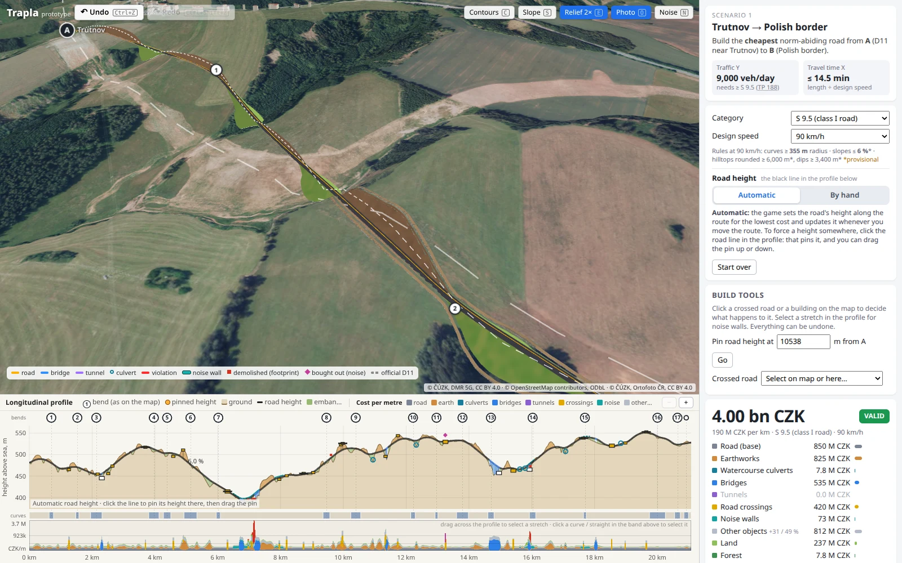
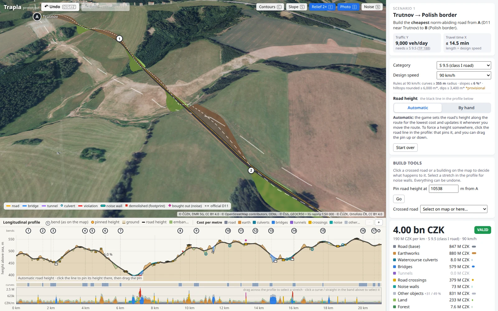
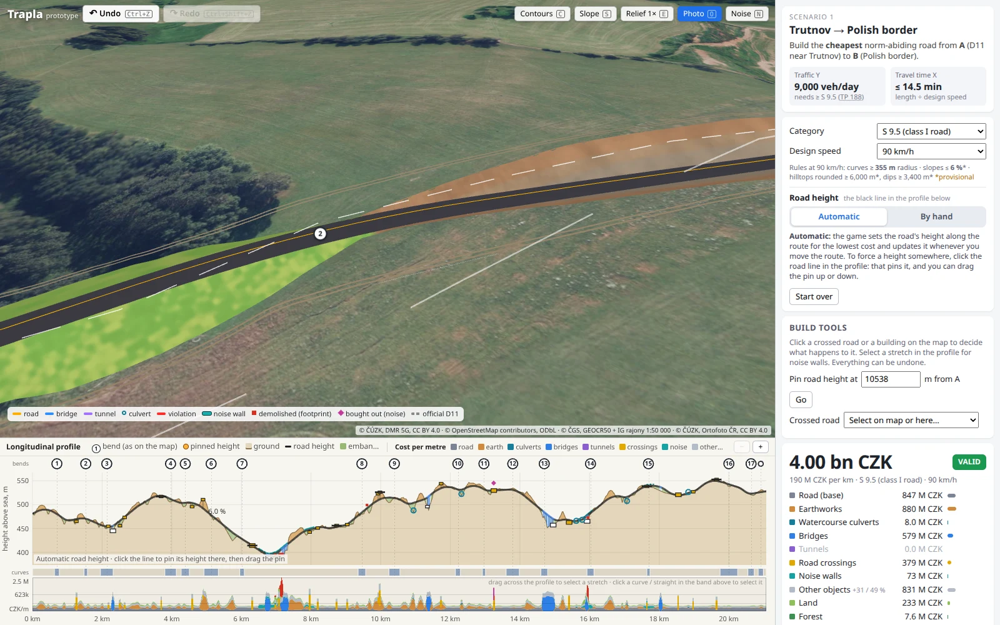
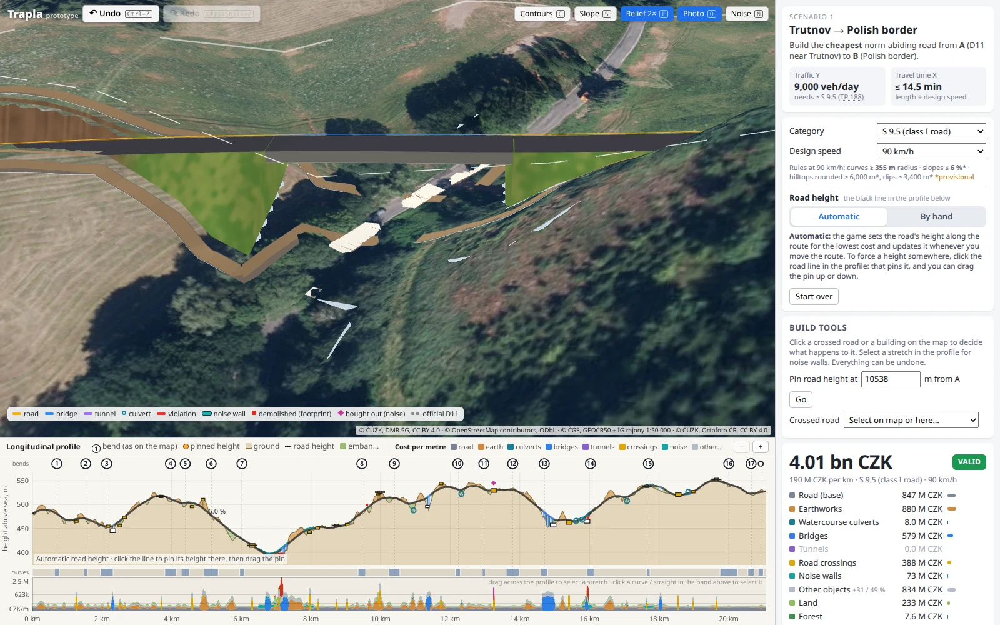
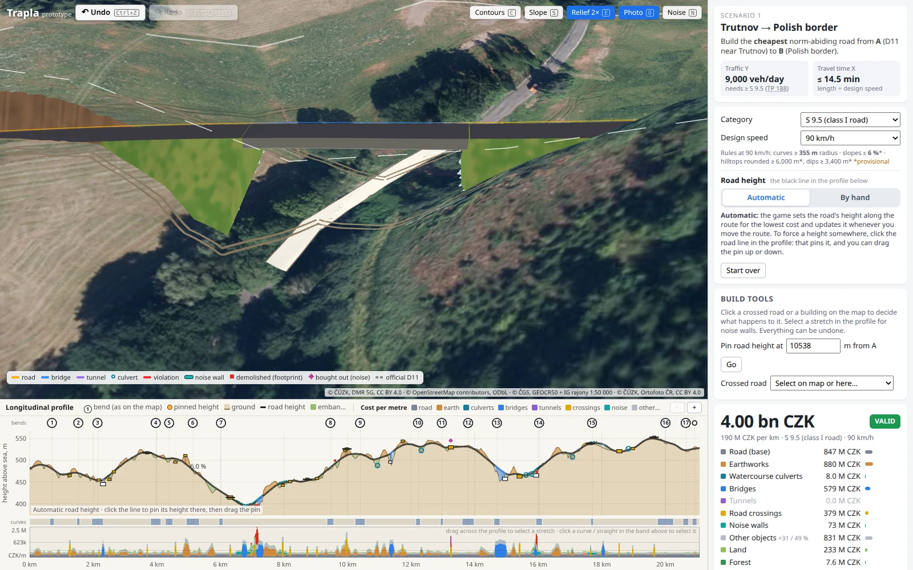

# Earthwork seams and diversion tracks

Matched evidence uses `scripts/best-design.json`, Chromium/SwiftShader, a 1600 × 1000 viewport, photo/map modes and 1×/2× relief. `scripts/seam-shots.mjs` records six oblique views (24 PNGs) plus the crossing geometry. Representative lossily compressed copies are checked in below; full captures are in `/tmp/trapla-seams-before` and `/tmp/trapla-seams-after` on the development machine.

## Causes and fixes

- **Parallel brown bands:** paid crossing diversions, not OSM raster tracks, backfaces or a skirt. The old path followed every daylight station, duplicating its zigzags, and drew the entire four-metre formation brown. Shortcuts and rounded bends checked against the full 3 m setback now change the **actual measured/billed path**, preserving both surveyed endpoints. Track links show two 0.6 m wheel strips, with textured ground between them. Other road classes retain their road surface. Smoothing can reduce the bill; this is not a display-only alternate alignment.
- **Chopped cut edge:** the old terrain discard polygon was inset up to 2.5 m into the slope, with the ribbon raised only to the 20 m mesh at station endpoints. Fine daylight vertices now share their natural-ground heights with 20 m-wide replacement collars. The discard boundary is outside the slope, safely within those collars; both cuts and fills use the same construction.
- **White shards:** sky through poorly covered discard boundaries, especially at crossing endpoint collars. The crossing mask's old proportional inset could be less than one mask texel and did not inset the endpoint collar's sides. The mask now has a fixed metric overlap on all these edges. Crossing ground strips are refined transversely too.
- **Sky at mask ends (2026-11-16):** the terrain mask's raster bleeds about a texel (≈ 3 m) past its polygon. Where nothing covers the ground beyond an end, sky shows. The mask now stops `MASK_END_INSET` short of the route's own ends, of an embankment at a structure, and of a crossed road's deck end on the ground (route-mask.ts). A tunnel portal's face gets ground drawn behind its top, over the tunnel, rising to the drawn terrain within 3 m and reaching 7.5 m in and past the side collars (view.ts `PORTAL_LID`). A crossed road's ground collar cell that reaches into our earthworks is dropped (crossings.ts `insideEarthworks`). Census on D11 straight, with the clear colour set to magenta, over 119 views of the crossings and portals: 20.4k → 4.4k sky pixels, no view worse. The remainder is spread over bridge abutments and crossing collars (not yet traced).
- **Broken retained road beneath the bridge:** overlapping ground collars blended toward the coarse terrain independently and buried one another's pavement. A spatially indexed, shared blend field keeps all collars at natural ground near either road; transverse pavement samples follow the same terrain. This does **not** disable depth testing or remove fill to reveal a road: existing roads under an embankment remain covered. Crossing-cost treatment of such conflicts remains separate.

Fine geometry is rebuilt only on evaluation, not on zoom/pan. Daylight and crossing ground are split into cullable chunks. A matched 40-frame close orbit (GPU-synchronized readback, software renderer) measured 482 ms median / 593 ms p95 before and 372 / 411 ms after. These timings are environment-dependent and are not hardware-GPU FPS. Smoothing probes bypass the reusable projection cache and halve failed shortcut candidates. They run only on evaluation, never per frame; evaluation timing on the concurrently loaded development machine is too variable for a precise overhead claim.

The ten saved bill fixtures were explicitly updated using their original fingerprinted pack. First, every original bill was reproduced on `main`; then the new bills were checked to change **only** crossings, surcharge and their construction/total sums. Grades, material values and every other cost item remain unchanged. Best-design crossings decrease by 8.836 M CZK and total cost by 11.711 M CZK; the largest total decrease among the fixtures is 24.161 M CZK (direct-80). The scenario-pack fingerprint itself is unchanged.

## Before / after

### Diversion bands, km 1.3, photo / 2×




### Cut daylight, km 1.5, photo / 1×




### Bridge approach, km 2.3, photo / 2×




## Reproduce

```sh
node scripts/seam-shots.mjs /tmp/trapla-seams-after
# Optional selection and a GPU-synchronized orbit probe:
SHOTS=bridge-detail PERF=1 node scripts/seam-shots.mjs /tmp/trapla-seams-after
# ROOT points at a baseline checkout for identical camera poses:
ROOT=/path/to/baseline node scripts/seam-shots.mjs /tmp/trapla-seams-before
npx tsc --noEmit
npx vitest run
npm run build
PORT=5198 node scripts/smoke.mjs
PORT=5198 node scripts/earthworks.mjs scripts/best-design.json /tmp/trapla-seams-earthworks
```

The seam capture closes Chromium and its Vite server in `finally`. Tests cover shared daylight heights for both cut and fill, ground-collar overlap, structure voids, overlapping road blend fields, and safe diversion simplification. Existing crossing audits continue to check measured lengths, bills and endpoint connectivity.
